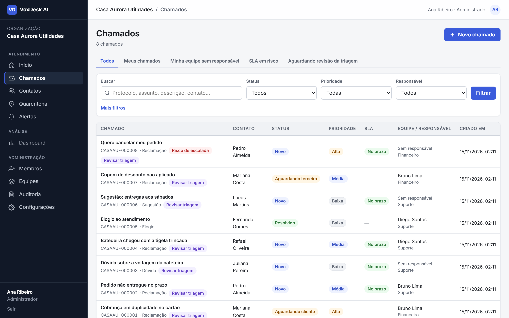
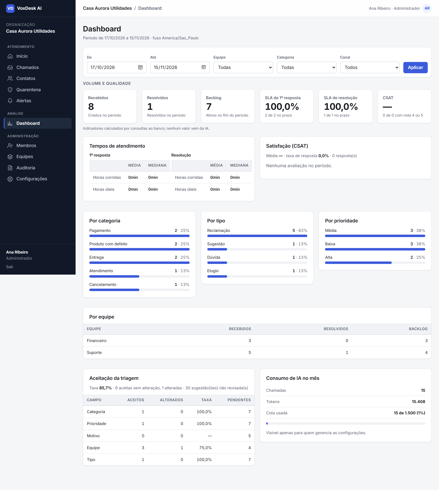
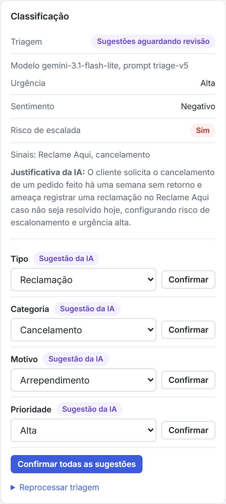
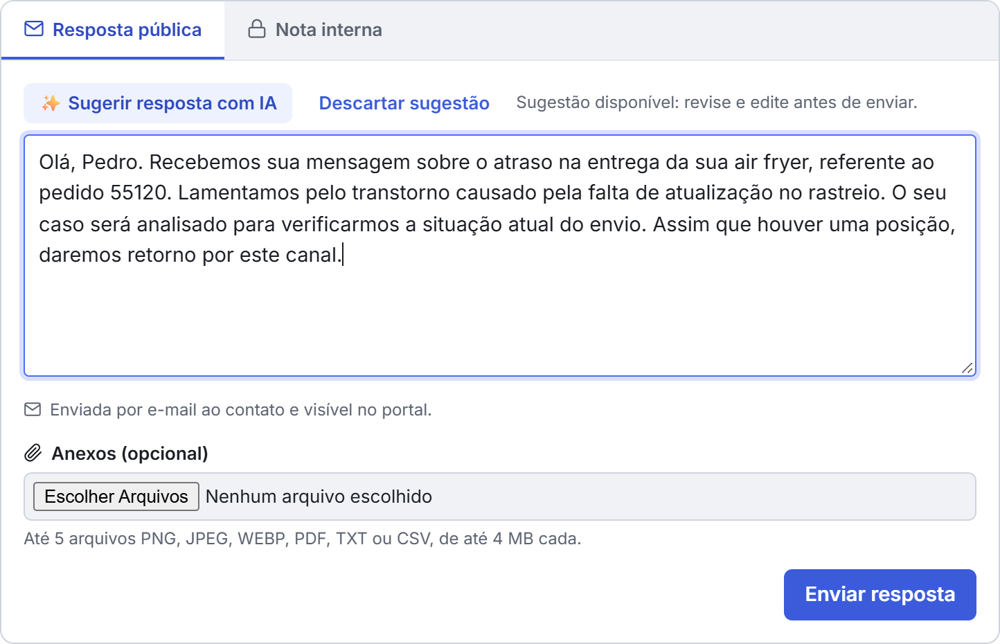
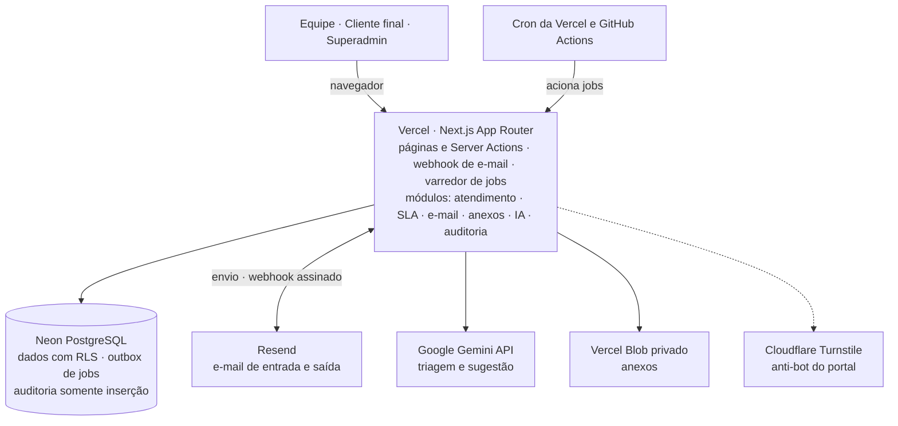
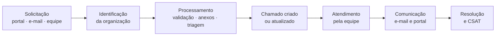

# VoxDesk AI — Plataforma Inteligente de Atendimento

*Uma solução Orizon*

SaaS B2B multi-tenant de atendimento ao cliente para pequenas e médias empresas, com triagem por inteligência artificial sempre revisada pela equipe.

🔗 **https://voxdesk.orizonprojects.com.br** · acesso por convite

---

## Sumário

1. [Apresentação](#1-apresentação)
2. [Principais funcionalidades](#2-principais-funcionalidades)
3. [Demonstração](#3-demonstração)
4. [Arquitetura da solução](#4-arquitetura-da-solução)
5. [Stack tecnológica](#5-stack-tecnológica)
6. [Fluxo de atendimento](#6-fluxo-de-atendimento)
7. [Inteligência artificial](#7-inteligência-artificial)
8. [Segurança e governança](#8-segurança-e-governança)
9. [Instalação e execução local](#9-instalação-e-execução-local)
10. [Testes e qualidade](#10-testes-e-qualidade)
11. [Roadmap](#11-roadmap)
12. [Documentação complementar](#12-documentação-complementar)
13. [Autoria e identidade](#13-autoria-e-identidade)

---

## 1. Apresentação

O **VoxDesk AI** reúne em uma só central os chamados que chegam pelo portal do cliente, por e-mail ou registrados pela equipe, com prazos de atendimento (SLA), histórico completo, avaliação de satisfação e indicadores.

**Problema de negócio.** PMEs costumam registrar atendimentos sem transformar o histórico em informação útil: a classificação manual varia entre atendentes, casos urgentes ou com risco de escalada externa (Procon, Reclame Aqui, ação judicial) são percebidos tarde e os relatórios por categoria perdem confiabilidade. O PRD trata esses pontos como hipóteses a validar com organizações piloto.

**Público-alvo.** Pequenas e médias empresas de tecnologia, serviços e comércio eletrônico. Operações centradas em dados de saúde ou financeiros altamente regulados não são público-alvo nesta etapa.

**Proposta de valor.** *Transformar cada interação com o cliente em uma oportunidade de resolução, aprendizado e melhoria contínua.*

**Diferenciais da v1.0**

| Diferencial | Como aparece no produto |
| --- | --- |
| Triagem estruturada | Cada chamado pode receber tipo, categoria, motivo, sentimento, urgência e risco padronizados |
| Prioridade explicável | Regras de negócio combinadas aos sinais da IA, com justificativa visível |
| Risco de escalada no contexto brasileiro | Sinais como Procon, Reclame Aqui, ação judicial e cancelamento |
| IA sob controle humano | A IA sugere e a equipe decide; nada é enviado ou alterado automaticamente |
| Consumo de IA transparente | Uso e custo medidos por organização, com cota mensal e teto global |

---

## 2. Principais funcionalidades

### Operacionais na v1.0

| Área | O que está implementado |
| --- | --- |
| **Chamados** | Criação manual, pelo portal ou por e-mail; status, prioridade, equipe e responsável; respostas públicas e notas internas; linha do tempo; reabertura em até 7 dias após a resolução e fechamento automático depois disso |
| **Organizações e usuários** | Multi-tenant; organizações criadas por convite da plataforma; membros por convite com perfis Atendente, Gestor e Administrador; equipes; opção de leitura executiva (somente dashboard) |
| **Contatos** | Cadastro de contatos e empresas-cliente, com histórico de chamados |
| **Portal do cliente** | Abertura de chamados com proteção anti-bot, acesso por link mágico enviado por e-mail, acompanhamento, resposta e avaliação |
| **E-mail de entrada** | Endereço por organização; criação de chamado a partir do e-mail; respostas do cliente associadas ao chamado por token; detecção de duplicidade e de mensagens automáticas; quarentena com decisão justificada e auditada |
| **E-mail de saída** | Confirmação de abertura, resposta pública, aviso de resolução com link de avaliação e link de acesso ao portal, por fila de envio com novas tentativas |
| **Anexos** | Imagens (PNG, JPEG, WebP), PDF, TXT e CSV, até 4 MB e 5 arquivos por mensagem; validação do tipo real e sanitização antes da liberação |
| **SLA** | Horário comercial e feriados por organização; metas de primeira resposta e resolução por prioridade; pausa em "aguardando"; situação no prazo, em risco (80%) ou violado |
| **CSAT** | Avaliação de 1 a 5 enviada ao cliente após a resolução, com resultado no dashboard |
| **Dashboard** | Recebidos, resolvidos, backlog, distribuição por categoria, tipo e prioridade, tempos de primeira resposta e resolução, cumprimento de SLA, CSAT, aceitação da triagem e consumo de IA, com filtros |
| **Alertas** | Alertas na aplicação para SLA em risco ou violado e para consumo de 80% e 100% da cota de IA |
| **Backoffice** | Área do Superadmin: convite de organizações, suspensão e reativação, consumo agregado, cota mensal por organização e teto global de IA |
| **Inteligência artificial** | Triagem com revisão humana e sugestão de resposta pública (detalhes na [seção 7](#7-inteligência-artificial)) |
| **Segurança da conta** | Verificação em duas etapas (TOTP), códigos de recuperação, encerramento de sessões em todos os dispositivos e recuperação de senha |

### Planejadas (ainda não implementadas)

Base de conhecimento e RAG, inteligência de CX (recorrência, tendências e planos de ação), importação de histórico por CSV, análise de qualidade, distribuição e escalonamento automáticos, novos canais (WhatsApp, chat), API pública, SSO, cadastro público de organizações e planos comerciais. Ver [Roadmap](#11-roadmap).

---

## 3. Demonstração

A plataforma está publicada em **https://voxdesk.orizonprojects.com.br**.

- O acesso é **controlado por convite**: não há cadastro público. Organizações são convidadas pela Orizon e cada organização convida os próprios membros.
- O portal do cliente de cada organização fica em `/p/{identificador-da-organização}`.
- O ambiente atual é de uso **não comercial** (plano Hobby da Vercel).

Telas da aplicação, capturadas com dados fictícios, estão no [Manual do Usuário](docs/manual-usuario/Manual-do-Usuario-VoxDesk-AI-v1.1.md).

| Lista de chamados | Dashboard |
| :---: | :---: |
|  |  |
| **Triagem com revisão humana** | **Sugestão de resposta** |
|  |  |

---

## 4. Arquitetura da solução

Monólito modular em **Next.js (App Router)** implantado na **Vercel**, com **PostgreSQL no Neon** e isolamento entre organizações garantido pelo banco (Row-Level Security). Decisões registradas nas [ADRs](docs/architecture/ADR/README.md).



| Camada | Implementação |
| --- | --- |
| **Frontend** | React 19 com Server Components e Server Actions; área interna (`/o/{slug}`), portal do cliente (`/p/{slug}`), backoffice (`/admin`) e landing page |
| **Backend** | Módulos em `src/server` (atendimento, organizações, SLA, e-mail, anexos, IA, auditoria, jobs, dashboard), chamados pelas Server Actions e por rotas de API restritas |
| **Banco de dados** | PostgreSQL (Neon) via Prisma 7; migrações versionadas em `prisma/migrations` |
| **Autenticação** | Better Auth (e-mail e senha, verificação em duas etapas); cliente final com sessão própria do portal, por link mágico |
| **Integrações** | Resend (e-mail de entrada e saída), Google Gemini (IA), Vercel Blob (anexos), Cloudflare Turnstile (anti-bot) |
| **Processamento assíncrono** | Outbox no PostgreSQL: o job é gravado na mesma transação do evento e executado logo após a resposta (`after()`) ou pelo varredor, acionado pelo cron diário da Vercel e por um workflow do GitHub Actions a cada 30 minutos; novas tentativas com backoff |
| **Isolamento multi-tenant** | Toda consulta de dados de organização passa por `withTenant`, que define o contexto da transação; políticas RLS com `FORCE` em todas as tabelas de tenant; a aplicação conecta com um papel sem `BYPASSRLS` |

---

## 5. Stack tecnológica

Versões fixadas em [`package.json`](package.json) (`save-exact`).

| Categoria | Tecnologia | Versão |
| --- | --- | --- |
| Runtime | Node.js | ≥ 22.12 |
| Framework | Next.js (App Router) | 16.4.3 |
| Interface | React / React DOM | 19.3.1 |
| Linguagem | TypeScript | 6.0.3 |
| ORM | Prisma (`@prisma/client`, `@prisma/adapter-neon`, `@prisma/adapter-pg`) | 7.10.1 |
| Banco | PostgreSQL no Neon (`@neondatabase/serverless` 1.2.0, `pg` 8.23.1) | — |
| Autenticação | Better Auth (`better-auth`, `@better-auth/prisma-adapter`) | 1.7.14 |
| IA | Google Gen AI SDK (`@google/genai`) | 3.0.0 |
| Anexos | Vercel Blob (`@vercel/blob`) · `sharp` (reconstrução de imagens) | 2.8.2 · 0.35.5 |
| Validação e saneamento | Zod · `sanitize-html` | 4.6.7 · 2.18.1 |
| Outros | `qrcode` (2FA) 1.5.4 · `uuidv7` 1.2.1 | — |
| Testes | Vitest 4.1.12 · jsdom 30.1.3 · axe-core 4.14.0 | — |
| Infraestrutura | Vercel (região `gru1`), Neon, Resend, GitHub Actions | — |

`.npmrc` usa `save-exact` e `legacy-peer-deps` (contorno de falha do npm 10 com as dependências opcionais do Better Auth).

---

## 6. Fluxo de atendimento



1. **Recebimento.** O cliente abre um chamado no portal, envia um e-mail para o endereço da organização ou a equipe registra o chamado manualmente.
2. **Identificação da organização.** No portal, pelo identificador no endereço. No e-mail, pelo destinatário (um endereço por organização); respostas do cliente são associadas ao chamado pelo token do endereço de resposta. Mensagens com token inválido ou vínculos contraditórios vão para a quarentena.
3. **Processamento.** O e-mail é recebido por webhook assinado e processado por job; mensagens automáticas e duplicadas são identificadas. Anexos passam por validação e sanitização. Com a IA ativa e autorizada, a triagem é enfileirada; sem ela, o chamado segue para a fila padrão.
4. **Criação ou atualização do chamado.** Um novo chamado recebe protocolo, contato vinculado e metas de SLA; uma resposta do cliente entra na conversa do chamado existente.
5. **Atendimento.** A equipe revisa a triagem, atribui equipe e responsável, troca status e prioridade, registra notas internas e responde. Alertas avisam sobre SLA em risco ou violado.
6. **Comunicação.** Respostas públicas são enviadas por e-mail e exibidas no portal; o cliente pode responder por qualquer um dos dois.
7. **Resolução e avaliação.** Ao resolver, o cliente recebe o aviso com link de avaliação (CSAT de 1 a 5). O chamado pode ser reaberto em até 7 dias; depois, é fechado automaticamente.

---

## 7. Inteligência artificial

A IA do VoxDesk AI é **uma chamada estruturada dentro de um fluxo determinístico**: não há agentes, ferramentas, RAG nem ações automáticas. A IA sugere; a pessoa decide.

### Recursos implementados

| Recurso | Funcionamento |
| --- | --- |
| **Triagem** | Sugere tipo, categoria, motivo, equipe, urgência, sentimento, risco de escalada e sinais de risco, com justificativa e confiança por campo. A saída é validada por JSON Schema e Zod; a prioridade final combina regras de negócio com esses sinais |
| **Revisão humana** | Fila de revisão da triagem: a equipe aceita ou corrige cada campo; a taxa de aceitação aparece no dashboard. Gestores podem pedir o reprocessamento |
| **Sugestão de resposta** | O atendente pede um rascunho de resposta pública, que volta para o editor. O envio continua sendo uma ação humana; nada é gravado como mensagem pela IA |

### Provedores

| Modo | Uso |
| --- | --- |
| `simulated` (padrão) | Classificação por palavras-chave e resposta fixa, sem rede e sem custo. Usado em desenvolvimento e nos testes automatizados |
| `gemini` | Integração real com a Gemini Developer API pelo SDK oficial, apenas no servidor. Exige chave e modelo definidos explicitamente; só aceita modelos com preço cadastrado, para que custo e cotas sejam calculados |

### Situação em produção

- A IA fica **desativada** nas organizações em produção.
- Até a **avaliação de privacidade DP-01** (revisão jurídica dos termos de dados do Gemini), a IA só processa organizações explicitamente autorizadas para testes com **dados sintéticos**. A autorização é técnica, por configuração do servidor, e falha fechada: sem ela, nenhuma organização pode ativar a IA, mesmo pelo botão em Configurações.

### Controles de privacidade, custo e governança

- **Minimização e mascaramento:** só o texto necessário é enviado, com dados pessoais mascarados; anexos e notas internas não são enviados.
- **Defesa contra prompt injection:** o conteúdo do cliente é delimitado como dado não confiável; a saída é restrita a valores da taxonomia da organização.
- **Isolamento:** uma organização por chamada, sem compartilhamento de contexto entre organizações.
- **Custo:** cota mensal por organização com reserva atômica, teto global definido pelo Superadmin e consumo registrado por operação.
- **Modo degradado:** em timeout, erro do provedor, cota esgotada ou teto atingido, o chamado é criado e atendido normalmente, sem triagem.
- **Rastreabilidade:** execuções e consumo são registrados; a auditoria guarda os eventos de IA sem o conteúdo.

### Limitações

- Antes de uso real, o modelo precisa ser validado no conjunto de referência (golden set) com as metas de acurácia do PRD.
- Sem acesso a base de conhecimento: a sugestão de resposta usa apenas o histórico público do chamado.
- Recursos como Copilot com RAG, inteligência de CX e análise de qualidade estão no roadmap, não no produto.

Detalhes: [Arquitetura de IA](docs/architecture/AI_ARCHITECTURE.md) · [ADR-005](docs/architecture/ADR/ADR-005-gemini.md).

---

## 8. Segurança e governança

| Tema | Mecanismos |
| --- | --- |
| **Autenticação** | E-mail e senha (mínimo de 12 caracteres) pelo Better Auth; cadastro apenas por convite; recuperação de senha por e-mail sem revelar se a conta existe |
| **Verificação em duas etapas** | TOTP com aplicativo autenticador, ativada em etapas com confirmação do código; obrigatória para o Superadmin; bloqueio temporário após tentativas inválidas |
| **Códigos de recuperação** | Exibidos uma única vez; cada código vale para um único acesso |
| **Controle de acesso** | Perfis e permissões por organização verificados no servidor; Superadmin sem acesso ao conteúdo dos chamados; leitura executiva restrita ao dashboard |
| **Isolamento multi-tenant** | Contexto de organização por transação (`withTenant`); papel de banco sem `BYPASSRLS` |
| **Row-Level Security** | Políticas com `FORCE` em todas as tabelas de tenant; suíte de testes de isolamento bloqueante na CI |
| **Auditoria** | `audit_logs` somente inserção (privilégios e trigger); eventos de login, 2FA, convites, configurações, quarentena e IA, sem conteúdo sensível |
| **Proteção de dados** | Somente dados sintéticos fora da produção; segredos apenas em variáveis de ambiente; IA limitada a dados sintéticos até a DP-01 |
| **Anexos** | Validação do tipo real pelo conteúdo, lista de tipos permitidos e bloqueados, limites de tamanho e quantidade, sanitização (reconstrução de imagens, normalização de texto, neutralização de fórmulas em CSV, recusa de PDF com conteúdo ativo), armazenamento privado e quarentena |
| **APIs** | Rotas internas exigem segredo e respondem 404 sem ele; webhook de e-mail com assinatura verificada; apenas rotas mínimas do Better Auth expostas; limite de taxa e anti-bot no portal; cabeçalhos de segurança HTTP |
| **Ciclo de desenvolvimento** | Verificação estática de regras de segurança (`scripts/check-security.mjs`) e `npm audit` na CI |

Modelo de ameaças, controles e decisões pendentes: [Arquitetura de Segurança](docs/architecture/SECURITY.md).

---

## 9. Instalação e execução local

> ⚠️ **Ambientes locais e de teste nunca devem usar o banco de produção.** Use um projeto Neon não produtivo, com bancos separados para desenvolvimento e testes, e apenas dados sintéticos.

### Pré-requisitos

- Node.js 22.12 ou superior
- Projeto PostgreSQL não produtivo (Neon ou PostgreSQL local), com um banco de desenvolvimento e um de testes cujo nome termine em `_test`

### Passos

1. Instale as dependências:
   ```bash
   npm ci
   ```
2. Copie `.env.example` para `.env` e preencha (o arquivo fica fora do Git).
3. Prepare o banco:
   ```bash
   npx prisma generate
   npm run db:migrate                     # conexão do dono do schema (DATABASE_URL_MIGRATOR)
   npm run db:bootstrap                   # LOGIN e senha do papel app_runtime
   DATABASE_URL_MIGRATOR=<url de teste> npx prisma migrate deploy && npm run db:bootstrap -- --test
   npm run db:seed                        # dados sintéticos; exibe as senhas uma única vez
   ```
4. Inicie a aplicação e acesse http://localhost:3000:
   ```bash
   npm run dev
   ```
5. Para processar jobs localmente (triagem, e-mails, SLA, fechamento automático):
   ```bash
   npm run jobs:work
   ```

Nunca use `prisma init` neste repositório: ele instala artefatos de agentes ([POC_RESULTS](docs/architecture/poc/POC_RESULTS.md), seção 6).

### Variáveis de ambiente

Os nomes abaixo são os lidos pela aplicação. Nunca versione valores.

| Grupo | Variáveis | Padrão local |
| --- | --- | --- |
| Banco | `DATABASE_URL_MIGRATOR`, `DATABASE_URL`, `DATABASE_DRIVER` (`neon` ou `pg`), `APP_RUNTIME_PASSWORD`, `TEST_DATABASE_URL_MIGRATOR`, `TEST_DATABASE_URL` | — |
| Autenticação | `BETTER_AUTH_SECRET`, `BETTER_AUTH_URL` | — |
| E-mail | `EMAIL_PROVIDER` (`console` ou `resend`), `EMAIL_FROM`, `RESEND_API_KEY`, `RESEND_INBOUND_API_KEY`, `RESEND_WEBHOOK_SECRET`, `INBOUND_EMAIL_DOMAIN` | `console`: a mensagem vai para o log |
| IA | `AI_PROVIDER` (`simulated` ou `gemini`), `GEMINI_API_KEY`, `AI_TRIAGE_MODEL`, `AI_TIMEOUT_MS`, `AI_SYNTHETIC_ORGS`, `AI_QUOTA_DEFAULT_OPS`, `AI_GLOBAL_BUDGET_USD` | `simulated` |
| Anexos | `STORAGE_PROVIDER` (`local` ou `vercel-blob`), `BLOB_READ_WRITE_TOKEN` | `local` (pasta `.storage/`) |
| Portal | `TURNSTILE_SITE_KEY`, `TURNSTILE_SECRET_KEY` | chaves de teste da Cloudflare |
| Jobs | `CRON_SECRET` (mínimo de 32 caracteres) | — |

As variáveis de e-mail do Resend e `EMAIL_FROM` ainda não constam do `.env.example`; a configuração usada no ambiente publicado está descrita em [DEPLOY-TESTE](docs/increments/DEPLOY-TESTE.md).

### Comandos

| Comando | O que faz |
| --- | --- |
| `npm run dev` | Servidor de desenvolvimento |
| `npm run lint` | Typecheck e verificação estática de segurança |
| `npm run test:unit` | Testes unitários |
| `npm run test:integration` | Integração e suíte de isolamento contra o banco de testes |
| `npm run build` | Build de produção (não exige banco nem segredos) |
| `npm run jobs:work` | Worker local da outbox |
| `npm run perf:dashboard` | p95 do dashboard com 50 mil chamados sintéticos; só em banco não produtivo (remove os dados ao final) |
| `npm run a11y:portal -- <slug>` | Verificação de acessibilidade do portal com axe-core |

---

## 10. Testes e qualidade

A CI ([`ci.yml`](.github/workflows/ci.yml)) executa, em sequência: typecheck e verificação de segurança, testes unitários, migrações em banco de teste, testes de integração e isolamento (bloqueantes), `npm audit` e build.

| Verificação | Evidência |
| --- | --- |
| Testes unitários | 122 aprovados (execução local de 15/11/2026) |
| Testes de integração | 187 aprovados, incluindo a suíte de isolamento entre organizações (execução local de 15/11/2026) |
| Isolamento entre organizações | `tests/integration/isolation.test.ts`, bloqueante na CI |
| Verificação estática de segurança | `scripts/check-security.mjs`: acesso a dados só por `withTenant`, Prisma centralizado, SQL bruto inseguro proibido, artefatos de agentes |
| Lint e build | Executados na CI a cada push e pull request |
| Acessibilidade | `npm run a11y:portal` (axe-core) para o portal do cliente |
| Desempenho do dashboard | p95 de 680 ms com 50 mil chamados e RLS ativo, contra a meta de 3 s ([I-5](docs/increments/I-5.md)) |
| Sobrecarga do RLS | p95 de 13 a 15 ms por transação com contexto, contra a meta de 15 ms, medida na Vercel ([DEPLOY-TESTE](docs/increments/DEPLOY-TESTE.md)) |

---

## 11. Roadmap

Sem datas: cada versão depende da homologação da anterior e de um PRD incremental aprovado. Itens planejados não são compromissos comerciais.

| Versão | Situação | Conteúdo |
| --- | --- | --- |
| **v1.0 · Atendimento Inteligente** | ✅ Entregue (MVP) | Organizações, central de atendimento, portal, e-mail de entrada e saída, triagem com revisão humana, SLA, CSAT, dashboard, auditoria e consumo de IA por organização. Evolução já entregue: sugestão de resposta pública e verificação em duas etapas com códigos de recuperação |
| v1.1 · Assistente de atendimento | Planejado | Base de conhecimento, RAG com citação de fontes, respostas prontas; possível importação de CSV |
| v1.2 · Inteligência de CX | Planejado | Recorrência, tendências e temas emergentes com evidência, dashboard executivo, planos de ação básicos |
| v1.3 · Qualidade e automações | Planejado | Apoio à avaliação de qualidade, distribuição e escalonamento automáticos |
| v2.0 · Novos canais e integrações | Planejado | WhatsApp, chat, API pública e webhooks, CRM, SSO e cadastro público de organizações |

Também dependem de decisão: planos comerciais e cobrança, plano da Vercel para uso comercial e liberação da IA para dados reais (DP-01).

---

## 12. Documentação complementar

| Documento | Conteúdo |
| --- | --- |
| [PRD](docs/PRD-Customer-Voice-AI.md) | Requisitos, regras de negócio, critérios de aceite e roadmap |
| [Arquitetura da solução](docs/architecture/ARCHITECTURE.md) | Visão geral, módulos, fluxos e infraestrutura |
| [ADRs](docs/architecture/ADR/README.md) | Decisões de arquitetura (ADR-001 a ADR-013) |
| [Modelo de dados](docs/architecture/DATA_MODEL.md) | Entidades e relacionamentos |
| [Arquitetura de IA](docs/architecture/AI_ARCHITECTURE.md) | Integração com o Gemini, triagem, custos e controles |
| [Segurança](docs/architecture/SECURITY.md) | Modelo de ameaças, controles, retenção e resposta a incidentes |
| [Custos de infraestrutura](docs/architecture/INFRASTRUCTURE_COSTS.md) | Planos e estimativas |
| [Revisão](docs/architecture/ARCHITECTURE_REVIEW.md) e [avaliação da arquitetura](docs/architecture/ARCHITECTURE_EVALUATION_3A.md) | Análises de arquitetura |
| [Resultados das PoCs](docs/architecture/poc/POC_RESULTS.md) | Provas de conceito de banco, IA e e-mail |
| [Incrementos I-0 a I-5](docs/increments/) | Escopo entregue, testes e decisões de cada incremento ([I-0](docs/increments/I-0.md) · [I-1](docs/increments/I-1.md) · [I-2](docs/increments/I-2.md) · [I-3](docs/increments/I-3.md) · [I-4](docs/increments/I-4.md) · [I-5](docs/increments/I-5.md)) |
| [Deploy de teste](docs/increments/DEPLOY-TESTE.md) | Configuração e verificações do ambiente publicado |
| [Manual do Usuário v1.1](docs/manual-usuario/Manual-do-Usuario-VoxDesk-AI-v1.1.md) ([PDF](docs/manual-usuario/Manual-do-Usuario-VoxDesk-AI-v1.1.pdf)) | Guia passo a passo para as equipes |

---

## 13. Autoria e identidade

**VoxDesk AI**

*Uma solução Orizon*

Projeto privado. Todos os direitos reservados.
