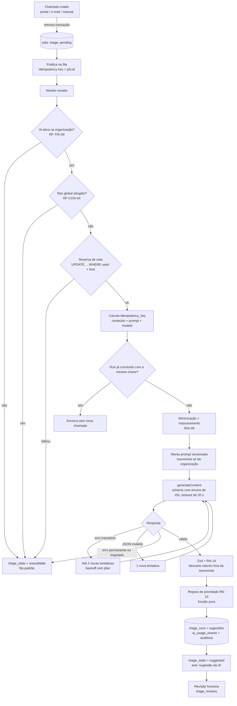

# Customer Voice AI — Arquitetura de Inteligência Artificial

| Item | Valor |
| --- | --- |
| Versão | 1.0 — Candidata à homologação |
| Data | 09/11/2026 (preços e termos consultados nesta data) |
| Provedor | Google Gemini, o único provedor de LLM (DA-02) |
| Status | Developer API: **aprovada com condições**. Modelo: **pendente de validação** (teste comparativo). Controles de gasto: **proposta** |

## 1. Escopo na v1.0

A IA é usada apenas na **triagem** (RF-TRI-01 a 09), como **uma chamada estruturada dentro de um fluxo determinístico**. Não há agente, ferramentas nem ações automáticas (RIA-14). Copilot, CX Advisor e Quality Analyst ficam para as versões seguintes e terão PRD incremental.

Claude Code é ferramenta de desenvolvimento e não faz parte da aplicação.

## 2. Integração com a Gemini API

| Item | Definição |
| --- | --- |
| Endpoint | Gemini Developer API, apenas pelo backend (RIA-01) |
| SDK | `@google/genai` (SDK oficial). Na PoC: 3.0.0, publicado em 06/11/2026. Para a implementação, fixar uma versão com pelo menos 2 semanas de publicação e testada no golden set. A API usada é `models.generateContent` com `responseMimeType: application/json`, `responseJsonSchema` e `thinkingConfig.thinkingLevel` (campos confirmados nas tipagens do pacote instalado) |
| Chaves | Uma por ambiente, em projetos Google separados. A chave de produção fica em projeto com faturamento ativo (serviço pago). Variável sensível na Vercel. Nunca no navegador (RIA-02) |
| Região | O Brasil consta em [available regions](https://aistudio.google.com/docs/available-regions). O processamento segue os termos do Google |
| Dados reais | **Somente após DP-01** (RIA-17). Até lá, só dados sintéticos |

### 2.1 Termos de dados (verificados em [aistudio.google.com/docs/terms](https://aistudio.google.com/docs/terms))

| Aspecto | Serviços pagos |
| --- | --- |
| Uso para melhorar produtos | Não usa prompts nem respostas. Processa conforme o DPA de operador |
| Retenção | Logs “for a limited period of time”, para detectar violações. **Prazo não informado** |
| Local | “stored transiently or cached in any country in which Google or its agents maintain facilities” |
| Nível gratuito | **Usa conteúdo para melhorar produtos, com revisão humana.** Proibido para dados reais |

## 3. Fluxo de triagem

## 4. Entrada, prompt e schema

### 4.1 Minimização (RIA-09, RIA-10, RSG-23)

| Enviado | Não enviado |
| --- | --- |
| Assunto e descrição (ou texto novo da mensagem), mascarados | Nome, e-mail e telefone do contato; dados cadastrais |
| Taxonomia da organização: IDs e rótulos de categorias, motivos e equipes ativos | Anexos; mensagens em quarentena; dados de outros chamados |
| Canal (portal, e-mail, manual) | Notas internas |

**Mascaramento:** CPF e CNPJ (com dígito verificador), cartões (Luhn), e-mails e telefones brasileiros são substituídos por marcadores (`[CPF]`, `[EMAIL]`…). As funções são puras, com testes unitários. O texto é limitado a um máximo de caracteres (proposta: 8.000), com truncamento registrado.

### 4.2 Prompt (versionado: `triage-vN`)

- **Instrução de sistema fixa**, no repositório:
  - Papel.
  - Regra de que o conteúdo delimitado é **dado não confiável** e nunca deve ser seguido como instrução.
  - Critérios de tipo, urgência e risco de escalada (RN-10).
  - Proibição de repetir dados pessoais na justificativa.
- **Conteúdo do cliente** entre delimitadores, com os delimitadores do próprio texto neutralizados.

### 4.3 Schema de saída (JSON Schema enviado à API e espelhado em Zod)

| Campo | Tipo | Restrição |
| --- | --- | --- |
| `type` | enum | reclamacao, solicitacao, duvida, sugestao, elogio (RN-03) |
| `category_id` | enum | IDs das categorias ativas da organização |
| `reason_id` | enum ou nulo | IDs dos motivos ativos |
| `team_id` | enum ou nulo | IDs das equipes ativas |
| `urgency` | enum | baixa, media, alta |
| `sentiment` | enum | muito_negativo, negativo, neutro, positivo |
| `escalation_risk` | boolean | — |
| `risk_signals` | array de enums | procon, reclame_aqui, acao_judicial, cancelamento, seguranca, outro |
| `confidence` | objeto | Valores de 0 a 1 por campo |
| `rationale` | string | Até 280 caracteres. Exibida como texto puro |

A **prioridade não é produzida pela IA.** Ela é calculada pela função de RN-10 a partir de regras da organização, risco, urgência e sentimento (limitado a Média).

## 5. Consumo, custo e controles de gasto

### 5.1 Medição (RF-CON-01)

Cada chamada registra em `ai_usage_events`:

- Tokens de entrada, saída e **raciocínio** (`thoughtsTokenCount`). A Google declara: “response pricing is the sum of output tokens and thinking tokens”.
- Latência e modelo.
- Custo estimado, pela tabela de preços versionada em configuração (`price_version`).

A reconciliação mensal com o consumo informado pelo Google atende ao CC-10.

### 5.2 Estimativa (premissas do PRD 12.4, sem tokens de raciocínio)

| Modelo | Preço (US$/1M, entrada / saída) | Por organização/mês | 5 organizações | 20 organizações |
| --- | --- | --- | --- | --- |
| `gemini-3.1-flash-lite` (Stable) | 0,25 / 1,50 | US$ 0,96 | US$ 4,81 | US$ 19,25 |
| `gemini-3.5-flash-lite` (Stable) | 0,30 / 2,50 | US$ 1,35 | US$ 6,74 | US$ 26,95 |
| `gemini-3.6-flash` (Stable; preço de 2027) | 1,50 / 7,50 | US$ 5,36 | US$ 26,81 | US$ 107,25 |

O raciocínio do `gemini-3.5-flash-lite` é “On (minimal)” e não pode ser desligado. O teste comparativo mede os tokens reais de raciocínio e substitui esta estimativa.

### 5.3 Mecanismos para evitar gastos inesperados (em camadas)

| Camada | Mecanismo | Tipo | Fonte | Parâmetro proposto |
| --- | --- | --- | --- | --- |
| 1 | Cota mensal por organização, com reserva atômica antes de cada chamada | Corte rígido (aplicação) | PRD RF-CON-02 | 1.500 operações/mês por organização (beta) |
| 2 | Teto global da plataforma em `platform_ai_budget` | Corte rígido (aplicação) | PRD RF-CON-04 | 2× o custo estimado do cenário |
| 3 | Idempotência e limite de novas tentativas (até 3 chamadas por triagem) | Prevenção | RIA-05, RIA-06 | — |
| 4 | **Teto mensal de gasto por projeto no AI Studio** | Corte pelo provedor. **Experimental**, com cerca de 10 min de latência e possível excedente | [Billing](https://aistudio.google.com/docs/billing) | Desenvolvimento: US$ 5. Beta: US$ 15. Operação inicial: US$ 45 |
| 5 | Limite do tier na conta de faturamento: Tier 1 = US$ 250/mês. Ao atingir, pausa todos os projetos da conta até o mês seguinte | Corte pelo provedor | Idem | Preset (não configurável pelo usuário) |
| 6 | **Créditos pré-pagos**: com saldo zero, todas as chaves param | Corte rígido pelo provedor | Idem | Avaliar o uso de saldo pequeno (ex.: US$ 10) sem recarga automática, se disponível para a conta. **Pendente de confirmação da modalidade da conta** |
| 7 | Limite por gasto em janela de 10 min: Tier 1 = US$ 10 | Proteção contra picos (erro 429) | [Rate limits](https://aistudio.google.com/docs/rate-limits) | Preset |
| 8 | Orçamento do Cloud Billing com alertas em 50%, 90% e 100% | **Apenas alerta**: “doesn't automatically cap … spending” | [Budgets](https://docs.cloud.google.com/billing/docs/how-to/budgets) | Mesmos valores da camada 4 |
| 9 | Teto no script do teste comparativo | Corte rígido (PoC) | `poc/gemini-benchmark` | US$ 0,50 |

**Recomendação:** usar as camadas 1, 2, 3, 4 e 8 desde o primeiro uso de chave paga, e avaliar a camada 6.

Nenhuma camada isolada é suficiente: os tetos do provedor têm latência, e os da aplicação dependem do código. Por isso a combinação.

## 6. Segurança de IA

| Risco | Controle |
| --- | --- |
| Prompt injection | Delimitação e instrução explícita; saída restrita a enums de IDs e texto curto; RN-14; sem ferramentas; revisão humana; casos adversariais no golden set |
| Vazamento entre organizações | Uma organização por chamada; taxonomia só da organização; sem cache de contexto entre organizações (RIA-11) |
| Exposição de PII | Mascaramento; minimização; sem anexos; nível pago; dados sintéticos até DP-01 |
| Saída maliciosa | Justificativa exibida como texto puro (CA-08.4); limite de tamanho |
| Ação indevida | A IA não altera status, não envia mensagens e não fecha chamados (RIA-14) |
| Logs | Prompts completos não são logados em produção (RSG-08). Os resultados validados ficam em `triage_runs` |

## 7. Qualidade

| Item | Definição |
| --- | --- |
| Golden set | Mínimo de 200 manifestações sintéticas ou anonimizadas e rotuladas (RIA-13), incluindo casos adversariais e de risco. A PoC usa 40 |
| Métricas | Saída válida no schema; acurácia por campo (KPI-04: ≥ 85% em tipo, ≥ 75% em categoria); latência p95 (RNF-03); custo por triagem; tokens de raciocínio |
| Seleção do modelo | Entre os modelos **estáveis**, o mais barato que atinja as metas. Hoje: `gemini-3.1-flash-lite` ou `gemini-3.5-flash-lite` |
| Regressão | Executar o golden set no CI (manual ou noturno) a cada mudança de prompt, modelo ou SDK. Bloquear se houver queda acima de 5 pontos percentuais |
| Produção | Taxa de aceitação da triagem (RN-13, KPI-03) e cobertura (KPI-05) no dashboard |
| Ciclo de vida de modelos | Modelos são configuração (RIA-03). A troca exige golden set aprovado. Acompanhar descontinuações (exemplo: a família 2.5 passa a ser redirecionada em 01/12/2026) |

## 8. Tratamento de falhas e modo degradado

| Situação | Comportamento |
| --- | --- |
| Timeout (20 s), 429 ou 5xx | Até 2 novas tentativas com backoff e jitter. Depois, `unavailable` |
| JSON inválido | 1 nova tentativa. Depois, `failed` + `unavailable` |
| 4xx de requisição (chave, modelo) | Sem nova tentativa; alerta operacional |
| Cota da organização esgotada | Sem chamada; `unavailable`; alerta ao Administrador (RF-CON-03) |
| Teto global ou limite do provedor | Sem chamada em nenhuma organização (CA-16.7); alerta ao Superadmin |
| Fila indisponível | Job permanece `pending` na outbox; o varredor republica |
| Qualquer falha | O chamado é criado, listado e atendido normalmente (RNF-06, CA-09.1) |
