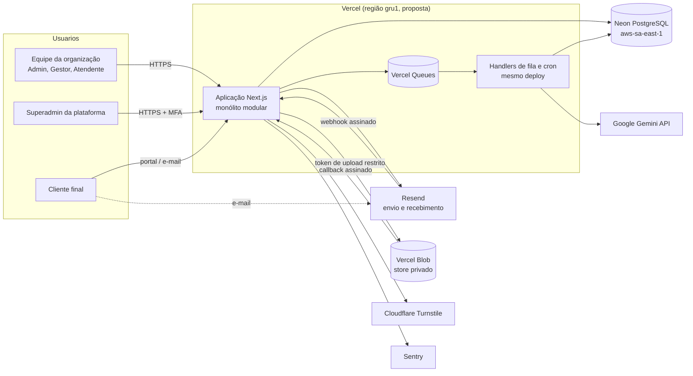
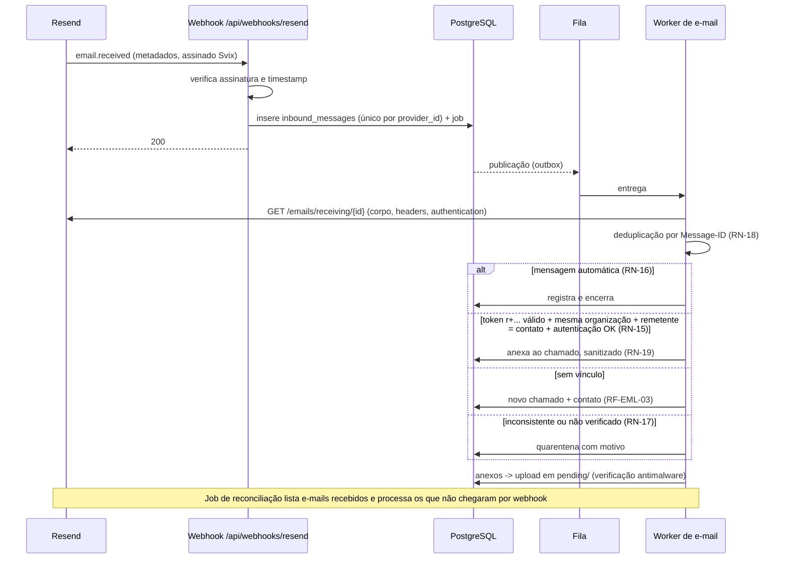
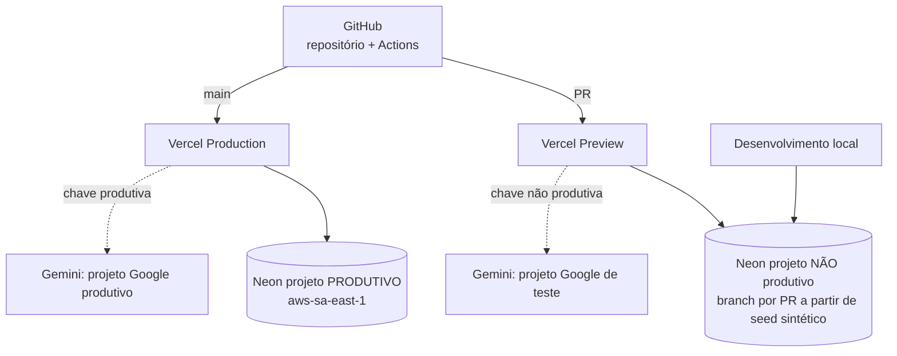

# Customer Voice AI — Arquitetura da Solução

| Item | Valor |
| --- | --- |
| Versão | 1.0 — Candidata à homologação |
| Base | PRD 0.2 (homologado), avaliação 3A e aprovação condicionada do responsável |
| Data | 09/11/2026 |
| Documentos relacionados | [DATA_MODEL.md](DATA_MODEL.md), [SECURITY.md](SECURITY.md), [AI_ARCHITECTURE.md](AI_ARCHITECTURE.md), [INFRASTRUCTURE_COSTS.md](INFRASTRUCTURE_COSTS.md), [ADR/](ADR/), [ARCHITECTURE_REVIEW.md](ARCHITECTURE_REVIEW.md), [poc/POC_RESULTS.md](poc/POC_RESULTS.md) |

Este documento descreve a arquitetura proposta para a v1.0. **Não autoriza implementação.** Cada decisão tem um status, e nenhuma aprovação condicional é tratada como definitiva.

## 1. Situação das decisões

| ADR | Decisão | Status |
| --- | --- | --- |
| [ADR-001](ADR/ADR-001-monolito-modular.md) | Monólito modular em Next.js na Vercel | **Aprovada** |
| [ADR-002](ADR/ADR-002-isolamento-multi-tenant.md) | `organization_id` + RLS + FKs compostas | **Aprovada com condições** (PoC no Neon aprovada com ressalvas; N7 pendente) |
| [ADR-003](ADR/ADR-003-orm-prisma.md) | Prisma 7.x fixado + `@prisma/adapter-neon` | **Pendente de validação** |
| [ADR-004](ADR/ADR-004-identidade.md) | Separação dos domínios de identidade | **Aprovada** |
| [ADR-004](ADR/ADR-004-identidade.md) | Better Auth para equipe e Superadmin | **Pendente de validação** |
| [ADR-005](ADR/ADR-005-gemini.md) | Gemini Developer API (paga); dados sintéticos até DP-01 | **Aprovada com condições** |
| [ADR-005](ADR/ADR-005-gemini.md) | Modelo de triagem (Flash-Lite estável) | **Pendente de validação** (teste comparativo) |
| [ADR-006](ADR/ADR-006-processamento-assincrono.md) | Outbox PostgreSQL + Vercel Queues | **Aprovada com condições** (provisória) |
| [ADR-007](ADR/ADR-007-email.md) | Resend para entrada e saída | **Aprovada com condições** (provisória) |
| [ADR-008](ADR/ADR-008-anexos-antimalware.md) | Anexos: Vercel Blob privado + CDR + quarentena, com custo adicional zero (S3 + GuardDuty **não aprovado**) | **Aprovada com condições** (revisão 2; não homologada para anexos reais; DP-12 pendente) |
| [ADR-009](ADR/ADR-009-rate-limiting.md) | Rate limiting e anti-bot | **Proposta** |
| [ADR-010](ADR/ADR-010-observabilidade.md) | Observabilidade | **Proposta** |
| [ADR-011](ADR/ADR-011-ambientes-deploy.md) | Ambientes, dados por ambiente e deploy | **Proposta** |
| [ADR-012](ADR/ADR-012-sla.md) | SLA: prazos persistidos + cron por minuto | **Proposta** |
| [ADR-013](ADR/ADR-013-planos-infraestrutura.md) | Planos pagos com gatilhos de contratação | **Proposta** (nenhuma contratação aprovada) |

## 2. Visão geral

O Customer Voice AI é um **monólito modular**: uma aplicação Next.js (App Router, runtime Node.js) com módulos de domínio de fronteiras explícitas, um banco PostgreSQL compartilhado entre organizações com isolamento em duas camadas, e integrações externas acessadas apenas pelo backend.



## 3. Componentes e módulos

### 3.1 Estrutura em camadas (proposta)

| Camada | Responsabilidade | Regra |
| --- | --- | --- |
| Interface | Páginas, Server Actions, rotas HTTP, webhooks | Valida entrada com Zod, resolve a sessão e chama casos de uso |
| Aplicação | Casos de uso, orquestração, transações | Única camada que coordena módulos |
| Domínio | Regras puras: status, prioridade, SLA, taxonomia, mascaramento | Sem I/O. 100% testável por unidade |
| Infraestrutura | Repositórios (`withTenant`), clientes Gemini, Resend e Blob, fila | Nenhum módulo acessa o banco fora daqui |

### 3.2 Módulos de domínio

| Módulo | Responsabilidade | Requisitos do PRD |
| --- | --- | --- |
| `organizations` | Organizações, convites de organização, configurações, checklist, suspensão | RF-ORG-01, 02, 07, 09, 11 |
| `identity` | Usuários, sessões, MFA, vínculos, perfis, Superadmin | RF-ORG-03 a 06, 08, 10 |
| `contacts` | Contatos, empresas-cliente, retenção legal, exportação, anonimização | RF-CLI-01 a 06 |
| `tickets` | Chamados, mensagens, notas, status, atribuição, busca, visões | RF-ATD-01 a 13 |
| `portal` | Formulário público, link mágico, sessão do cliente, CSAT | RF-POR-01 a 06 |
| `email` | Envio, recebimento, associação, quarentena, eventos de entrega | RF-EML-01 a 08 |
| `triage` | Pipeline Gemini, regras de prioridade, revisão humana | RF-TRI-01 a 09 |
| `sla` | Calendários, metas, prazos, alertas, violações | RF-SLA-01 a 05 |
| `dashboard` | Indicadores determinísticos | RF-DSH-01 a 04 |
| `usage` | Consumo de IA, cotas, teto global | RF-CON-01 a 04, RF-DSH-05 |
| `attachments` | Validação, upload direto com token restrito, sanitização (CDR), quarentena, download autorizado; interface `MalwareScanner` para scanner futuro | RF-ATD-09, RSG-12, 17 a 19 |
| `audit` | Trilha de auditoria imutável | RF-AUD-01 a 03 |
| `jobs` | Outbox, publicação, varredor, execução idempotente | DP-04 |
| `platform` | Página pública, saúde do sistema, métricas operacionais | RF-PUB-01 |

### 3.3 Rotas e domínios de acesso

| Prefixo | Público | Autenticação |
| --- | --- | --- |
| `/` | Página pública (RF-PUB-01) | Nenhuma |
| `/app/*` | Equipe da organização | Sessão Better Auth + vínculo com a organização ativa |
| `/admin/*` | Superadmin | Sessão Better Auth + papel de plataforma + MFA |
| `/portal/{slug}/*` | Cliente final | Sessão própria do portal (link mágico ou token de acompanhamento) |
| `/api/webhooks/*` | Resend, callbacks do Vercel Blob | Assinatura do provedor |
| `/api/internal/*` | Fila e cron | Assinatura da Vercel Queues / segredo de cron |

## 4. Fluxos principais

### 4.1 Criação de chamado e triagem

Ver [AI_ARCHITECTURE.md](AI_ARCHITECTURE.md), seção 3.

1. O chamado e o job de triagem são gravados na mesma transação (outbox).
2. A publicação na fila é idempotente.
3. O worker executa sob `withTenant` e grava a sugestão.
4. A falha da IA nunca bloqueia o atendimento.

### 4.2 Recebimento de e-mail



### 4.3 Anexos (Vercel Blob privado + CDR, custo adicional zero — ADR-008 rev. 2)

```mermaid
sequenceDiagram
    participant U as Navegador
    participant A as Aplicação
    participant B as Vercel Blob (store privado)
    participant W as Worker de sanitização (CDR)
    U->>A: solicita upload (nome, tipo, tamanho)
    A->>A: autoriza (sessão, organização, chamado) e valida lista e limites
    A->>A: cria attachment (status=pending)
    A-->>U: token de upload restrito (tipo, tamanho, caminho quarantine/{org}/{id})
    U->>B: upload direto (evita o limite de 4,5 MB das funções)
    B-->>A: onUploadCompleted (callback assinado)
    A->>A: cria job attachment.sanitize
    W->>B: lê o original em quarantine/
    W->>W: magic bytes + CDR por tipo (recodifica imagens, normaliza texto/CSV, rejeita PDF ativo)
    alt sanitização aprovada
        W->>B: grava released/{org}/{id} e exclui o original
        W->>A: status=released (scan_status=not_scanned)
    else reprovado
        W->>A: status=quarantined + auditoria + alerta
    else erro técnico
        W->>A: permanece pending (falha fechada; varredor reprocessa)
    end
    U->>A: download
    A->>A: autoriza e confirma status=released
    A->>B: lê o arquivo sanitizado (servidor)
    A-->>U: streaming com Content-Disposition attachment, nosniff, no-store, CSP sandbox
```

**Limitação declarada:** a CDR não é verificação antimalware por assinatura. O uso no beta com dados reais exige aceitação formal e temporária do risco residual ou um antimalware aprovado (RSG-19, DP-12).

### 4.4 Portal do cliente

1. O cliente informa o e-mail. Se houver um contato com esse e-mail na organização, o sistema envia um link mágico de uso único, válido por 15 minutos e guardado como hash. A resposta ao formulário é sempre idêntica, para não revelar se o e-mail existe.
2. A troca do link cria uma `portal_session`, com cookie `Path=/portal` e duração curta, ligada a contato e organização.
3. As consultas do portal usam `withTenant(orgId)` e filtram pelo `contact_id` da sessão. Nunca retornam notas, triagem ou quarentena.

## 5. Isolamento multi-tenant (resumo)

Detalhes em [ADR-002](ADR/ADR-002-isolamento-multi-tenant.md), [DATA_MODEL.md](DATA_MODEL.md) e [SECURITY.md](SECURITY.md).

| Camada | Controle |
| --- | --- |
| Banco | RLS com `FORCE`, `app_current_org()` com `NULLIF`, FKs compostas `(organization_id, id)`, papel de runtime sem `BYPASSRLS` |
| Acesso a dados | `withTenant(orgId, fn)` como única via. Cliente Prisma cru não exportado. Lint bloqueia importações indevidas |
| API e sessão | `organization_id` vem da sessão validada, nunca do cliente. IDs de outro tenant retornam 404 |
| Fila | Mensagens contêm apenas IDs. O worker recarrega os dados sob `withTenant` |
| Arquivos | Prefixo por organização, registro sob RLS, download só após autorização |
| E-mail | Endereço por organização. Token de resposta ligado a chamado e organização |
| Gemini | Uma organização por requisição. Taxonomia só da organização |
| Cache | Sem cache compartilhado de dados de tenant na v1.0 |
| Logs | Sem conteúdo. `orgId` e `requestId` para correlação |
| Exportações | Job sob `withTenant`, prefixo da organização, expiração |

## 6. Processamento assíncrono

Detalhes em [ADR-006](ADR/ADR-006-processamento-assincrono.md).

| Elemento | Definição |
| --- | --- |
| Fonte de verdade | Tabela `jobs` (outbox), gravada na mesma transação do evento |
| Transporte | Vercel Queues (beta): at-least-once, gravação em 3 zonas de disponibilidade, TTL de até 7 dias, sem DLQ nativa |
| Idempotência | `idempotency key = job.id` na publicação. Worker idempotente por chave de negócio |
| Retentativas | `maxDeliveries` por tipo de job. Esgotadas, o job fica `failed` na outbox, que funciona como DLQ própria |
| Varredor | Cron que republica jobs `pending`/`stuck` (por minuto no Pro; manual no Hobby) |
| Tipos (v1.0) | `triage`, `email.inbound`, `email.outbound`, `email.reconcile`, `attachment.sanitize`, `export`, `anonymize`, `retention.expire`, `sla.tick` |
| Contingência | Upstash QStash, trocando apenas o publicador |

## 7. Infraestrutura



| Recurso | Proposta |
| --- | --- |
| Região da aplicação | `gru1` (São Paulo), próxima ao banco. A confirmar na configuração |
| Banco | Neon `aws-sa-east-1` (região confirmada na documentação do Neon) |
| Gemini | Processamento conforme os termos do Google (“any country”) |
| Anexos | Vercel Blob, store privado por ambiente (região do store a confirmar na configuração) |
| Ambientes | Ver [ADR-011](ADR/ADR-011-ambientes-deploy.md) |

## 8. Implantação e incrementos

Sequência técnica alinhada ao PRD 16.2. Não há novo roadmap.

| Etapa | Componentes técnicos | Dependências técnicas | Decisões que precisam estar válidas |
| --- | --- | --- | --- |
| PoCs | RLS (Neon): aprovada com ressalvas; teste comparativo Gemini e Resend: pendentes | Credenciais de teste | — |
| I-0 | Repositório, CI, ambientes, schema base com RLS, `withTenant`, Better Auth, organizações, convites, auditoria base. **Obrigatório antes da homologação do componente de persistência:** medição do N7 em ambiente equivalente ao de produção; testes de concorrência e dimensionamento do pool | PoC de RLS aprovada (com ressalvas) | ADR-001 a 004, ADR-011 |
| I-1 | Contatos, chamados manuais, listagem, detalhe, notas, linha do tempo | I-0 | ADR-002, 003 |
| I-2 → **MVP Core** | Outbox + Queues, worker de triagem, cliente Gemini, mascaramento, schemas, revisão humana, consumo | I-1, teste comparativo Gemini | ADR-005, 006 |
| I-3 | Status, atribuição, respostas públicas, envio de e-mail, busca, visões, recuperação de acesso, equipes, checklist | MVP Core homologado | ADR-007 (envio) |
| I-4 | Portal, Turnstile, WAF, recebimento de e-mail, quarentena, reconciliação, anexos com CDR e quarentena, CSAT | I-3, lista de tipos aprovada (ADR-008) | ADR-007, 008, 009 |
| I-5 | SLA, prioridade, reprocessamento, cotas e teto, dashboard, leitura executiva | I-4 | ADR-012 |
| I-6 → **Marco A** | Anonimização, retenção legal, exportações, página pública, backup testado, revisão de segurança, documentação | I-5 | Todas |
| **Gate de dados reais** | Planos pagos conforme gatilhos, DPAs, documentos legais, DP-01, DP-12, DP-16 | Marco A | ADR-013 |
| **Marco B** | Organização real por 30 dias | Gate | — |

## 9. Restrições técnicas relevantes

| Restrição | Fonte | Tratamento |
| --- | --- | --- |
| Hobby restrito a uso não comercial | [Fair use da Vercel](https://vercel.com/docs/limits/fair-use-guidelines) | ADR-013 |
| Cron no Hobby: 1 vez por dia, ±59 min | [Cron da Vercel](https://vercel.com/docs/schedules/cron-jobs/usage-and-pricing) | Varredor e SLA dependem do Pro em ambiente compartilhado |
| Corpo de requisição/resposta de função limitado a 4,5 MB | [Limites de funções](https://vercel.com/docs/functions/limitations) | Uploads diretos ao armazenamento |
| Logs de runtime: 1 h (Hobby), 1 dia (Pro) | [Logs de runtime](https://vercel.com/docs/logs/runtime) | Eventos operacionais persistidos (ADR-010) |
| Pooler do Neon sem `SET` de sessão e sem `LISTEN/NOTIFY` | [Pooling do Neon](https://neon.com/docs/connect/connection-pooling) | Contexto local à transação (ADR-002) |
| Prisma 8 sem `$transaction` | Notas de versão do Prisma | Fixar Prisma 7.x (ADR-003) |
| Vercel Queues em beta, sem DLQ | [Vercel Queues](https://vercel.com/docs/queues) | Outbox própria e contingência (ADR-006) |
| Webhook do Resend pode ser desativado após falhas | [Retentativas do Resend](https://resend.com/docs/webhooks/retries-and-replays) | Job de reconciliação (ADR-007) |
