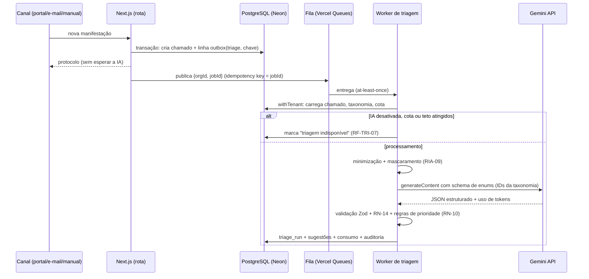

# Customer Voice AI — Fase 3A: Avaliação Arquitetural e Recomendações

| Item | Valor |
| --- | --- |
| Documento | Avaliação técnica e recomendações (Etapa 3A) |
| Base | PRD 0.2 (homologado) |
| Data das consultas de preço e documentação | 09/11/2026 |
| Status | **Histórico.** Avaliada pelo responsável em 09/11/2026, com aprovação condicionada. As decisões consolidadas e seus status estão em [ARCHITECTURE.md](ARCHITECTURE.md) e [ADR/](ADR/). Valem os documentos da Etapa 3B |
| Próxima etapa | 3B — Documentação arquitetural (somente após aprovação) |

Este documento não consolida a arquitetura definitiva. Ele identifica as decisões necessárias, compara alternativas com dados de fontes oficiais e recomenda uma opção para cada decisão, submetida à aprovação do responsável pelo produto. Nenhum serviço foi contratado ou configurado.

**Convenções**

- **Verificado:** dado obtido em página oficial na data acima, com a URL citada.
- **Pendente:** não foi possível confirmar em fonte oficial.
- **Inferência:** conclusão técnica não documentada pelo fornecedor, que exige prova de conceito.

Algumas páginas longas foram lidas parcialmente e resumidas automaticamente. Os dados afetados estão marcados como “(resumo)” e devem ser reconfirmados antes de qualquer contratação.

---

## 1. Resumo executivo

A recomendação é um **monólito modular em Next.js na Vercel**, com **PostgreSQL no Neon** e isolamento multi-tenant em duas camadas: `organization_id` na aplicação mais Row-Level Security no banco, condicionada a uma prova de conceito. Completam a proposta:

- **Autenticação:** Better Auth para a equipe interna e um módulo próprio, isolado, para o portal do cliente.
- **Processamento assíncrono:** outbox transacional no PostgreSQL com entrega via Vercel Queues.
- **E-mail:** Resend para entrada e saída.
- **Anexos:** Amazon S3 com GuardDuty Malware Protection.
- **Triagem:** Gemini Flash-Lite estável, com seleção final pelo golden set.

**Custo mensal estimado (premissas na seção 13):**

| Cenário | Custo |
| --- | --- |
| A — Desenvolvimento | US$ 0 a 1 por mês, mais o domínio (anual, preço pendente) |
| B — Beta fechado | cerca de US$ 65 por mês |
| C — Operação inicial | cerca de US$ 150 a 200 por mês |

Os principais custos fixos são o plano Pro da Vercel (obrigatório para uso comercial), o Neon Launch e o Resend Pro.

**Incompatibilidades e riscos relevantes encontrados:**

1. O plano Hobby da Vercel é restrito a uso pessoal não comercial. O beta e a operação exigem o plano Pro (US$ 20/mês).
2. O pooler do Neon (PgBouncer em modo transação) não suporta `SET` de sessão nem `LISTEN/NOTIFY`. O contexto de RLS precisa ser local à transação, e isso deve ser provado.
3. O Prisma 8 (ainda em pré-lançamento) remove `$transaction` e as client extensions, e o adaptador do Better Auth não o suporta. A recomendação é fixar o Prisma 7.x.
4. Os termos pagos da Gemini Developer API não informam o prazo de retenção para monitoramento de abuso e permitem armazenamento “em qualquer país”. A disponibilidade no Brasil não foi confirmada. O nível gratuito usa os dados para melhorar produtos e não pode receber dados reais.
5. O webhook de entrada do Resend envia apenas metadados. O resultado de SPF/DKIM/DMARC, exigido pela RN-15, não aparece documentado.
6. O ClamAV exige de 3 a 4 GiB de RAM e não é viável em funções serverless.

---

## 2. Decisões arquiteturais necessárias

| # | Decisão | Relação com o PRD | Status |
| --- | --- | --- | --- |
| D-01 | Estilo arquitetural (monólito modular ou serviços) | RST-07 | Proposta |
| D-02 | Estratégia multi-tenant (A ou B) | DP-05, RSG-01 a 03 | Proposta + PoC |
| D-03 | ORM e versão | DP-06 | Proposta |
| D-04 | Autenticação da equipe e do portal | DP-03, RSG-05, RSG-06 | Proposta |
| D-05 | Modelos Gemini e arquitetura da triagem | DP-01, DP-02, seção 12 | Proposta + benchmark |
| D-06 | Processamento assíncrono | DP-04 | Proposta |
| D-07 | Provedor de e-mail | DP-07, RN-15 a RN-19 | Proposta + verificação |
| D-08 | Armazenamento de anexos e antimalware | DP-08, DP-12, RSG-12, RSG-17 a 19 | Proposta |
| D-09 | Rate limiting e anti-bot | RSG-11 | Proposta |
| D-10 | Observabilidade | DP-09 | Proposta |
| D-11 | Ambientes, dados por ambiente e deploy | RNF-16, RNF-17 | Proposta |
| D-12 | Cálculo de SLA e alertas | RF-SLA, RN-20 a 24 | Proposta |
| D-13 | Plano de hospedagem para uso comercial | DP-10 | Requer aprovação de custo |

---

## 3. D-01 — Estilo arquitetural

**Recomendação: monólito modular em Next.js (App Router, runtime Node.js) em um único repositório e um único deploy na Vercel.**

| Critério | Monólito modular | Microsserviços |
| --- | --- | --- |
| Operação por um desenvolvedor | Simples: um deploy, um banco | Vários deploys, contratos e observabilidade distribuída |
| Isolamento multi-tenant | Um ponto de controle (camada de dados) | Controle repetido em cada serviço |
| Custo | Uma aplicação | Mais recursos e mais tráfego entre serviços |
| Evolução | Módulos com fronteiras claras permitem extração futura | Já nasce distribuído |

Estrutura proposta, a detalhar na 3B:

- **Módulos de domínio:** `organizations`, `identity`, `contacts`, `tickets`, `portal`, `email`, `triage`, `sla`, `dashboard`, `audit`, `usage`, `attachments`, `privacy`.
- **Camadas por módulo:** interface (rotas e Server Actions), aplicação (casos de uso), domínio (regras puras e testáveis) e infraestrutura (repositórios, clientes externos).
- **Regras de dependência:** módulos só se comunicam pela camada de aplicação. Regras de negócio (prioridade, SLA, transições de status) são funções puras, sem I/O, cobertas por testes unitários.
- **Processamento em segundo plano:** handlers de fila e cron são rotas internas do mesmo deploy, autenticadas por segredo ou assinatura.

---

## 4. D-02 — Estratégia multi-tenant

### 4.1 Alternativas

| Critério | A: `organization_id` só na aplicação | B: `organization_id` + RLS no PostgreSQL |
| --- | --- | --- |
| Proteção contra esquecimento de filtro | Depende de disciplina e testes | O banco bloqueia mesmo com filtro esquecido |
| Proteção contra bug em consulta crua | Nenhuma | Bloqueia |
| Complexidade | Baixa | Média: contexto por transação, papéis separados, políticas |
| Compatibilidade com pooler do Neon | Total | Exige contexto local à transação (inferência, ver 4.2) |
| Compatibilidade com Prisma 7 | Total | Exige transação interativa por requisição ou extensão |
| Desempenho | Melhor | Sobrecarga de uma transação e um `set_config` por unidade de trabalho |
| Adequação ao PRD (RSG-02) | Atende parcialmente | Atende, se a PoC passar |

### 4.2 Fatos de compatibilidade (verificados)

- **Pooler do Neon:** “PgBouncer in transaction mode”. Não suporta “`SET` / `RESET` (session variables)” nem “`LISTEN` / `NOTIFY`”. O comportamento de `SET LOCAL` não é documentado ([neon.com/docs/connect/connection-pooling](https://neon.com/docs/connect/connection-pooling)).
- **Guia de RLS do Neon:** centrado na Data API (`auth.user_id()`), não em uso com pooler ([neon.com/docs/guides/row-level-security](https://neon.com/docs/guides/row-level-security)).
- **Prisma 7:** com `@prisma/adapter-neon` (GA desde a 6.16), a última versão estável é a 7.10.1. A tag `latest` do npm aponta para um pré-lançamento do Prisma 8, segundo o guia do Neon ([neon.com/docs/guides/prisma](https://neon.com/docs/guides/prisma); [github.com/prisma/prisma/releases](https://github.com/prisma/prisma/releases)).
- **Exemplo oficial de RLS do Prisma:** usa `set_config('app.current_company_id', id, TRUE)` em transação e avisa que “It is not intended to be used in production environments” e que transações explícitas “may not work as intended” ([github.com/prisma/prisma-client-extensions/row-level-security](https://github.com/prisma/prisma-client-extensions/tree/main/row-level-security)).
- **Prisma 8 (pré-lançamento):** “has no `$transaction`” e substitui as client extensions.

**Inferência a provar:** `set_config(..., true)` equivale a `SET LOCAL` e dura até o fim da transação. Em modo transação, o PgBouncer mantém a mesma conexão do servidor durante toda a transação, então o contexto não deveria vazar para outra requisição. Isso precisa ser demonstrado com concorrência real.

### 4.3 Recomendação

**Alternativa B, condicionada à PoC.** Se a PoC falhar, adota-se a Alternativa A reforçada (4.5) e a decisão volta para aprovação.

Desenho proposto:

1. **Papéis no banco:**
   - `app_runtime`: sem `BYPASSRLS` e sem ser dono das tabelas. Todas as tabelas de tenant com `ENABLE` e `FORCE ROW LEVEL SECURITY`.
   - `app_migrator`: dono do schema, usado só pela conexão direta no CI.
   - `app_system`: para jobs que operam sobre várias organizações (cotas globais, varreduras), com políticas explícitas e uso restrito a módulos de sistema.
2. **Contexto por unidade de trabalho:** toda operação de tenant roda em transação interativa que primeiro executa `select set_config('app.org_id', $1, true)` e depois as consultas. Um helper único, `withTenant(orgId, fn)`, é a única forma de obter um cliente de dados de tenant. O cliente Prisma “cru” não é exportado para os módulos de domínio.
3. **Política padrão:** `USING (organization_id = current_setting('app.org_id', true)::uuid)` e `WITH CHECK` idêntico. Sem contexto, `current_setting` retorna nulo e nenhuma linha é visível (falha fechada).
4. **Integridade entre tenants no próprio esquema:** chaves estrangeiras compostas `(organization_id, id)`. Assim, um chamado da organização A não pode referenciar contato, equipe ou categoria da organização B, mesmo com bug na aplicação.
5. **A origem do `organization_id` é sempre a sessão no servidor** (vínculo usuário-organização validado), nunca um parâmetro do cliente.

### 4.4 Prova de conceito proposta (não executada)

| Item | Definição |
| --- | --- |
| Objetivo | Provar que RLS com contexto local à transação é seguro e viável com Neon pooler + Prisma 7 + `@prisma/adapter-neon` + funções Vercel |
| Ambiente | Projeto Neon gratuito separado, com dados sintéticos, mais deploy Preview na Vercel Hobby (não comercial) |
| Escopo | 3 tabelas (`organizations`, `contacts`, `tickets`), 2 papéis, políticas, helper `withTenant` |
| Teste 1 — vazamento | 2.000 requisições concorrentes alternando 2 organizações pela conexão pooled. Cada resposta deve conter apenas dados da organização da requisição. Zero vazamentos |
| Teste 2 — falha fechada | Consulta sem `set_config` retorna zero linhas. Insert com `organization_id` divergente é recusado |
| Teste 3 — filtro esquecido | Consulta sem `where organization_id` retorna apenas linhas do tenant do contexto |
| Teste 4 — transações | Transação interativa com várias escritas e rollback mantém o contexto. Erro no meio não deixa contexto residual |
| Teste 5 — FK composta | Referência a registro de outra organização é recusada pelo banco |
| Teste 6 — desempenho | Medir a sobrecarga de latência p95 com e sem RLS. Critério proposto: até 15 ms adicionais por unidade de trabalho |
| Teste 7 — migrations | `prisma migrate deploy` pela conexão direta com `app_migrator`; runtime com `app_runtime` |
| Critério de sucesso | Testes 1 a 5 sem exceção e teste 6 dentro do limite |
| Duração | Limitada a 2 a 3 dias de trabalho |
| Saída | Relatório e ADR-002 atualizada para aprovação |

### 4.5 Alternativa A reforçada (contingência)

- Repositórios que exigem `orgId` em toda assinatura, com regra de lint que proíbe usar o cliente Prisma fora da camada de repositório.
- Extensão de consulta que injeta e verifica `organization_id`.
- Testes de isolamento obrigatórios (RSG-03) e FKs compostas (4.3, item 4), que valem nas duas alternativas.

### 4.6 Isolamento nas demais camadas

| Camada | Controle proposto |
| --- | --- |
| APIs | Toda rota resolve a organização da sessão, verifica o vínculo e o perfil e executa via `withTenant`. IDs inexistentes ou de outro tenant retornam 404 |
| Sessões | A sessão guarda a organização ativa. A troca de organização revalida o vínculo. O portal tem sessão própria (D-04) |
| Arquivos | Chave de objeto `org/{orgId}/...` mais registro no banco sob RLS. O download exige autorização e URL assinada de 5 minutos |
| E-mails | Endereço de entrada exclusivo por organização. O token de resposta identifica chamado e organização, validados conforme RN-15 |
| Filas | A mensagem carrega apenas IDs (`organizationId`, `jobId`), nunca conteúdo. O worker recarrega os dados via `withTenant` |
| Cache | Sem cache compartilhado de dados de tenant na v1.0. Se adotado, a chave começa por `orgId` |
| Logs | Logs estruturados com `orgId` e `requestId`, sem conteúdo (RSG-08) |
| Gemini | Uma requisição por chamado, com taxonomia apenas da organização (RIA-11). Sem cache de contexto entre organizações |
| Exportações | Geradas por job sob `withTenant`, armazenadas no prefixo da organização, com expiração (DP-17) |

---

## 5. D-03 — ORM

**Recomendação: Prisma 7.x, versão fixada (sem `^` para major), com `@prisma/adapter-neon`.** O Prisma 8 só será avaliado depois de estável e quando o adaptador do Better Auth o suportar.

- **Por que manter o Prisma:** faz parte da stack de referência, tem tipagem forte e migrations integradas. O Better Auth oferece adaptador oficial para Prisma 7 e avisa que “Prisma ORM 8 … is not supported by the adapter yet” ([better-auth.com/docs/adapters/prisma](https://www.better-auth.com/docs/adapters/prisma)).
- **Risco:** a direção do Prisma 8 muda a API de transações. A camada `withTenant` isola esse impacto.
- **Alternativa, se a PoC de RLS falhar por limitação do Prisma:** Drizzle ORM, cuja integração com RLS é citada no guia do Neon. A troca seria submetida à aprovação.

---

## 6. D-04 — Autenticação e autorização

### 6.1 Comparação (verificada em 09/11/2026)

| Critério | Clerk | Better Auth |
| --- | --- | --- |
| Modelo | Serviço gerenciado | Biblioteca MIT, auto-hospedada, dados no próprio PostgreSQL |
| Custo com MFA | MFA indisponível no Hobby (gratuito); **Pro US$ 25/mês** (US$ 20 no plano anual) ([clerk.com/pricing](https://clerk.com/pricing)) | US$ 0 (plugin 2FA: TOTP, códigos de backup) |
| Usuários incluídos | 50.000 MRU por app | Sem limite de licença |
| Organizações | Grátis até 100 MROs, depois US$ 1/mês cada. **Até 20 membros por organização** sem o add-on de US$ 100/mês | Plugin de organização: convites, papéis owner/admin/member, controle de acesso customizado, organização ativa na sessão. Limite padrão configurável de 100 membros |
| Papéis customizados | Add-on Enhanced B2B, US$ 100/mês | Incluído (`createAccessControl`) |
| Sessões | Revogação de dispositivos | Listar, revogar uma, outras ou todas. Atenção: com `cookieCache`, a revogação só vale após o `maxAge` |
| Convites | Sim | Sim (expiração padrão de 48 h) |
| Recuperação de acesso | Gerenciada | Recuperação de senha, link mágico (padrão de 300 s) |
| Residência dos dados | Não informada | Própria (Neon) |
| Responsabilidade de segurança | Fornecedor | Nossa: atualizações, configuração, e-mails, rate limiting |
| Compatibilidade com RLS e consultas | Usuários fora do banco, exige sincronização | Usuários no mesmo banco |
| Versão mais recente | n/a | **Pendente** (não exibida na página do GitHub consultada) |

### 6.2 Recomendação

**Better Auth para a equipe interna.** Motivos:

- O PRD exige MFA, o que no Clerk exige o Pro (US$ 25/mês).
- O plano gratuito do Clerk limita 20 membros por organização.
- Manter os dados de identidade no mesmo banco simplifica LGPD, auditoria e integridade.
- Custo zero, alinhado à RST-04.

O custo é assumir a responsabilidade operacional pela segurança da biblioteca. Mitigações: fixar a versão, acompanhar avisos de segurança, cobrir os fluxos de autenticação com os testes CA-02.x e restringir `cookieCache` (ou desativá-lo) para que a revogação seja imediata (CA-02.2).

**Separação dos domínios de identidade:**

| Domínio | Mecanismo | Armazenamento | Cookie e rotas |
| --- | --- | --- | --- |
| Equipe da organização | Better Auth (e-mail + senha, 2FA, convites, plugin de organização) | Tabelas do Better Auth + `memberships` | Cookie de sessão próprio, rotas `/app/*` |
| Superadmin | Better Auth com papel de plataforma (tabela `platform_admins`), MFA obrigatório, sem vínculo com organizações | Mesmo banco | Rotas `/admin/*`, middleware que exige papel e MFA |
| Cliente final (portal) | **Módulo próprio, fora do Better Auth:** link mágico de uso único (hash SHA-256, 15 min, ligado a contato + organização) e token de acompanhamento por chamado (revogável) | Tabelas `portal_access_tokens`, `portal_sessions` | Cookie distinto com `Path=/portal`, sessão curta, sem acesso a rotas `/app` |

Contatos nunca são “usuários”. Assim, um token do portal jamais concede acesso à central, e a anonimização de contatos não afeta a tabela de usuários.

**Autorização:** matriz de permissões em código (perfil × ação), verificada no backend em toda ação (RSG-04), mais o vínculo com a organização. A leitura executiva (RF-ORG-10) é uma permissão restrita.

---

## 7. D-05 — Arquitetura da Gemini API

### 7.1 Modelos disponíveis (verificado em [aistudio.google.com/docs/models](https://aistudio.google.com/docs/models) e [/docs/pricing](https://aistudio.google.com/docs/pricing))

| Modelo (ID) | Status na página | Entrada / saída (US$ por 1M tokens, pago) | Batch | Observação |
| --- | --- | --- | --- | --- |
| `gemini-3.1-flash-lite` | Stable | 0,25 / 1,50 | 0,125 / 0,75 | Mais barato entre os estáveis. **Candidato principal** |
| `gemini-3.5-flash-lite` | Stable | 0,30 / 2,50 | 0,15 / 1,25 | Candidato alternativo |
| `gemini-3.6-flash` | Stable | 0,75 / 3,75 até 31/12/2026; **1,50 / 7,50 a partir de 01/01/2027** | 50% | Só se os Flash-Lite falharem na qualidade |
| `gemini-3.8-flash` | “New” (sem selo Stable) | Igual ao 3.6 Flash | 50% | Não recomendado até ser estável |
| `gemini-2.5-flash-lite` | Acesso restrito a usuários existentes | 0,10 / 0,40 (resumo) | — | Não recomendado: acesso restrito, família antiga |
| `gemini-2.5-flash` / `2.5-pro` | Deprecated (redirecionados a partir de 01/12/2026) | — | — | Não usar |
| `gemini-embedding-001` / `gemini-embedding-2` | Sem selo | 0,15 / 0,20 por 1M (resumo) | 50% | Para a v1.1 (RIA-16) |

- **Limites de taxa:** a página não publica RPM, TPM e RPD desses modelos. Eles aparecem apenas no AI Studio (**pendente**).
- **Limite de gasto do Tier 1:** US$ 10 por 10 minutos, suficiente para os cenários.
- **Ponto de atenção — tokens de raciocínio:** modelos com “thinking” podem gerar tokens de saída adicionais. O controle do orçamento de raciocínio para classificação **não foi verificado** e entra no benchmark.

**Seleção definitiva:** benchmark no golden set (RIA-13) comparando `gemini-3.1-flash-lite` e `gemini-3.5-flash-lite`, medindo acurácia (KPI-04), taxa de saída válida no schema, latência p95 e custo real por triagem, incluindo tokens de raciocínio. Escolhe-se o mais barato que atingir as metas.

### 7.2 Termos de uso de dados (verificado em [aistudio.google.com/docs/terms](https://aistudio.google.com/docs/terms), vigentes desde 23/03/2026)

| Aspecto | Serviços pagos | Serviços não pagos |
| --- | --- | --- |
| Uso para melhorar produtos | “Google doesn't use your prompts … or responses to improve our products” | Usa conteúdo e respostas para melhorar produtos. Revisores humanos podem ler |
| Base contratual | DPA “for Products Where Google is a Data Processor” | — |
| Retenção | “logs prompts and responses for a limited period of time, solely for detecting and preventing violations” — **prazo não informado** | Não informado |
| Local | “stored transiently or cached in any country in which Google or its agents maintain facilities” | — |
| Condição de serviço pago | Projeto Cloud com conta de faturamento ativa | — |
| Restrições | Uso profissional ou comercial. Apenas regiões disponíveis | — |

**Conclusão para DP-01 (proposta, não jurídica):** o nível pago da Developer API é compatível em princípio com o uso pretendido: Google como operador sob DPA, sem uso dos dados para treino. Ficam pendentes:

1. A ausência de prazo de retenção para monitoramento de abuso.
2. O armazenamento em qualquer país (transferência internacional, RSG-22).
3. A **confirmação de que o Brasil consta na lista de regiões disponíveis** ([aistudio.google.com/docs/available-regions](https://aistudio.google.com/docs/available-regions)). A consulta não confirmou o Brasil explicitamente.
4. A revisão jurídica.

**Regras propostas:**

- Dados reais só com chave de projeto com faturamento ativo (nível pago).
- Development e Preview usam somente dados sintéticos (RIA-17).
- A Vertex AI só será considerada se a revisão jurídica exigir prazos de retenção ou localização que a Developer API não ofereça.

### 7.3 Fluxo de triagem proposto

**Detalhes:**

1. **Idempotência (RIA-06):**
   - `idempotency_key = sha256(conteúdo normalizado + versão do prompt + modelo)`, com unicidade por `(organization_id, ticket_id, idempotency_key)`.
   - Uma reentrega da fila encontra o job concluído e encerra sem nova chamada.
2. **Cota:**
   - Reserva atômica antes da chamada: `UPDATE ... SET used = used + 1 WHERE used < limit`. Ajuste pelo consumo real depois.
   - O teto global (RF-CON-04) funciona como disjuntor, verificado antes de cada chamada.
3. **Mascaramento:** regex com validação (CPF e CNPJ com dígito verificador, cartões com Luhn, e-mails, telefones BR). Os tokens são substituídos por marcadores (`[CPF]`). Nome e dados cadastrais não são enviados.
4. **Prompt:**
   - Instruções fixas versionadas e a taxonomia da organização (IDs e rótulos).
   - Conteúdo do cliente delimitado como dado não confiável.
   - Saída restrita a enums de IDs e a uma justificativa curta com limite de caracteres.
5. **Erros:**
   - **Transitórios** (timeout de 20 s, 429, 5xx): até 2 novas tentativas com backoff exponencial e jitter.
   - **Saída inválida no schema:** 1 nova tentativa.
   - **Erros permanentes** (4xx de requisição): sem nova tentativa.
   - **Esgotadas as tentativas:** RF-TRI-07.
6. **Regras de prioridade:** função pura aplicada após a IA (RN-10), com a regra vencedora registrada na justificativa.
7. **Consumo:** tokens de entrada, saída e raciocínio (se informados), latência, modelo, versão do prompt e custo estimado pela tabela de preços versionada em configuração.
8. **Modo degradado:** a falha da IA nunca bloqueia criação, consulta ou resposta.

---

## 8. D-06 — Processamento assíncrono

Funções serverless não oferecem execução durável por si só. Recursos como `waitUntil`/`after` não sobrevivem a falhas e **não são aceitos como mecanismo único**.

| Alternativa | Durabilidade | Retentativa | Custo | Complexidade | Observação |
| --- | --- | --- | --- | --- | --- |
| Vercel Queues | At-least-once, TTL de até 7 dias | Automática (32 tentativas configuráveis), idempotency key, atraso | Hobby: 1M operações incluídas. Pro: a partir de US$ 0,60 por 1M | Baixa, mesma plataforma | **Beta** ([vercel.com/docs/queues](https://vercel.com/docs/queues)) |
| Upstash QStash | Sim | Sim, com DLQ. Cada retentativa é cobrada | Grátis: 1.000 mensagens/dia. PAYG: US$ 1 por 100 mil | Baixa | Novo fornecedor |
| Inngest | Sim, por etapas | Sim | Grátis: 50 mil execuções/mês, depois pausa. Pro: US$ 99/mês | Média | Pausa ao atingir a cota gratuita |
| Trigger.dev | Sim | Sim | Grátis: US$ 5 em créditos. Hobby: US$ 10/mês | Média | Novo fornecedor |
| pg-boss (Postgres) | Sim | Sim, com DLQ | US$ 0 | Média | Requer worker que consulte a fila. `LISTEN/NOTIFY` indisponível no pooler. Na Vercel, sem processo persistente |
| Vercel Workflow | Sim | Sim | Hobby: 50 mil eventos. Pro: US$ 20 por 1M eventos | Média | Recurso mais amplo que o necessário na v1.0 |

**Recomendação: outbox transacional no PostgreSQL + Vercel Queues.**

- A tabela `jobs` (outbox) é a fonte de verdade, gravada na mesma transação do chamado. Nada se perde mesmo se a publicação falhar.
- A publicação na fila usa `idempotency key = jobId`.
- Um varredor periódico republica jobs pendentes ou travados.
- O worker é idempotente (D-05, item 1).
- Concorrência controlada pela fila e pela trava otimista do job (`status`, `attempts`, `locked_until`).
- Sendo a outbox a fonte de verdade, trocar o transporte por QStash é barato se o Queues sair do beta com mudanças.

**Evolução:**

| Fase | Uso |
| --- | --- |
| MVP Core | Triagem |
| v1.0 | Processamento de e-mails recebidos, envio de e-mails, verificação de anexos, exportações, anonimização e expiração de retenção |

**Restrição relevante:** no Hobby, o cron roda **no máximo uma vez por dia**, com precisão de ±59 min. No Pro, a cada minuto ([vercel.com/docs/schedules/cron-jobs/usage-and-pricing](https://vercel.com/docs/schedules/cron-jobs/usage-and-pricing)). Em desenvolvimento, o varredor pode ser acionado manualmente. O beta exige o Pro (D-13).

---

## 9. D-07 — E-mail de entrada e saída

### 9.1 Comparação (verificada em 09/11/2026)

| Provedor | Gratuito | Plano pago de entrada | Recebimento | Veredito SPF/DKIM/DMARC no recebimento | Observações |
| --- | --- | --- | --- | --- | --- |
| **Resend** | 3.000/mês, 100/dia, 3 domínios, recebimento incluído | Pro US$ 20 (50 mil), US$ 35 (100 mil). Excedente US$ 0,90/mil | Webhook `email.received` só com metadados. Corpo, cabeçalhos e anexos via API | **Não informado** | E-mails recebidos contam na cota. Webhooks assinados (Svix). Retenção de 30 dias ([resend.com/pricing](https://resend.com/pricing)) |
| Postmark | 100/mês, sem recebimento | Pro US$ 16,50 (10 mil, com recebimento). Excedente US$ 1,30/mil | Webhook JSON | Não informado | Retenção de 45 dias |
| Amazon SES | Créditos de novos clientes AWS | US$ 0,10/mil (à la carte). Recebimento US$ 0,10/mil + US$ 0,09 por mil blocos de 256 KB | Entrega em S3 ou SNS | Não informado nas páginas lidas | Mais barato em volume, porém mais configuração AWS |
| Mailgun | 100/dia, 1 rota de entrada | Basic US$ 15 (10 mil, 5 rotas) | Rotas (documentação não verificada, HTTP 404) | Não verificado | — |
| Cloudflare Email Service | Recebimento ilimitado (Workers Free). Envio indisponível no Free | Envio no Workers Paid: 3.000 incluídos, depois US$ 0,35/mil. Preço do Workers Paid **pendente** | Worker com MIME bruto, até 25 MiB | **Sim:** valida DMARC e acrescenta `Authentication-Results` | Exige o domínio no Cloudflare e um Worker |

### 9.2 Recomendação

**Resend para entrada e saída**, por ser um único fornecedor com camada gratuita em desenvolvimento, recebimento incluído e webhooks assinados.

**Condição obrigatória antes da Fase 4:** verificar (PoC curta, sem dados reais) se a API de e-mails recebidos do Resend expõe os cabeçalhos completos, inclusive `Authentication-Results`.

- **Se não expuser:** RN-15(c) fica impossível e adota-se o **Cloudflare Email Service para recebimento** (gratuito, com veredito DMARC), encaminhando ao nosso webhook. O envio continua no Resend.
- **Também a verificar:** suporte a cabeçalhos customizados no envio (`Message-ID`, `Reply-To`) e a recebimento em subdomínio com endereços variáveis.

**Desenho independente de fornecedor (atende RN-15 a RN-19):**

- **Endereço de entrada por organização:** `{slug}@in.{dominio}`.
- **Reply-To por chamado:** `r+{token}@in.{dominio}`, com token aleatório de 128 bits guardado como hash e ligado a chamado e organização. Esse é o vínculo principal. O `Message-ID` emitido é registrado para correspondência secundária via `In-Reply-To`/`References`.
- **Pipeline de recebimento:**
  1. Verificar a assinatura do webhook.
  2. Fazer a deduplicação por `Message-ID` (RN-18).
  3. Gravar o registro bruto em `inbound_messages`.
  4. Enfileirar o processamento.
  5. O worker classifica: mensagem automática (RN-16), novo chamado, associação válida (RN-15) ou quarentena (RN-17).
  6. Sanitizar o HTML (RN-19).
  7. Transferir anexos para o armazenamento em estado “pendente” (D-08).
  8. Registrar o evento com o motivo.
- **E-mails de saída:** contêm apenas a mensagem nova e o link (RN-19). Webhooks de entrega e bounce atualizam o status (RF-EML-07).

**Ressalva:** nenhuma página consultada afirma que a camada gratuita do Resend (ou de outro provedor) permite uso comercial. A camada gratuita é tratada como válida apenas para desenvolvimento.

---

## 10. D-08 — Anexos e antimalware

### 10.1 Armazenamento

| Critério | Vercel Blob (privado) | Cloudflare R2 | Amazon S3 |
| --- | --- | --- | --- |
| Armazenamento | US$ 0,023/GB-mês | US$ 0,015/GB-mês, 10 GB grátis | **Pendente** (tabela não lida) |
| Operações | US$ 0,40/1M simples, US$ 5/1M avançadas | US$ 0,36/1M (B), US$ 4,50/1M (A) | GET US$ 0,0004/mil. PUT pendente |
| Saída de dados | Incluída no CDN do Pro | Grátis | 100 GB/mês grátis. Depois, pendente |
| Entrega privada | Por uma Function (respostas em streaming isentas do limite de 4,5 MB) | URL pré-assinada (API S3; não citada na página de preços) | URL pré-assinada |
| Antimalware gerenciado | Não | Não | **GuardDuty Malware Protection for S3** |
| Integração | Nativa na Vercel | Nova conta | Nova conta AWS |

### 10.2 Antimalware

| Opção | Custo | Viabilidade | Observação |
| --- | --- | --- | --- |
| **S3 + GuardDuty Malware Protection** | US$ 0,09/GB verificado + US$ 0,215 por mil objetos. Gratuito até 1 GB e 1.000 objetos/mês ([aws.amazon.com/guardduty/pricing](https://aws.amazon.com/guardduty/pricing/)) | Alta: verifica automaticamente cada novo objeto, até 100 GB. Resultado por tag no objeto e EventBridge | Pago por uso, sem assinatura. Novo fornecedor (AWS) |
| ClamAV próprio | Servidor sempre ligado (preço pendente) | Baixa na Vercel: exige “Minimum: 3 GiB; Preferred: 4 GiB” de RAM e 1,2 GiB só para carregar assinaturas ([docs.clamav.net](https://docs.clamav.net/manual/Installing/Docker.html)) | Custo e manutenção recorrentes. Licença GPLv2 |
| Cloudmersive (API) | **Pendente** (preços não exibidos) | Média | Envia o conteúdo a mais um terceiro |
| Aceitação temporária de risco | US$ 0 | Permitida pela RSG-19 só com registro formal e prazo | Não recomendada como solução permanente |

**Recomendação: Amazon S3 com GuardDuty Malware Protection.** Região a definir após confirmar a disponibilidade do GuardDuty para S3 na região escolhida (preferência por São Paulo, `sa-east-1`, **pendente**).

**Fluxo:**

1. A aplicação valida tipo, extensão, conteúdo e tamanho (RSG-12, RSG-17).
2. Emite uma URL pré-assinada de PUT para o prefixo `org/{orgId}/pending/`. O upload vai direto do navegador ao S3, contornando o limite de 4,5 MB das funções.
3. O GuardDuty verifica e marca o objeto com uma tag.
4. O evento chega à aplicação (EventBridge para um endpoint HTTPS assinado), ou um job consulta a tag como contingência.
5. Objetos limpos ficam “liberados”. Os reprovados ficam em quarentena, com alerta e auditoria (RSG-19).
6. Downloads só após autorização e por URL pré-assinada de GET de 5 minutos, com `Content-Disposition: attachment` (RSG-18).

Restrição de tipos e download forçado continuam como controles complementares, não substitutos.

**Alternativa, se a AWS não for aprovada:** Vercel Blob privado mais uma das outras opções antimalware. Nesse caso, a DP-12 permanece aberta e bloqueia o Gate de dados reais.

O MVP Core não tem anexos. A decisão é necessária apenas para o incremento I-4.

---

## 11. D-09, D-10, D-12 — Rate limiting, observabilidade e SLA

**D-09 — Rate limiting e anti-bot**

- Regras de IP no **Vercel WAF Rate Limiting** para portal, login, link mágico e webhooks. Disponível em todos os planos: Hobby com 1 regra; Pro com 40 regras, a US$ 0,50 por 1M de requisições permitidas.
- **Limites por organização e por identidade** em tabela PostgreSQL de janela fixa. Upstash Redis (500 mil comandos/mês grátis) só se a carga exigir.
- **Anti-bot:** Cloudflare Turnstile, gratuito com até 20 widgets e desafios ilimitados. O BotID básico da Vercel (gratuito) fica como alternativa.

**D-10 — Observabilidade**

- Logs estruturados em JSON (`requestId`, `orgId`, `jobId`, sem conteúdo), consultados nos logs da Vercel. A retenção por plano está **pendente**.
- **Sentry Developer** (gratuito, um usuário, 5 mil erros/mês). O uso comercial no plano gratuito não está informado (**pendente**). Alternativa: Sentry Team a US$ 29/mês.
- **Métricas de IA, fila e custo:** tabelas próprias (`ai_usage_events`, `jobs`) e uma página do Superadmin.
- **Alertas:** cron que verifica limiares (fila parada, taxa de erro da IA, teto de gasto, bounces) e envia e-mail. Sem nova ferramenta na v1.0.

**D-12 — SLA**

- Prazos calculados por função pura (calendário, feriados e pausas) e gravados no chamado (`first_response_due_at`, `resolution_due_at`), recalculados nos eventos (RN-21, RN-22, RN-24).
- O estado “em risco” ou “violado” é derivado na leitura.
- Um cron a cada minuto (Pro) grava as violações (RF-SLA-05) e emite os alertas uma única vez (CA-12.2). Não há timer por chamado.

---

## 12. D-11 e D-13 — Ambientes, deploy e plano de hospedagem

**Ambientes**

| Ambiente | Vercel | Banco | Gemini | Dados |
| --- | --- | --- | --- | --- |
| Development | Local | Projeto Neon **não produtivo**, branch `dev` | Chave de projeto Google separado (com faturamento, para não usar o nível gratuito) | Sintéticos |
| Preview | Deploy por PR | Mesmo projeto não produtivo, um branch por PR criado a partir do branch `seed` sintético | Chave não produtiva | Sintéticos |
| Production | Branch `main` | **Projeto Neon separado** | Chave produtiva | Reais, só após o Gate |

**Ponto crítico:** branches de Preview nunca podem ser criados a partir do banco de produção, porque copiariam dados reais e violariam a RNF-16. Por isso a proposta usa projetos Neon separados.

**CI/CD (GitHub Actions + integração Git da Vercel)**

1. Em cada PR: lint, typecheck, testes unitários (Vitest), integração com Postgres (branch Neon efêmero ou container), suíte de isolamento (bloqueante) e E2E (Playwright) contra o Preview.
2. Merge em `main` executa `prisma migrate deploy` pela conexão direta, com o papel de migração, antes da promoção.
3. Migrations no padrão expand/contract para permitir rollback da aplicação sem rollback de schema.
4. **Rollback:** reversão instantânea da Vercel para a aplicação. Para dados, instant restore do Neon: 7 dias no Launch, 30 no Scale.
5. A cota gratuita do GitHub Actions para repositório privado está **pendente**.

**D-13 — Plano de hospedagem**

- A Vercel declara que Hobby é “restricted to non-commercial personal use only” ([vercel.com/docs/limits/fair-use-guidelines](https://vercel.com/docs/limits/fair-use-guidelines)).
- **Proposta:**
  - **Hobby** para desenvolvimento, PoCs e MVP Core (não comerciais).
  - **Pro** (US$ 20/mês, com US$ 20 de crédito de uso) antes do Gate de dados reais.
  - **Neon Free** para não produção.
  - **Neon Launch** (pago por uso, sem mínimo, PITR de até 7 dias) para produção. O Free não declara permissão de uso comercial e oferece só 6 h de restauração.

---

## 13. Análise financeira (estimativas)

### 13.1 Premissas

| Premissa | Valor |
| --- | --- |
| Chamados por organização | 1.000/mês |
| Tokens por triagem | 2.000 de entrada e 250 de saída, mais 10% de novas tentativas (PRD 12.4). Tokens de raciocínio **não incluídos** (risco) |
| E-mails de saída por chamado | 4,5 (confirmação, cerca de 2 respostas, resolução/CSAT, links mágicos) |
| E-mails recebidos por chamado | 2 (50% dos chamados por e-mail, mais cerca de 1,5 resposta de cliente) |
| Anexos | 20% dos chamados, 1,5 arquivo, 1 MB em média |
| Mensagens de fila por chamado | cerca de 12 operações |
| Câmbio | Não aplicado. Valores em US$ |

### 13.2 Custo de IA (triagem)

| Modelo | Por organização/mês | Cenário B (5 orgs) | Cenário C (20 orgs) |
| --- | --- | --- | --- |
| `gemini-3.1-flash-lite` | 2,2M × 0,25 + 0,275M × 1,50 = **US$ 0,96** | US$ 4,81 | US$ 19,25 |
| `gemini-3.5-flash-lite` | 2,2M × 0,30 + 0,275M × 2,50 = US$ 1,35 | US$ 6,74 | US$ 26,95 |
| `gemini-3.6-flash` (preço de 2027) | 2,2M × 1,50 + 0,275M × 7,50 = US$ 5,36 | US$ 26,81 | US$ 107,25 |

### 13.3 Cenários

| Componente | A — Desenvolvimento | B — Beta (5 orgs) | C — Operação inicial (20 orgs) |
| --- | --- | --- | --- |
| Vercel | Hobby US$ 0 (não comercial) | Pro US$ 20 (crédito de US$ 20 deve cobrir o uso) | Pro US$ 20, mais uso eventual acima do crédito (estimado em US$ 0 a 20) |
| Neon | Free US$ 0 | Launch ≈ US$ 20 (cerca de 180 CU-h × US$ 0,106 + armazenamento a US$ 0,35/GB + histórico a US$ 0,20/GB). Não produção no Free | Launch ≈ US$ 42 (cerca de 360 CU-h + ~5 GB) |
| Gemini | < US$ 1 (sintético) | ≈ US$ 5 | ≈ US$ 19 |
| E-mail (Resend) | Free US$ 0 (100/dia) | Pro US$ 20 (≈ 32,5 mil/mês, dentro de 50 mil) | ≈ US$ 62 (130 mil/mês: Pro 100 mil a US$ 35 + 30 mil × US$ 0,90/mil) |
| Anexos (S3) + GuardDuty | US$ 0 (sem anexos reais) | ≈ US$ 1 (cerca de 1,5 GB e 1.500 objetos/mês; armazenamento S3 pendente) | ≈ US$ 2 a 4 (6 GB e 6.000 objetos/mês ≈ US$ 1,83 de verificação, mais armazenamento pendente) |
| Fila (Vercel Queues) | US$ 0 (1M incluído no Hobby) | < US$ 1 | < US$ 1 |
| Autenticação (Better Auth) | US$ 0 | US$ 0 | US$ 0 |
| Observabilidade (Sentry) | US$ 0 | US$ 0 (plano gratuito; uso comercial pendente) | US$ 0 a 29 |
| Anti-bot e WAF | US$ 0 | US$ 0 a 1 | US$ 0 a 1 |
| Domínio | Anual, pendente | Anual, pendente | Anual, pendente |
| **Total mensal estimado** | **≈ US$ 0 a 1** | **≈ US$ 65 a 70** | **≈ US$ 145 a 200** |

### 13.4 Limites gratuitos e riscos de ultrapassagem

| Risco | Impacto | Mitigação |
| --- | --- | --- |
| Resend Free com 100 e-mails/dia | Bloqueia testes de carga | Manter volume sintético baixo |
| Neon Free com 100 CU-h/projeto | Suspensão da computação em não produção | Scale-to-zero, que no Free não pode ser desativado |
| Vercel Hobby: Blob de 1 GB, 4 CPU-h, cron diário | Limita testes | Upgrade só no Gate |
| Gemini: tokens de raciocínio ou troca para Flash | Custo de IA de 2 a 5 vezes maior | Benchmark, teto global, cotas |
| `gemini-3.6-flash` dobra de preço em 01/01/2027 | — | Preferência pelos Flash-Lite |
| Resend no cenário C | Excedente cresce linearmente | Reavaliar SES (US$ 0,10/mil) se o volume passar de cerca de 150 mil/mês |
| Uso da Vercel acima do crédito no Pro | Cobrança sem teto por padrão | Configurar alertas e limite de gasto na conta |

**Nenhum serviço pago recorrente foi contratado ou está autorizado.** Os custos dos cenários B e C dependem de aprovação específica antes do Gate de dados reais.

---

## 14. ADRs propostas (a formalizar na 3B)

| ADR | Título | Recomendação | Status |
| --- | --- | --- | --- |
| ADR-001 | Estilo arquitetural | Monólito modular Next.js na Vercel | Proposta |
| ADR-002 | Isolamento multi-tenant | `organization_id` + RLS + FKs compostas, condicionado à PoC | Proposta |
| ADR-003 | ORM | Prisma 7.x fixado + adaptador Neon | Proposta |
| ADR-004 | Identidade | Better Auth (equipe e Superadmin) + módulo próprio do portal | Proposta |
| ADR-005 | Gemini | Developer API paga. Flash-Lite estável por benchmark. Pipeline determinístico | Proposta |
| ADR-006 | Assíncrono | Outbox PostgreSQL + Vercel Queues | Proposta |
| ADR-007 | E-mail | Resend (com contingência de recebimento via Cloudflare) | Proposta + verificação |
| ADR-008 | Anexos e antimalware | S3 + GuardDuty Malware Protection | Proposta |
| ADR-009 | Rate limiting e anti-bot | Vercel WAF + limites em PostgreSQL + Turnstile | Proposta |
| ADR-010 | Observabilidade | Logs da Vercel + Sentry Developer + métricas em tabelas próprias | Proposta |
| ADR-011 | Ambientes e dados | Projetos Neon separados (produção e não produção). Preview só com dados sintéticos | Proposta |
| ADR-012 | SLA | Prazos persistidos + cron por minuto | Proposta |
| ADR-013 | Plano de hospedagem | Hobby até o MVP Core. Pro e Neon Launch antes do Gate | Requer aprovação de custo |

---

## 15. Sequência técnica dos incrementos (alinhada ao PRD 16.2)

| Incremento | Componentes técnicos | Dependências |
| --- | --- | --- |
| PoC (antes do I-0) | RLS com Prisma 7 e pooler do Neon. Benchmark Gemini no golden set inicial. Verificação de cabeçalhos do Resend | Aprovação desta avaliação |
| I-0 | Repositório, CI, ambientes, schema base com RLS, Better Auth, organizações, convites, auditoria base, `withTenant` | ADR-001 a 004, ADR-011 |
| I-1 | Contatos, chamados manuais, listagem, detalhe, notas, linha do tempo | I-0 |
| I-2 (MVP Core) | Outbox + Queues, worker de triagem, cliente Gemini, mascaramento, schemas Zod, revisão humana, consumo | ADR-005, ADR-006, DP-01 apenas para dados sintéticos |
| I-3 | Status, atribuição, respostas públicas (envio pelo Resend), busca, visões, recuperação de acesso, equipes, checklist | ADR-007 (saída) |
| I-4 | Portal (identidade própria), Turnstile, WAF, recebimento de e-mail, quarentena, anexos S3 + GuardDuty, CSAT | ADR-007 (entrada), ADR-008, ADR-009 |
| I-5 | SLA, regras de prioridade, reprocessamento, cotas e teto, dashboard, leitura executiva, cron por minuto | ADR-012. Pro necessário para cron por minuto em ambiente compartilhado |
| I-6 (Marco A) | Anonimização e retenção legal, exportações, página pública, backup e restauração testados, revisão de segurança, documentação | Todos os anteriores |
| Gate de dados reais | Vercel Pro, Neon Launch, Resend Pro, conta AWS, DPAs, documentos legais | Aprovações financeiras e jurídicas |
| Marco B | Organização real, acompanhamento por 30 dias | Gate |

---

## 16. Questões que exigem aprovação

1. **D-01:** aprova o monólito modular em Next.js na Vercel?
2. **D-02:** aprova a Alternativa B (RLS) condicionada à PoC da seção 4.4, e a execução dessa PoC antes do I-0, com projeto Neon gratuito e dados sintéticos?
3. **D-03:** aprova o Prisma 7.x fixado, com Drizzle como contingência sujeita a nova aprovação?
4. **D-04:** aprova o Better Auth para a equipe e o Superadmin, e o módulo próprio para o portal, em vez do Clerk Pro (US$ 25/mês)?
5. **D-05:** aprova a Developer API paga, com benchmark entre `gemini-3.1-flash-lite` e `gemini-3.5-flash-lite`, e uso só de dados sintéticos até a conclusão de DP-01 (inclusive a confirmação do Brasil como região disponível)?
6. **D-06:** aprova a outbox PostgreSQL com Vercel Queues (beta), tendo QStash como contingência?
7. **D-07:** aprova o Resend, condicionado à verificação de cabeçalhos de autenticação, com o Cloudflare Email Service como contingência para recebimento?
8. **D-08:** aprova a inclusão da AWS (S3 + GuardDuty, pago por uso, sem assinatura) como fornecedor de anexos e antimalware?
9. **D-09 a D-12:** aprova as propostas de rate limiting, observabilidade, ambientes e SLA?
10. **D-13:** de acordo com a necessidade de Vercel Pro (US$ 20/mês), Neon Launch (≈ US$ 20 a 42/mês) e Resend Pro (US$ 20/mês ou mais) **antes do Gate de dados reais**? Não há contratação agora.
11. Autoriza a etapa 3B para produzir ARCHITECTURE.md, DATA_MODEL.md, SECURITY.md, AI_ARCHITECTURE.md, INFRASTRUCTURE_COSTS.md, ADR/ e ARCHITECTURE_REVIEW.md com as decisões aprovadas?

## 17. Pendências de verificação

| Item | Onde verificar | Bloqueia |
| --- | --- | --- |
| Brasil na lista de regiões da Gemini API | aistudio.google.com/docs/available-regions | Uso da Gemini (qualquer ambiente) |
| Prazo de retenção dos logs da Gemini (nível pago) | Termos e DPA do Google, consulta jurídica | Gate de dados reais |
| Limites RPM/TPM dos modelos Flash-Lite no Tier 1 | AI Studio (rate-limit) | Dimensionamento |
| Controle de tokens de raciocínio nos modelos 3.x | Documentação de geração e benchmark | Custo |
| Versão estável atual do `@google/genai` | npm ou GitHub (a página do npm retornou 403) | I-2 |
| Versão estável atual do Better Auth | GitHub releases ou npm | I-0 |
| Cabeçalhos e veredito de autenticação no recebimento do Resend; Message-ID customizado | Documentação e API do Resend (PoC) | I-4 |
| Preços do S3 (armazenamento e PUT) e GuardDuty em `sa-east-1` | aws.amazon.com/s3/pricing, guardduty/pricing | I-4 |
| Regiões do Neon disponíveis (São Paulo) | Documentação de regiões do Neon | I-0 |
| Retenção de logs da Vercel por plano | Documentação da Vercel | Observabilidade |
| Uso comercial nos planos gratuitos de Resend, Sentry e Neon | Termos de cada serviço | Gate de dados reais |
| Preço do Workers Paid (Cloudflare), se a contingência for usada | Preços da Cloudflare | Contingência D-07 |
| Cota do GitHub Actions para repositório privado | Preços do GitHub | CI |
| Preço do domínio | Registrador escolhido | I-3 |

## 18. Fontes consultadas (09/11/2026)

- Gemini: aistudio.google.com/docs/pricing, /docs/models, /docs/terms, /docs/rate-limits, /docs/structured-output, /docs/libraries, /docs/batch-api, /docs/available-regions (redirecionadas de ai.google.dev).
- Vercel: vercel.com/pricing, /docs/limits/fair-use-guidelines, /docs/plans/hobby, /docs/plans/pro-plan, /docs/vercel-blob/usage-and-pricing, /docs/queues, /docs/queues/pricing, /docs/schedules/cron-jobs/usage-and-pricing, /docs/functions/limitations, /docs/vercel-firewall/vercel-waf/rate-limiting, /docs/botid, /docs/workflows.
- Neon e Prisma: neon.com/pricing, /docs/introduction/plans, /docs/connect/connection-pooling, /docs/introduction/branch-restore, /docs/guides/row-level-security, /docs/guides/prisma; prisma.io/docs (Neon, client extensions, transactions); github.com/prisma/prisma/releases; github.com/prisma/prisma-client-extensions.
- Autenticação: clerk.com/pricing, clerk.com/docs/organizations/overview; better-auth.com/docs (introduction, organization, 2fa, magic-link, adapters/prisma, session-management, admin); github.com/better-auth/better-auth.
- E-mail: resend.com/pricing e docs de recebimento e webhooks; postmarkapp.com/pricing e guia de inbound; aws.amazon.com/ses/pricing; docs.aws.amazon.com/ses (receiving); mailgun.com/pricing; developers.cloudflare.com/email-service (pricing, limits, email handler).
- Armazenamento, filas, segurança e observabilidade: developers.cloudflare.com/r2/pricing; aws.amazon.com/s3/pricing; aws.amazon.com/guardduty/pricing; docs.aws.amazon.com/guardduty (malware protection S3, quotas); inngest.com/pricing; upstash.com/pricing/qstash e /redis; trigger.dev/pricing; github.com/timgit/pg-boss; sentry.io/pricing; developers.cloudflare.com/turnstile; docs.clamav.net; cloudmersive.com/pricing.
