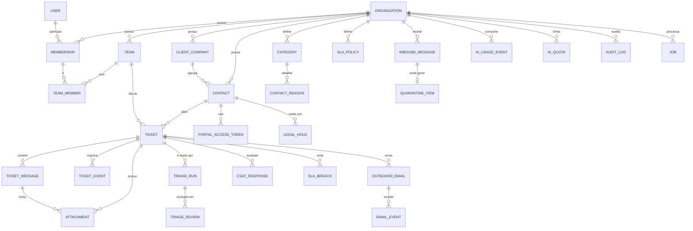

# Customer Voice AI — Modelo de Dados

| Item | Valor |
| --- | --- |
| Versão | 1.0 — Candidata à homologação |
| Data | 09/11/2026 |
| Banco | PostgreSQL (Neon), região `aws-sa-east-1` (proposta) |
| Status | **Proposta.** Depende da ADR-002 (aprovada com condições) e da ADR-003 (pendente de validação). Nenhuma migration foi gerada |

## 1. Convenções

| Convenção | Definição |
| --- | --- |
| Identificadores | `uuid` gerado pela aplicação (UUIDv7, ordenável por tempo; proposta) |
| Tabelas de tenant | Coluna `organization_id uuid NOT NULL`, chave única `(organization_id, id)` e RLS com `FORCE` |
| Referências entre tabelas de tenant | **FK composta** `(organization_id, x_id) → tabela(organization_id, id)`, para impedir referência cruzada no próprio banco (PoC T5) |
| Tabelas de plataforma | Sem `organization_id`. Acessadas só por módulos de plataforma, com papel e políticas específicos |
| Tempo | `timestamptz` em UTC. O fuso da organização é aplicado na apresentação e no cálculo de SLA |
| E-mails | `citext`, ou texto normalizado em minúsculas com índice único |
| Enums | Tipos enum do PostgreSQL ou `CHECK`, a definir na implementação |
| Exclusão | Não há `DELETE` físico em dados de atendimento. Anonimização conforme PRD 10.5. Exclusão física apenas no encerramento da organização e na expiração de exportações, logs e quarentena |
| Nomes | `snake_case` no banco, com mapeamento no ORM |

## 2. Modelo conceitual

## 3. Modelo lógico

### 3.1 Identidade e organização

| Tabela | Escopo | Colunas principais | Chaves e restrições |
| --- | --- | --- | --- |
| `users`, `sessions`, `accounts`, `verifications`, `two_factors` | Plataforma (gerenciadas pelo Better Auth, nomes mapeáveis) | Conforme a biblioteca | Sem RLS de tenant. Acesso restrito ao módulo `identity` |
| `platform_admins` | Plataforma | `user_id`, `created_at` | PK `user_id`. MFA obrigatório verificado no acesso a `/admin` |
| `organization_invitations` | Plataforma | `id`, `email`, `token_hash`, `expires_at`, `used_at`, `created_by` | `token_hash` único. Uso único (RF-ORG-01) |
| `organizations` | Tenant (raiz) | `id`, `slug`, `name`, `timezone`, `ticket_prefix`, `ticket_seq`, `status` (active/suspended), `ai_enabled`, `retention_days`, `plan_code` (nulo na v1.0), `created_at` | `slug` único. Política: `id = app_current_org()` |
| `memberships` | Tenant | `organization_id`, `id`, `user_id`, `role` (admin/manager/agent), `executive_read`, `status`, `created_at` | Único `(organization_id, user_id)`. A consulta pré-contexto (“de quais organizações sou membro?”) usa a política de leitura `own_memberships_read` com `app.user_id` local à transação (I-0; substitui a função `SECURITY DEFINER`, que o `FORCE RLS` também filtraria) |
| `user_invitations` | Tenant | `organization_id`, `id`, `email`, `role`, `team_ids`, `token_hash`, `expires_at`, `accepted_at`, `created_by` | `token_hash` único. Único parcial `(organization_id, email)` para convites pendentes |
| `teams` | Tenant | `organization_id`, `id`, `name`, `archived_at` | Único `(organization_id, id)` |
| `team_members` | Tenant | `organization_id`, `team_id`, `membership_id` | PK `(organization_id, team_id, membership_id)`. FKs compostas |
| `onboarding_checklist` | Tenant | `organization_id`, `item`, `completed_at` | PK `(organization_id, item)` (RF-ORG-11) |

### 3.2 Configuração de atendimento

| Tabela | Colunas principais | Chaves e restrições |
| --- | --- | --- |
| `categories` | `organization_id`, `id`, `name`, `active` | Desativação, nunca exclusão (RN-12) |
| `contact_reasons` | `organization_id`, `id`, `category_id`, `name`, `active` | FK composta para `categories` |
| `priority_rules` | `organization_id`, `id`, `match_type` (category/reason), `match_id`, `priority`, `active` | RN-10, regra (1) |
| `sla_policies` | `organization_id`, `priority`, `first_response_minutes`, `resolution_minutes`, `business_hours` | PK `(organization_id, priority)`. `CHECK` de minutos > 0 |
| `business_hours` | `organization_id`, `weekday`, `start_time`, `end_time` | PK `(organization_id, weekday, start_time)` |
| `holidays` | `organization_id`, `date`, `name` | PK `(organization_id, date)` |

### 3.3 Clientes

| Tabela | Colunas principais | Chaves e restrições |
| --- | --- | --- |
| `client_companies` | `organization_id`, `id`, `name`, `email_domain`, `anonymized_at` | — |
| `contacts` | `organization_id`, `id`, `name`, `email`, `phone`, `client_company_id`, `pseudonym_code`, `anonymized_at`, `created_at` | Único parcial `(organization_id, email) WHERE anonymized_at IS NULL` (RF-CLI-01, CA-19.2). FK composta para `client_companies` |
| `legal_holds` | `organization_id`, `id`, `target_type` (contact/ticket), `target_id`, `reason`, `review_at`, `created_by`, `released_at`, `released_by` | Índice `(organization_id, target_type, target_id) WHERE released_at IS NULL` (RF-CLI-06) |
| `anonymization_records` | `organization_id`, `id`, `pseudonym_code`, `scope`, `requested_by`, `executed_at`, `receipt` | **Sem dados pessoais.** Base para reaplicar anonimizações após restauração (RN-36) |
| `exports` | `organization_id`, `id`, `contact_id`, `storage_key`, `status`, `expires_at`, `created_by` | Expiração conforme DP-17 |

### 3.4 Chamados

| Tabela | Colunas principais | Chaves e restrições |
| --- | --- | --- |
| `tickets` | `organization_id`, `id`, `number`, `contact_id`, `subject`, `description`, `channel` (portal/email/manual), `type`, `category_id`, `reason_id`, `priority`, `status`, `team_id`, `assignee_membership_id`, `escalation_risk`, `sentiment`, `triage_state` (pending/suggested/reviewed/unavailable), `parent_ticket_id`, `cancel_reason`, `reply_token_hash`, `first_response_due_at`, `resolution_due_at`, `first_responded_at`, `resolved_at`, `closed_at`, `sla_paused_since`, `sla_paused_seconds`, `resolution_seq`, `created_at`, `updated_at` | Único `(organization_id, number)` (RN-01; número obtido de `organizations.ticket_seq` com bloqueio de linha). `reply_token_hash` único. FKs compostas para contato, equipe, categoria, motivo, responsável e chamado-pai. `CHECK` de status e transições validado na aplicação (RN-05) |
| `ticket_messages` | `organization_id`, `id`, `ticket_id`, `kind` (customer_message/public_reply/internal_note/system), `author_membership_id`, `author_contact_id`, `body_text`, `body_html_sanitized`, `source` (portal/email/app), `email_message_id`, `unverified_sender`, `created_at` | `CHECK`: exatamente um autor (membro, contato ou sistema). `internal_note` nunca é exposta ao portal |
| `ticket_events` | `organization_id`, `id`, `ticket_id`, `type`, `actor_type`, `actor_id`, `data` (jsonb, sem conteúdo pessoal), `created_at` | Linha do tempo (RF-ATD-05). Somente inserção |
| `csat_responses` | `organization_id`, `id`, `ticket_id`, `resolution_seq`, `score`, `comment`, `created_at` | Único `(organization_id, ticket_id, resolution_seq)`. `CHECK score BETWEEN 1 AND 5` (CA-13.1) |
| `sla_breaches` | `organization_id`, `id`, `ticket_id`, `target` (first_response/resolution), `due_at`, `breached_at` | Único `(organization_id, ticket_id, target, due_at)`. Somente inserção (RF-SLA-05, CA-12.5) |
| `sla_alerts` | `organization_id`, `ticket_id`, `target`, `kind` (risk/breach), `due_at`, `created_at` | PK `(organization_id, ticket_id, target, kind, due_at)`: alerta único (CA-12.2) |
| `notifications` | `organization_id`, `id`, `membership_id`, `type`, `ticket_id`, `read_at`, `created_at` | Alertas in-app |

### 3.5 Anexos

| Tabela | Colunas principais | Chaves e restrições |
| --- | --- | --- |
| `attachments` | `organization_id`, `id`, `ticket_id`, `message_id`, `storage_key` (`quarantine/{orgId}/{id}` → `released/{orgId}/{id}`), `original_name_sanitized`, `declared_type`, `detected_type`, `size_bytes`, `status` (pending/released/quarantined/rejected/deleted), `sanitizer` (método de CDR aplicado), `sanitize_reason`, `scan_status` (`not_scanned` enquanto não houver scanner aprovado), `sha256`, `processed_at`, `created_at` | `storage_key` único. `CHECK size_bytes <= limite`. Download permitido só com `status = 'released'` (RSG-19) |

### 3.6 Triagem e consumo de IA

| Tabela | Colunas principais | Chaves e restrições |
| --- | --- | --- |
| `triage_runs` | `organization_id`, `id`, `ticket_id`, `idempotency_key`, `model`, `prompt_version`, `status` (pending/succeeded/failed/skipped), `result` (jsonb validado), `error_code`, `forced`, `forced_reason`, `forced_by`, `input_tokens`, `output_tokens`, `thought_tokens`, `latency_ms`, `created_at` | Único parcial `(organization_id, ticket_id, idempotency_key) WHERE forced = false` (RIA-06). `CHECK (forced = false OR forced_reason IS NOT NULL)` (RF-TRI-08) |
| `triage_reviews` | `organization_id`, `id`, `triage_run_id`, `field`, `suggested_value`, `final_value`, `outcome` (accepted/changed/pending), `reviewer_membership_id`, `reviewed_at` | Único `(organization_id, triage_run_id, field)` (RN-11) |
| `ai_usage_events` | `organization_id`, `id`, `feature`, `model`, `triage_run_id`, `input_tokens`, `output_tokens`, `thought_tokens`, `cost_usd_micros`, `price_version`, `latency_ms`, `outcome`, `created_at` | Somente inserção (RF-CON-01) |
| `ai_quotas` | `organization_id`, `period` (AAAA-MM), `limit_ops`, `used_ops`, `alerted_80_at`, `alerted_100_at` | PK `(organization_id, period)`. Reserva atômica `UPDATE … WHERE used_ops < limit_ops` (RF-CON-02, 03) |
| `platform_ai_budget` | `period`, `limit_usd_micros`, `spent_usd_micros`, `tripped_at` | Plataforma (RF-CON-04) |

### 3.7 E-mail e portal

| Tabela | Colunas principais | Chaves e restrições |
| --- | --- | --- |
| `inbound_messages` | `organization_id`, `id`, `provider_email_id`, `message_id`, `from_address`, `to_addresses`, `received_for`, `subject`, `auth_spf`, `auth_dkim`, `auth_dmarc`, `classification` (new_ticket/associated/automated/quarantined/duplicate/rejected), `reason`, `ticket_id`, `created_at` | Único `provider_email_id` (idempotência do webhook). Índice `(organization_id, message_id)` (RN-18). Destinatário sem organização é descartado e registrado em `operational_events` |
| `quarantine_items` | `organization_id`, `id`, `inbound_message_id`, `reason`, `status` (pending/associated/new_ticket/discarded), `decided_by`, `decided_at`, `justification` | `CHECK (status = 'pending' OR justification IS NOT NULL)` (RF-EML-08) |
| `outbound_emails` | `organization_id`, `id`, `ticket_id`, `message_id` (mensagem do chamado; I-3), `template`, `to_address`, `rfc_message_id` (Message-ID gerado pela plataforma; no I-3 a coluna recebeu esse nome), `provider_email_id`, `idempotency_key`, `status` (queued/sent/delivered/delayed/bounced/complained/failed), `created_at`, `updated_at` | Único `idempotency_key`. `rfc_message_id` é só interno e de auditoria: o provedor substitui o `Message-ID` na entrega (PoC 3), e a correlação de respostas usa apenas o token `r+` (ADR-007) |
| `email_events` | `organization_id`, `id`, `outbound_email_id`, `provider_event_id`, `type`, `occurred_at` | Único `provider_event_id` (RF-EML-07) |
| `portal_access_tokens` | `organization_id`, `id`, `contact_id`, `ticket_id`, `kind` (magic_link/tracking), `token_hash`, `expires_at`, `used_at`, `revoked_at` | `token_hash` único. Link mágico de uso único (RSG-06) |
| `portal_sessions` | `organization_id`, `id`, `contact_id`, `session_hash`, `expires_at`, `revoked_at` | `session_hash` único |

### 3.8 Operação e auditoria

| Tabela | Escopo | Colunas principais | Chaves e restrições |
| --- | --- | --- | --- |
| `audit_logs` | Tenant (`organization_id` nulo para eventos de plataforma) | `id`, `organization_id`, `actor_type` (user/superadmin/contact/system), `actor_id`, `action`, `target_type`, `target_id`, `details` (jsonb mascarado), `ip_hash`, `request_id`, `created_at` | **Somente inserção:** o runtime recebe apenas `INSERT`/`SELECT`, e um trigger rejeita `UPDATE`/`DELETE` (RF-AUD-03). A exceção é a pseudonimização na anonimização, feita pelo papel de sistema com evento próprio (DP-16) |
| `jobs` | Tenant ou plataforma | `id`, `organization_id`, `type`, `payload` (somente IDs), `idempotency_key`, `status`, `attempts`, `max_attempts`, `run_after`, `locked_until`, `last_error`, `created_at`, `updated_at` | Único `(type, idempotency_key)`. Índice `(status, run_after)` |
| `operational_events` | Plataforma | `id`, `organization_id`, `level`, `type`, `data`, `created_at` | Retenção conforme DP-17 (ADR-010) |
| `rate_limit_counters` | Plataforma | `key`, `window_start`, `count` | PK `(key, window_start)`. Limpeza periódica |

## 4. Índices principais

| Tabela | Índice | Uso |
| --- | --- | --- |
| `tickets` | `(organization_id, status, priority, created_at DESC)` | Listagem e filtros (RNF-01) |
| `tickets` | `(organization_id, team_id, assignee_membership_id, status)` | “Meus chamados”, “Minha equipe sem responsável” |
| `tickets` | `(organization_id, first_response_due_at) WHERE first_responded_at IS NULL AND status NOT IN (…)` | SLA em risco; cron de SLA |
| `tickets` | `(organization_id, resolution_due_at) WHERE resolved_at IS NULL AND status NOT IN (…)` | Idem |
| `tickets` | `(organization_id, triage_state) WHERE triage_state = 'suggested'` | “Aguardando revisão da triagem” |
| `tickets` | `(organization_id, contact_id, created_at DESC)` | Perfil do contato |
| `tickets` | GIN de busca textual em `subject` e `description` (config `portuguese`) | RF-ATD-11. Alternativa: `pg_trgm` |
| `contacts` | `(organization_id, lower(email))`, GIN trigram em `name` | Busca por contato |
| `ticket_messages` | `(organization_id, ticket_id, created_at)` | Linha do tempo |
| `ticket_events` | `(organization_id, ticket_id, created_at)` | Linha do tempo |
| `triage_reviews` | `(organization_id, reviewed_at)` | Taxa de aceitação (RN-13) |
| `ai_usage_events` | `(organization_id, created_at)` | Consumo mensal |
| `audit_logs` | `(organization_id, created_at DESC)`, `(organization_id, action)` | Consulta de auditoria |
| `jobs` | `(status, run_after)`, `(status, locked_until)` | Varredor |

Os indicadores do dashboard (RN-40 a RN-45) são consultas agregadas sobre `tickets`, `sla_breaches`, `csat_responses` e `triage_reviews`. Visões materializadas só serão adotadas se o RNF-04 não for atingido.

## 5. Estratégia multi-tenant no modelo

1. **RLS em todas as tabelas de tenant:** `ENABLE` + `FORCE`, política `organization_id = app_current_org()` com `USING` e `WITH CHECK`.
2. **`app_current_org()`** retorna `NULLIF(current_setting('app.org_id', true), '')::uuid` (achado T6b da PoC).
3. **Papéis:**

| Papel | Uso | Privilégios |
| --- | --- | --- |
| `app_migrator` | Migrations no CI (conexão direta) | Dono do schema |
| `app_runtime` | Aplicação (conexão pooled) | DML nas tabelas de tenant, sem `BYPASSRLS`. Sem `UPDATE`/`DELETE` em `audit_logs`, `ai_usage_events`, `sla_breaches`, `ticket_events` |
| `app_system` | Jobs entre organizações (varredor, cron de SLA, teto global, expiração) | Políticas explícitas por tabela. Uso restrito aos módulos `jobs`, `sla` e `usage`. Mesmo esses jobs, quando processam dados de um tenant, mudam para `withTenant(orgId)` |

4. **FKs compostas** em todas as referências entre tabelas de tenant.
5. **Tabelas de plataforma** (identidade, convites de organização, orçamento global, contadores, eventos operacionais) ficam fora do RLS de tenant e só são acessíveis por módulos de plataforma, verificados por revisão e lint.

## 6. Política de exclusão, anonimização e retenção

Conforme PRD 10.5 (RN-30 a RN-36). Os prazos dependem de DP-11, DP-16 e DP-17.

| Dados | Retenção | Na anonimização do contato | No encerramento da organização |
| --- | --- | --- | --- |
| `contacts` | Configurável (DP-11) | Nome, e-mail e telefone excluídos; `pseudonym_code` aleatório; vínculo com empresa removido | Exclusão física após o prazo contratual (RSG-25) |
| `tickets.subject/description`, `ticket_messages.body_*`, `inbound_messages` (assunto e corpo) | Configurável (DP-11) | Substituídos por marcador | Exclusão física |
| `ticket_events`, datas, status, SLA | Configurável | Mantidos (sem dados pessoais) | Exclusão física |
| `triage_runs.result` | Configurável | Campos estruturados mantidos; justificativa removida | Exclusão física |
| `attachments` | Configurável | Objeto excluído; metadados reduzidos a tipo e tamanho | Exclusão física |
| `csat_responses` | Configurável | Nota mantida; comentário removido | Exclusão física |
| `audit_logs` | DP-17 (proposta de 12 meses) | Referências pseudonimizadas; detalhes mascarados | Mantidos pelo prazo de DP-17 e depois excluídos (DP-16) |
| `quarantine_items` | DP-17 (proposta de 30 dias) | Excluídos | Exclusão física |
| `exports` | DP-17 (proposta de 7 dias) | Excluídos | Exclusão física |
| `operational_events` e logs | DP-17 (proposta de 30 dias) | Não editados (não devem conter dados pessoais) | Expiram |
| `portal_access_tokens`, `portal_sessions` | Até expirar + 30 dias | Revogados e excluídos | Exclusão física |
| Backups (Neon) | Janela de restauração do plano (7 dias no Launch) | Não alterados; reaplicação via `anonymization_records` (RN-36) | Expiram com a janela |

A anonimização é um job (`anonymize`) que roda sob `withTenant`, verifica retenção legal (RN-34), aplica todas as alterações em uma transação, remove os objetos de armazenamento depois do commit e grava `anonymization_records` e o evento de auditoria.
