# Manual do Usuário — VoxDesk AI

**Versão 1.1 · Novembro de 2026 · Uma solução Orizon**

Este manual explica, passo a passo, como usar o VoxDesk AI no dia a dia do atendimento. Ele descreve somente as funcionalidades disponíveis na versão publicada da plataforma.

> **Sobre as imagens:** todas as telas deste manual foram capturadas da aplicação real, usando a empresa fictícia "Casa Aurora Utilidades". Nomes, e-mails, telefones e pedidos são inventados.

## Sumário

1. Apresentação do VoxDesk AI
2. Primeiro acesso e autenticação
3. Seleção de organização
4. Navegação pelo sistema
5. Dashboard e indicadores
6. Contatos e empresas-cliente
7. Criação e gerenciamento de chamados
8. Respostas públicas e notas internas
9. Anexos
10. Status, prioridades e atribuições
11. Triagem inteligente com Gemini
12. Sugestão de respostas com IA
13. Revisão humana das sugestões
14. Equipes e permissões
15. Configurações
16. Boas práticas
17. Perguntas frequentes
18. Glossário

## 1. Apresentação do VoxDesk AI

O VoxDesk AI é uma central de atendimento ao cliente para pequenas e médias empresas. Ele reúne em um só lugar os chamados recebidos pelo portal do cliente, por e-mail ou registrados pela equipe, com prazos de atendimento (SLA), histórico completo e indicadores.

A plataforma conta com recursos de inteligência artificial (IA), baseados no Google Gemini, que ajudam a equipe a classificar os chamados e a redigir respostas. A IA sempre trabalha como apoio: as sugestões precisam ser revisadas por uma pessoa, e nenhuma mensagem é enviada ao cliente sem a ação de um atendente.

### 1.1 Principais recursos

- **Chamados:** registro, acompanhamento, atribuição a equipes e responsáveis, status e prioridades.
- **Conversa com o cliente:** respostas públicas (enviadas por e-mail e visíveis no portal) e notas internas (visíveis só para a equipe).
- **Anexos:** envio de imagens, PDFs e arquivos de texto, com verificação de segurança.
- **SLA:** metas de primeira resposta e de resolução por prioridade, com aviso de prazo em risco.
- **Contatos e empresas-cliente:** cadastro dos clientes atendidos e histórico de chamados de cada um.
- **Dashboard:** indicadores de volume, prazos, satisfação (CSAT) e uso da IA.
- **Triagem inteligente:** a IA sugere tipo, categoria, motivo, prioridade, urgência, sentimento e risco de escalada.
- **Sugestão de resposta:** a IA redige um rascunho de resposta para o atendente revisar e editar.

### 1.2 Perfis de acesso

Cada pessoa da equipe tem um perfil em cada organização. O perfil define o que ela vê e pode fazer.

| Perfil | Para quem é | Resumo do acesso |
| --- | --- | --- |
| Atendente | Quem responde aos clientes | Chamados, contatos e alertas. Assume chamados das suas equipes. |
| Gestor | Quem coordena a operação | Tudo do Atendente, mais atribuição de chamados, dashboard, quarentena de e-mails e reprocessamento da triagem. |
| Administrador | Quem configura a organização | Acesso completo, incluindo membros, equipes, auditoria e configurações. |

A tabela completa de permissões está no capítulo 14.

### 1.3 Requisitos

- Um navegador atualizado (Microsoft Edge, Google Chrome, Mozilla Firefox ou Safari).
- Conexão com a internet.
- Um convite enviado pelo administrador da sua organização.

A interface também funciona em celulares e tablets: o menu lateral vira um botão de menu no topo da tela.

## 2. Primeiro acesso e autenticação

O acesso ao VoxDesk AI é feito somente por convite. Não existe cadastro aberto.

### 2.1 Aceitar o convite

1. Abra o e-mail de convite enviado pelo administrador da sua organização e clique no link.
2. A tela **Convite para a equipe** mostra a organização e o perfil para o qual você foi convidado.
3. Se você ainda não tem conta, preencha seus dados e crie uma senha com **no mínimo 12 caracteres**. Clique em **Criar conta e aceitar**.
4. Se você já tem conta no VoxDesk AI, clique em **Entre para aceitar**, faça login e depois clique em **Aceitar convite**.

> **Atenção:** o convite vale por 7 dias e só pode ser aceito com o mesmo e-mail para o qual foi enviado. Se expirar, peça um novo ao administrador.

### 2.2 Criar a organização da sua empresa

Esta seção é para quem recebeu da Orizon o convite para **criar uma organização** no VoxDesk AI. Quem cria a organização se torna o seu Administrador.

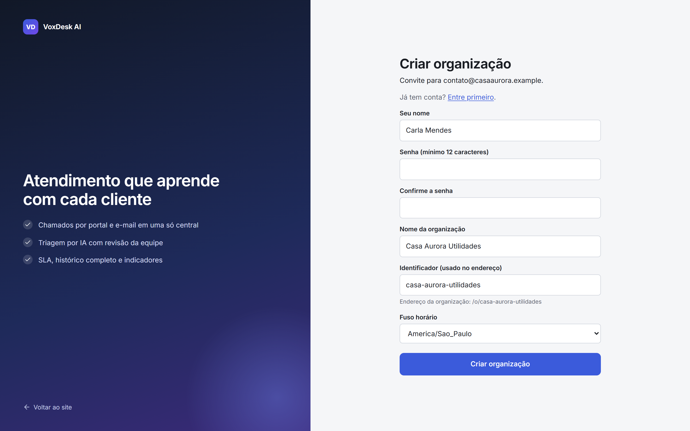

1. Abra o e-mail **Convite para criar sua organização no VoxDesk AI** e clique no link.
2. Se você ainda não tem conta, preencha **Seu nome** e crie uma senha com **no mínimo 12 caracteres**. Se já tem conta, clique em **Entre primeiro** e faça login com o mesmo e-mail do convite.
3. Em **Nome da organização**, digite o nome da empresa como ele deve aparecer na plataforma (por exemplo, "Casa Aurora Utilidades").
4. O campo **Identificador (usado no endereço)** é preenchido automaticamente a partir do nome: letras minúsculas, sem acentos e com hífens no lugar dos espaços (por exemplo, `casa-aurora-utilidades`). Logo abaixo aparece o endereço da organização.
5. Se quiser, edite o identificador. Depois de editado, ele não muda mais quando você altera o nome. Use de 3 a 48 caracteres: letras sem acento, números e hífens.
6. Escolha o **Fuso horário** e clique em **Criar organização**.

> **Atenção:** o identificador precisa ser único. Se ele já estiver em uso por outra organização, a tela avisa e mantém os dados preenchidos para você escolher outro, por exemplo acrescentando a cidade ou o segmento. O nome da organização pode ser alterado depois em **Configurações**; o identificador, não.

### 2.3 Entrar na plataforma

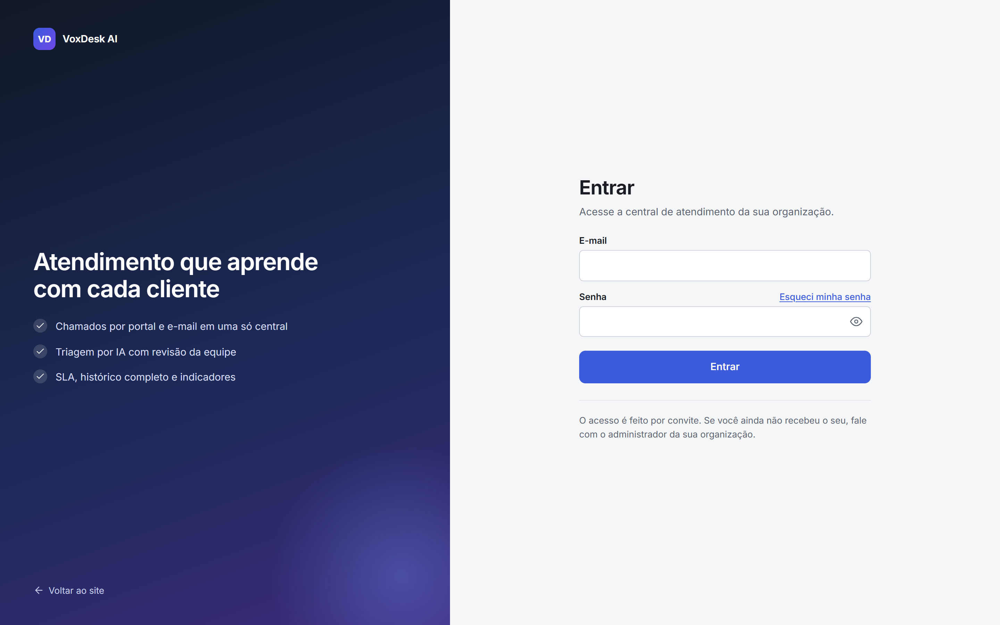

1. Acesse o endereço do VoxDesk AI informado pela sua empresa.
2. Informe seu **E-mail** e sua **Senha**. O ícone de olho mostra ou oculta a senha digitada.
3. Clique em **Entrar**.

Se a verificação em duas etapas estiver ativada na sua conta, a tela seguinte pede o **código de 6 dígitos** do seu aplicativo autenticador (veja a seção 2.5).

Se você perdeu o acesso ao aplicativo, clique em **Perdeu o acesso ao aplicativo? Usar um código de recuperação** e digite um dos códigos de recuperação que você guardou. Cada código vale uma única vez. Para voltar ao código do aplicativo, clique em **Usar o código do aplicativo autenticador**.

### 2.4 Esqueci minha senha

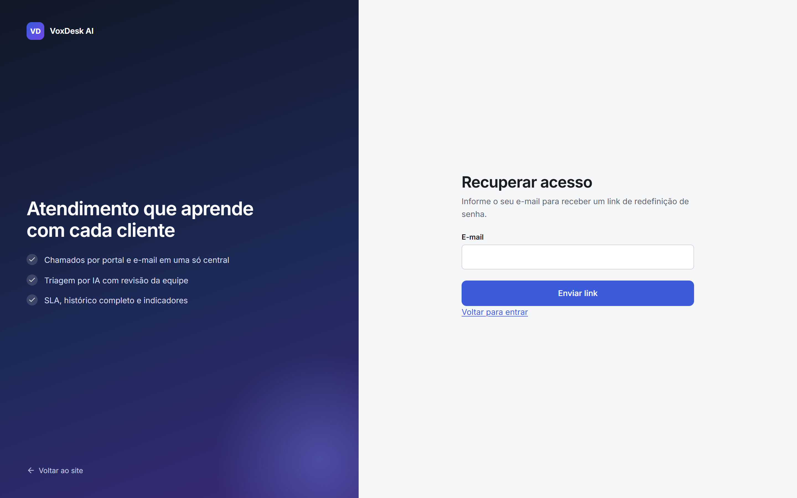

1. Na tela de login, clique em **Esqueci minha senha**.
2. Informe o e-mail da sua conta e confirme.
3. Você receberá um e-mail com um link para criar uma nova senha (mínimo de 12 caracteres).

### 2.5 Segurança da conta e verificação em duas etapas

A página **Segurança da conta** fica no topo da tela de seleção de organização.

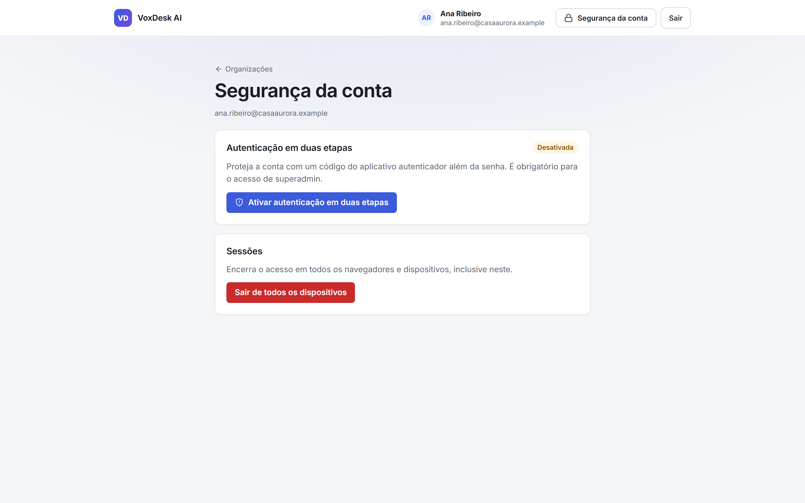

Com a **verificação em duas etapas** ativada, o login passa a pedir, além da senha, um código de 6 dígitos gerado por um aplicativo autenticador no celular (Google Authenticator, Microsoft Authenticator, Authy ou similar).

**Para ativar:**

1. Clique em **Ativar autenticação em duas etapas**, confirme sua senha e clique em **Continuar**.
2. **Leia o QR Code** com o aplicativo autenticador. O aplicativo passa a mostrar a conta "VoxDesk AI" com um código que muda a cada 30 segundos.

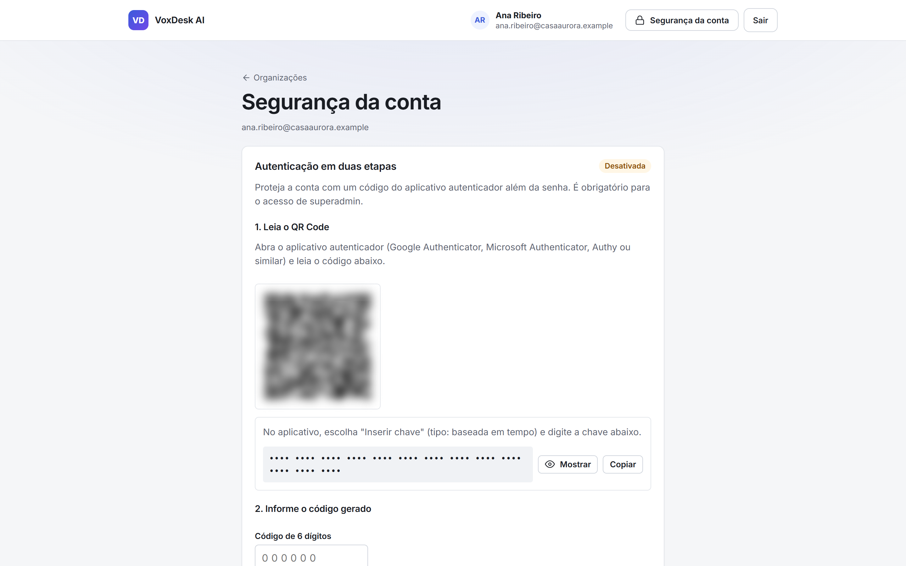

3. Se não conseguir ler o QR Code, clique em **Não consegue ler o QR Code? Inserir chave manualmente**. A chave aparece oculta: use **Mostrar** para vê-la ou **Copiar** para copiá-la e digite-a no aplicativo (opção "Inserir chave", do tipo baseada em tempo).
4. Em **Código de 6 dígitos**, digite o código que aparece no aplicativo e clique em **Confirmar ativação**.
5. Na etapa seguinte, guarde os **códigos de recuperação**. Use **Copiar códigos** ou **Baixar arquivo .txt** e guarde-os em local seguro, como um gerenciador de senhas. Eles são exibidos uma única vez.

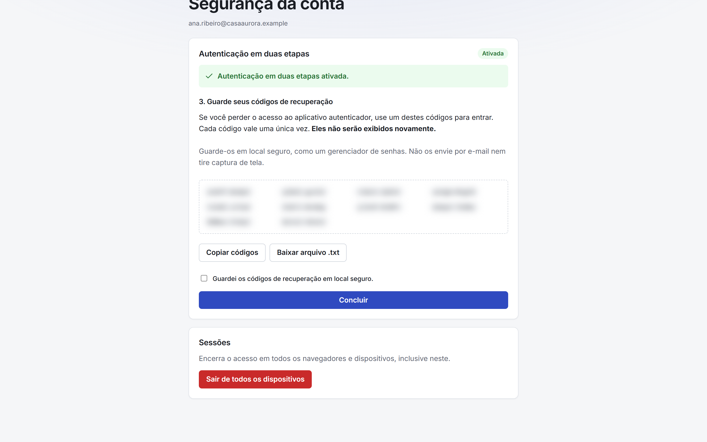

6. Marque **Guardei os códigos de recuperação em local seguro** e clique em **Concluir**. O cartão passa a mostrar **Ativada**.

> **Se o código for recusado:** use o código que aparece no momento (ele muda a cada 30 segundos) e confira se o relógio do celular está no horário automático. Se a tela informar que a configuração expirou, clique em **Recomeçar** e repita a ativação: o novo QR Code substitui o anterior.

> **Segurança:** não tire captura de tela do QR Code, da chave ou dos códigos de recuperação e não os envie por e-mail ou mensagem. Se perder o acesso ao aplicativo autenticador, entre com um código de recuperação (veja a seção 2.3). Se também não tiver os códigos, fale com o administrador da plataforma.

**Sessões:** o botão **Sair de todos os dispositivos** encerra o acesso em todos os navegadores e aparelhos, inclusive no atual. Use se perder um aparelho ou suspeitar de acesso indevido.

> **Recomendação:** ative a verificação em duas etapas, principalmente nos perfis de Gestor e Administrador.

### 2.6 Sair

Para encerrar o acesso, clique em **Sair**, no canto inferior do menu lateral ou no topo da tela de seleção de organização.

## 3. Seleção de organização

Depois do login, a tela **Selecione sua organização** lista as organizações às quais você tem acesso e o seu perfil em cada uma.

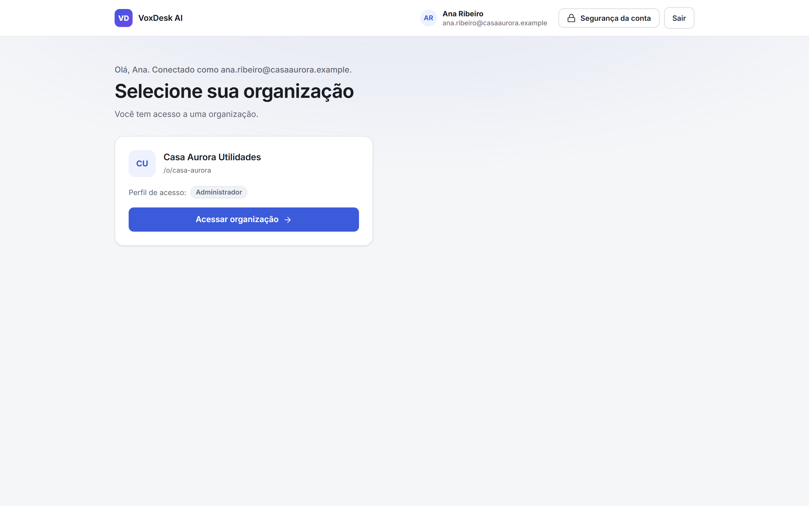

1. Localize o cartão da organização desejada.
2. Confira o **Perfil de acesso** (Administrador, Gestor ou Atendente).
3. Clique em **Acessar organização**.

Para mudar de organização depois, clique em **Trocar organização**, logo abaixo do nome da organização no menu lateral.

Cada organização é completamente separada das demais: chamados, contatos, equipes e configurações de uma organização nunca aparecem em outra.

## 4. Navegação pelo sistema

### 4.1 Estrutura da tela

- **Menu lateral (à esquerda):** mostra a organização atual e as seções do sistema, agrupadas em Atendimento, Análise e Administração. No rodapé ficam o seu nome, o seu perfil e o botão **Sair**.
- **Barra superior:** mostra onde você está (organização / seção) e o seu nome e perfil.
- **Área principal:** o conteúdo da seção escolhida.

O menu exibe apenas as seções permitidas para o seu perfil:

| Administrador | Gestor | Atendente |
| --- | --- | --- |
| 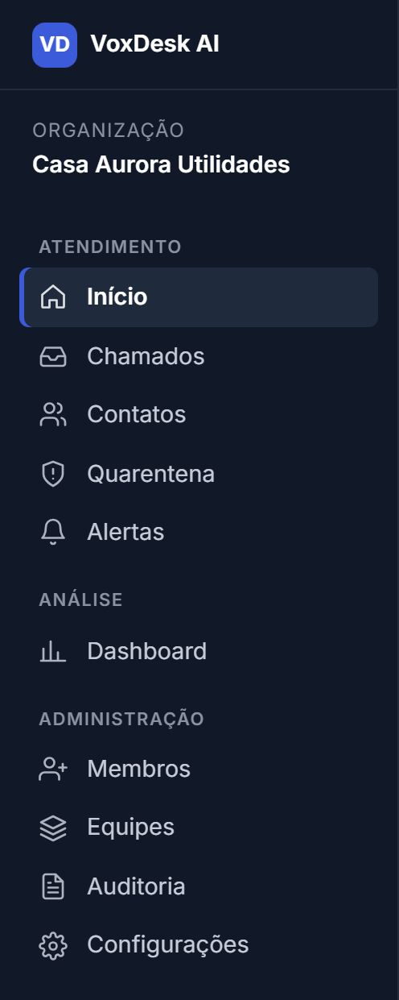 | 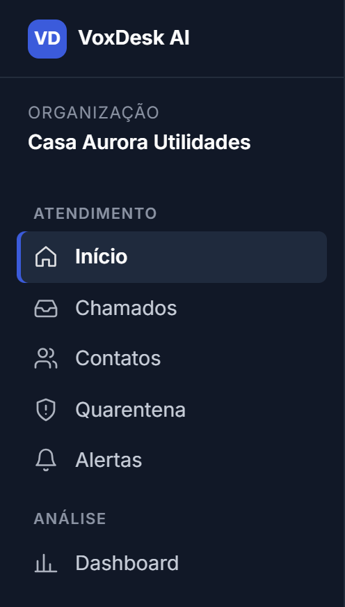 | 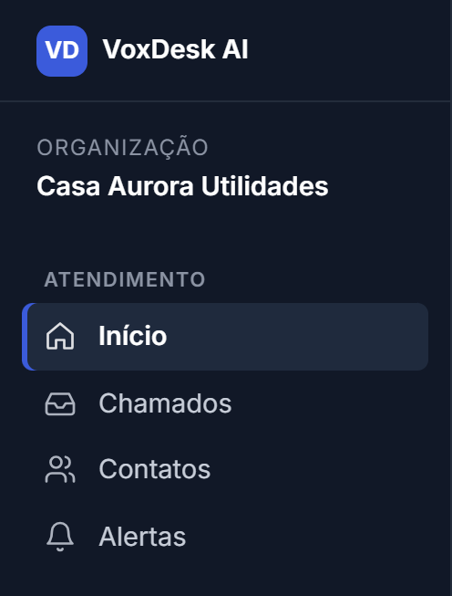 |

### 4.2 Página Início

A página **Início** é o ponto de partida do dia de trabalho.

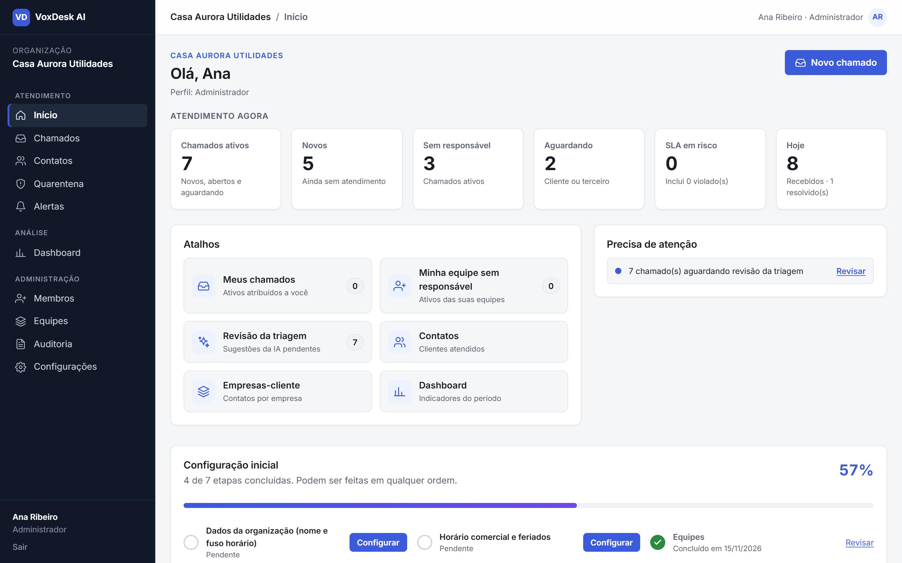

- **Atendimento agora:** indicadores em tempo real. Chamados ativos, Novos (ainda sem atendimento), Sem responsável, Aguardando (cliente ou terceiro), SLA em risco e Hoje (recebidos e resolvidos no dia). Alguns indicadores são clicáveis e abrem a lista de chamados já filtrada.
- **Atalhos:** acesso rápido a Meus chamados, Minha equipe sem responsável, Revisão da triagem, Contatos, Empresas-cliente e, conforme o perfil, Dashboard e Alertas.
- **Precisa de atenção:** pendências que pedem ação, como chamados aguardando revisão da triagem ou chamados da sua equipe sem responsável.
- **Configuração inicial (Administrador):** lista de etapas para deixar a organização pronta para uso, como dados da organização, horário comercial, equipes, categorias, política de SLA, e-mail de entrada e convite da equipe. Cada etapa tem um botão **Configurar** ou **Revisar**.
- **Novo chamado:** botão no canto superior direito para registrar um chamado.

### 4.3 Outras áreas do menu

- **Alertas:** avisos para você, como prazos de SLA e uso da cota de IA.

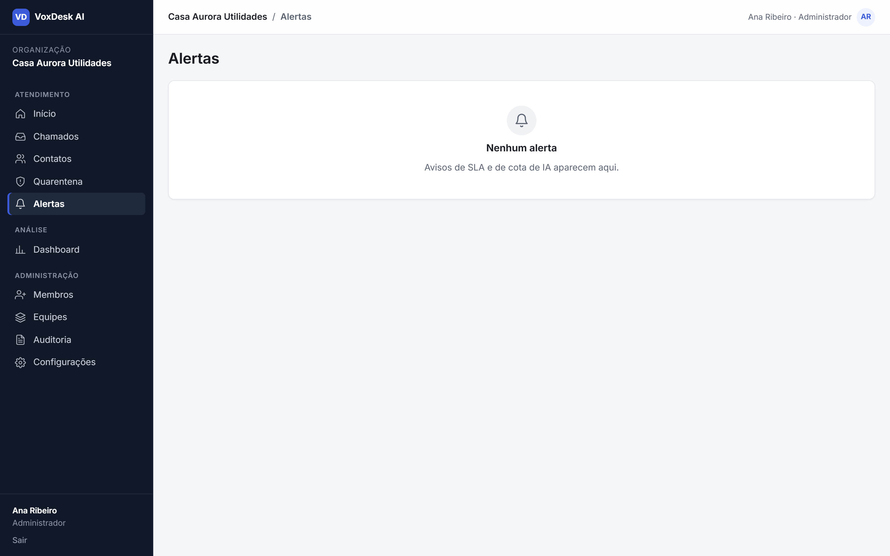

- **Quarentena (Gestor e Administrador):** e-mails recebidos que não passaram na validação de segurança. Eles não aparecem nos chamados nem no portal até que alguém decida o que fazer: associar a um chamado existente, criar um novo chamado ou descartar.
- **Auditoria (Administrador):** registro das últimas ações relevantes realizadas na organização, com data, ação e autor.

### 4.4 Uso no celular

Em telas pequenas, o menu lateral fica recolhido. Toque no botão de menu no topo para abri-lo. As telas se reorganizam em uma coluna, sem rolagem lateral.

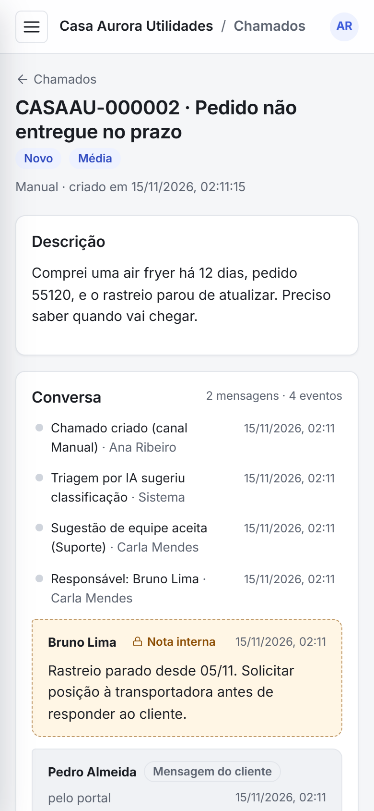

## 5. Dashboard e indicadores

O **Dashboard** reúne os indicadores do atendimento em um período. Está disponível para Gestores e Administradores.

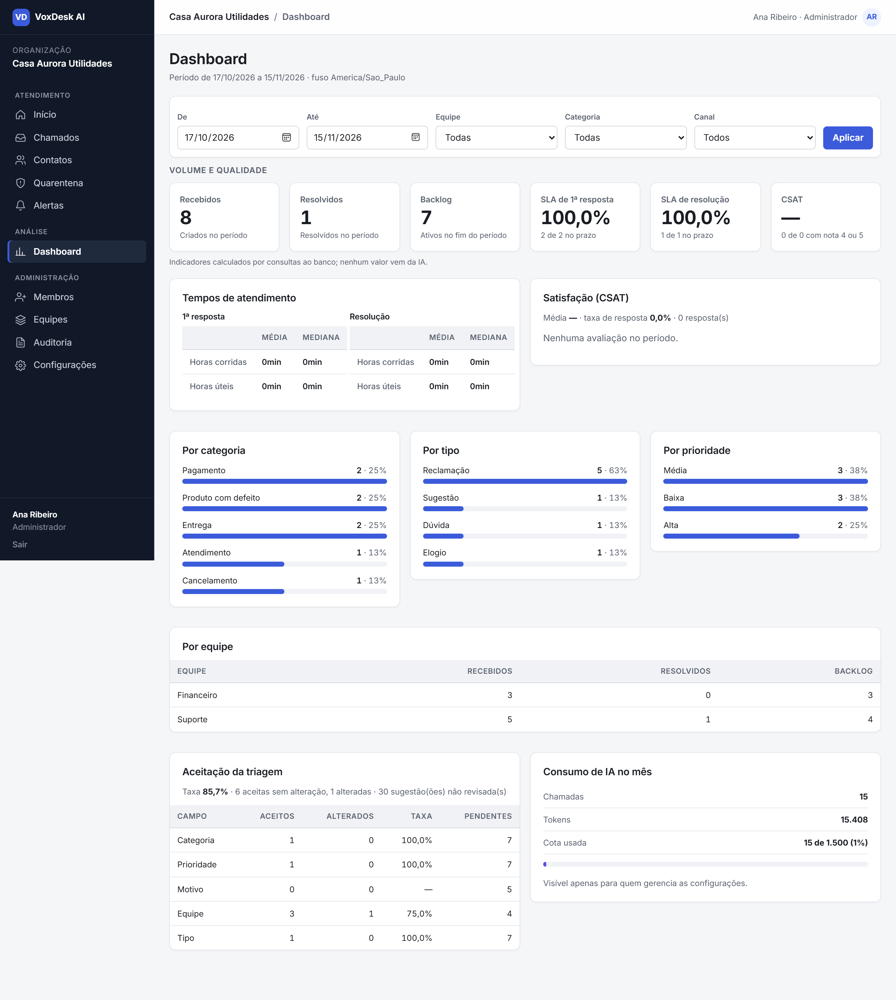

### 5.1 Filtros

No topo, escolha o período (**De** e **Até**) e, se quiser, filtre por **Equipe**, **Categoria** e **Canal** (Portal, E-mail ou Manual). Clique em **Aplicar**. O período padrão são os últimos 30 dias, no fuso horário da organização.

### 5.2 Indicadores

- **Volume e qualidade:** Recebidos (criados no período), Resolvidos, Backlog (ativos no fim do período), SLA de 1ª resposta, SLA de resolução e CSAT (percentual de avaliações com nota 4 ou 5).
- **Tempos de atendimento:** média e mediana da primeira resposta e da resolução, em horas corridas e em horas úteis.
- **Satisfação (CSAT):** média das notas e taxa de resposta das avaliações enviadas aos clientes após a resolução.
- **Por categoria, por tipo e por prioridade:** distribuição dos chamados, com quantidade e percentual.
- **Por equipe:** recebidos, resolvidos e backlog de cada equipe.
- **Aceitação da triagem:** quantas sugestões da IA foram aceitas sem alteração, quantas foram alteradas e quantas ainda aguardam revisão, por campo.
- **Consumo de IA no mês (Administrador):** chamadas, tokens e cota usada.

> **Importante:** todos os números do dashboard são calculados a partir dos registros reais de atendimento da sua organização. Nenhum valor é estimado pela IA.

## 6. Contatos e empresas-cliente

### 6.1 Consultar contatos

Clique em **Contatos** no menu. A lista mostra nome, e-mail, telefone e empresa de cada cliente. Use o campo **Buscar por nome ou e-mail** para localizar alguém.

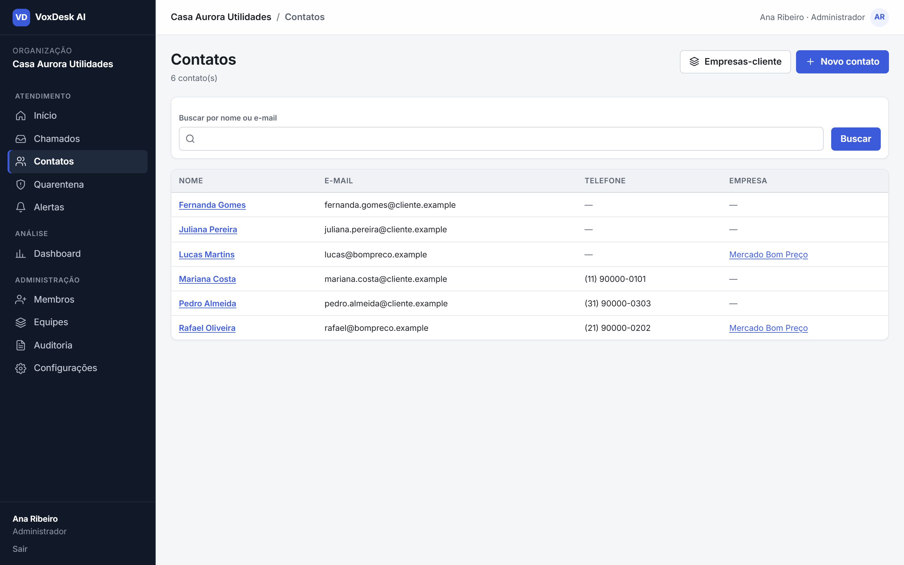

### 6.2 Cadastrar um contato

1. Em **Contatos**, clique em **Novo contato**.
2. Preencha **Nome** e **E-mail** (obrigatórios).
3. Se quiser, informe **Telefone** e vincule uma **Empresa-cliente**.
4. Clique em **Salvar contato**.

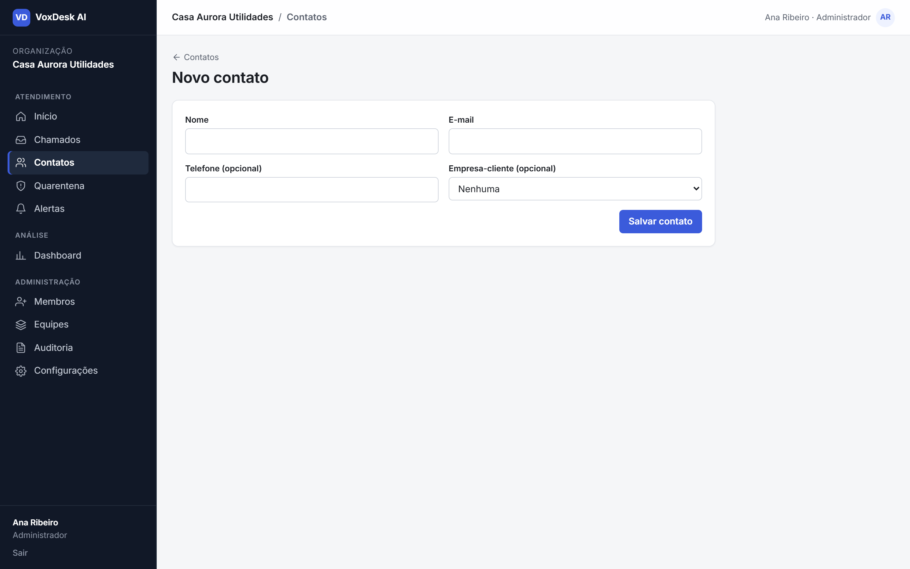

Contatos também são criados automaticamente quando um cliente abre um chamado pelo portal ou por e-mail, e podem ser criados na própria tela de novo chamado (seção 7.1).

### 6.3 Perfil do contato

Clique no nome de um contato para abrir o perfil. Nele você encontra:

- **Histórico de chamados:** todos os chamados do contato, com prioridade e status.
- **Dados do contato:** formulário para corrigir nome, e-mail, telefone e empresa. Clique em **Salvar alterações** para gravar.
- **Novo chamado para este contato:** abre o formulário de chamado já com o contato selecionado.

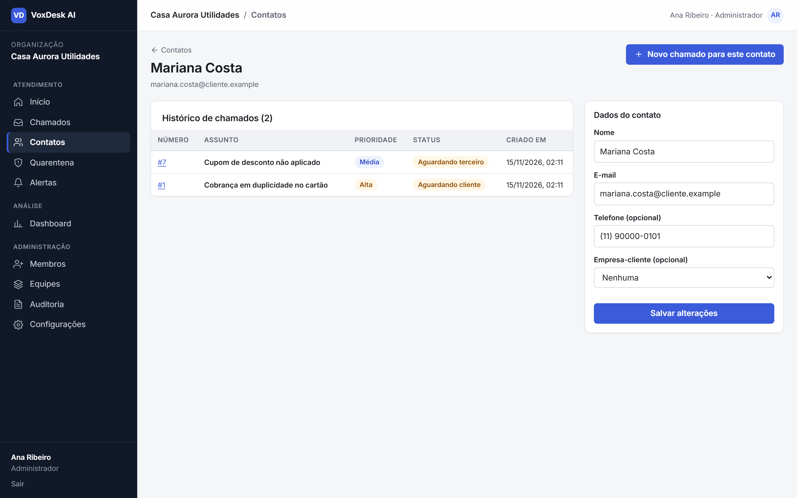

### 6.4 Empresas-cliente

Quando você atende empresas, pode agrupar os contatos por empresa. Em **Contatos**, clique em **Empresas-cliente**.

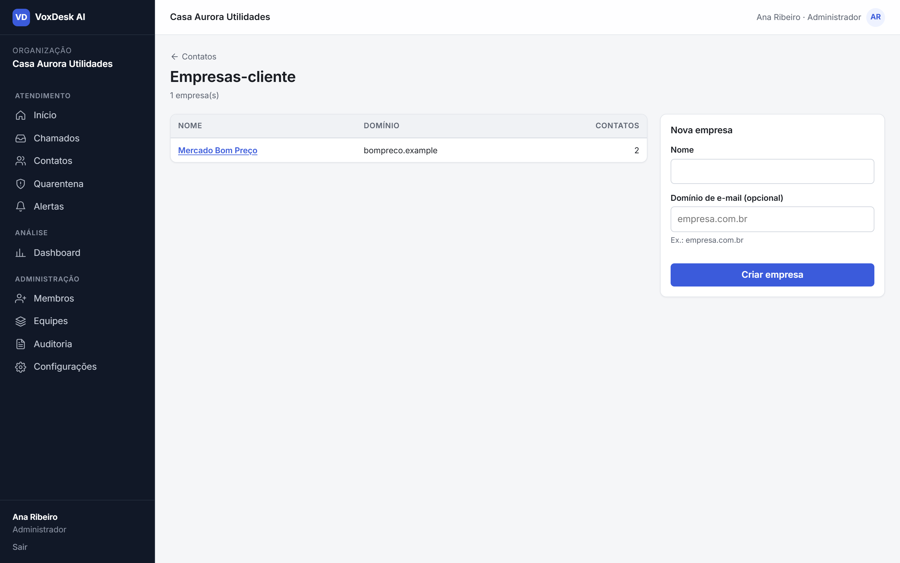

Para cadastrar uma empresa, preencha **Nome** e, se quiser, o **Domínio de e-mail** (por exemplo, empresa.com.br). Depois clique em **Criar empresa**. Contatos vinculados aparecem na contagem da empresa.

## 7. Criação e gerenciamento de chamados

Um chamado representa uma solicitação de um cliente. Cada chamado recebe um protocolo único, formado pelo prefixo da organização e um número (por exemplo, CASAAU-000002).

### 7.1 Criar um chamado

Chamados chegam automaticamente pelo portal do cliente e pelo e-mail de entrada (quando configurado). A equipe também pode registrar chamados recebidos por outros meios, como telefone ou balcão:

1. Clique em **Novo chamado** (na página Início ou na lista de chamados).
2. Selecione o **Contato**. Se o cliente ainda não estiver cadastrado, use **Contato novo?** para cadastrá-lo ali mesmo.
3. Preencha **Assunto** e **Descrição** com as palavras do cliente.
4. Opcionalmente, escolha **Tipo**, **Prioridade** e **Equipe (fila)**. Se deixar em branco, a triagem inteligente pode sugerir esses valores.
5. Clique em **Criar chamado**.

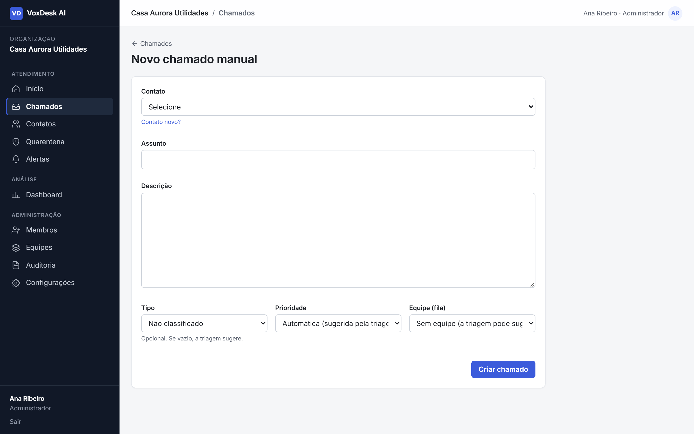

### 7.2 Lista de chamados

Clique em **Chamados** no menu para ver a lista.

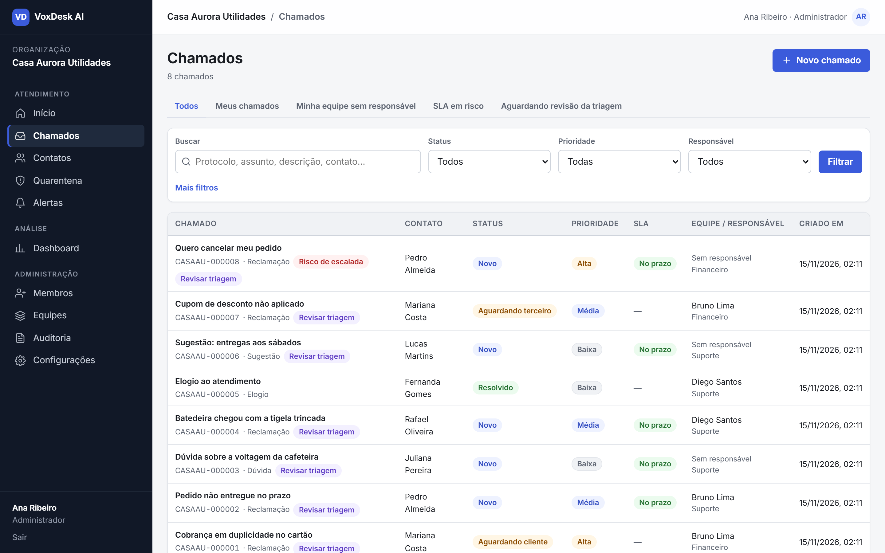

- **Visões rápidas:** Todos, Meus chamados, Minha equipe sem responsável, SLA em risco e Aguardando revisão da triagem.
- **Busca:** por protocolo, assunto, descrição, nome ou e-mail do contato.
- **Filtros:** Status, Prioridade e Responsável. Clique em **Filtrar** para aplicar. **Mais filtros** mostra opções adicionais.
- **Colunas:** chamado (assunto, protocolo e tipo), contato, status, prioridade, situação do SLA, equipe e responsável, e data de criação.
- **Etiquetas:** "Risco de escalada" destaca chamados com sinais de reclamação pública ou cancelamento. "Revisar triagem" indica sugestões da IA ainda não revisadas.

Clique no assunto para abrir o chamado.

### 7.3 Tela do chamado

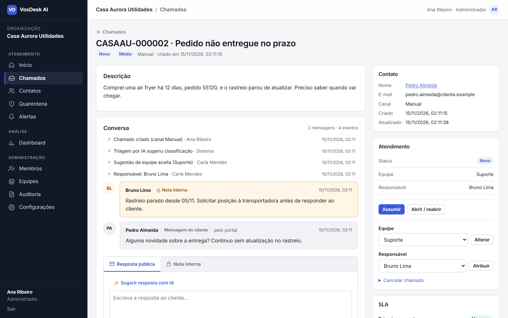

A tela do chamado é dividida em duas colunas:

- **À esquerda:** a **Descrição** original e a **Conversa**, com todas as mensagens e eventos em ordem cronológica. Abaixo da conversa fica o editor para responder ou registrar notas.
- **À direita:** os painéis **Contato**, **Atendimento** (status, equipe e responsável), **SLA** e **Classificação** (triagem por IA).

A conversa registra automaticamente cada evento: criação do chamado, triagem, mudanças de status, atribuições e decisões sobre as sugestões da IA.

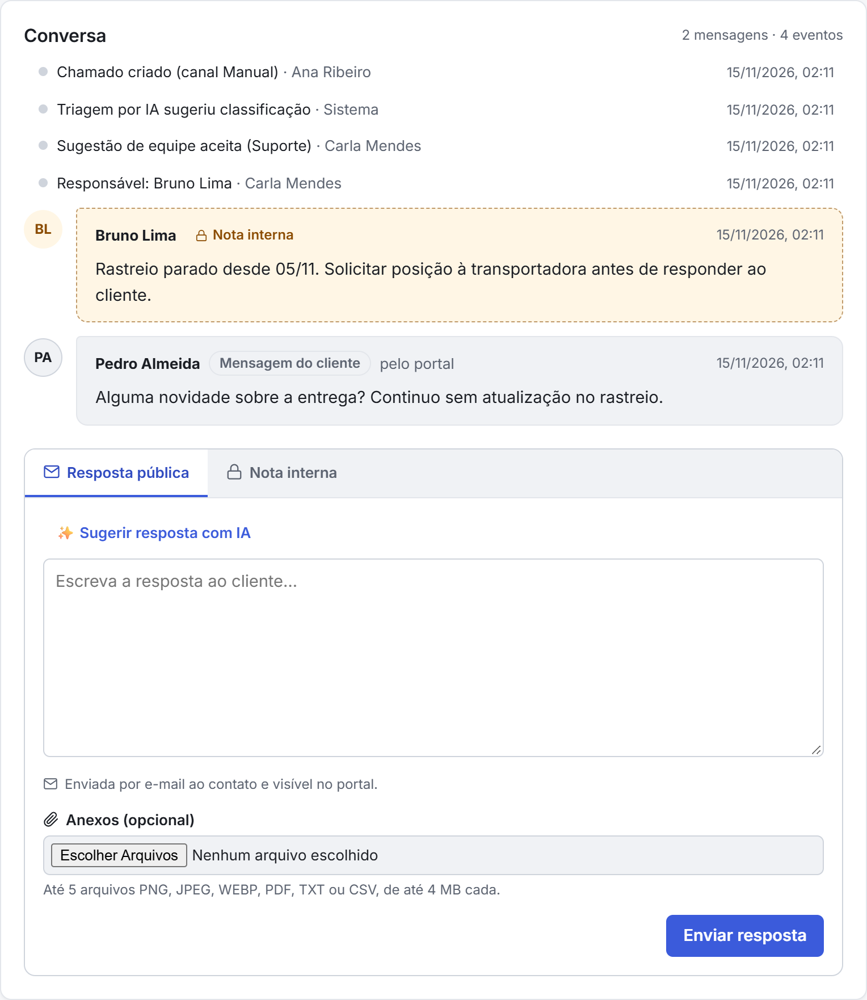

## 8. Respostas públicas e notas internas

O editor, abaixo da conversa, tem duas abas.

| Aba | Quem vê | Quando usar |
| --- | --- | --- |
| **Resposta pública** | O cliente (por e-mail e no portal) e a equipe | Para falar com o cliente. |
| **Nota interna** | Somente a equipe | Para registrar informações, combinados e próximos passos. |

### 8.1 Enviar uma resposta pública

1. Na aba **Resposta pública**, escreva a mensagem.
2. Se precisar, adicione anexos (capítulo 9).
3. Clique em **Enviar resposta**.

A resposta é enviada por e-mail ao contato e fica visível no portal do cliente. Na conversa, a mensagem mostra a situação do e-mail, por exemplo "e-mail enviado". Se o chamado estiver como Novo, ele passa automaticamente para Aberto ao ser respondido.

> **Dica:** o botão **Sugerir resposta com IA** aparece nesta aba quando o recurso está disponível para a sua organização (capítulo 12).

### 8.2 Registrar uma nota interna

1. Clique na aba **Nota interna**.
2. Escreva a nota e, se quiser, anexe arquivos.
3. Clique em **Adicionar nota interna**.

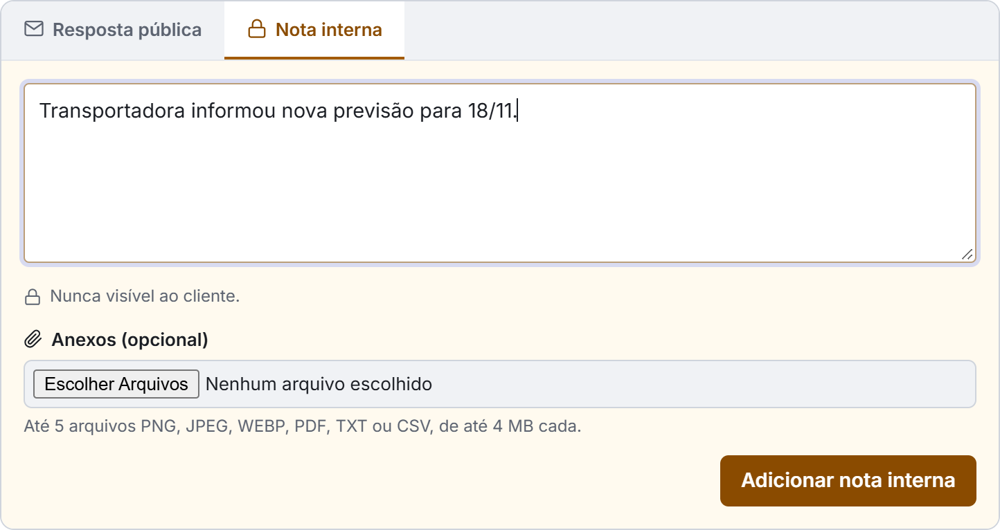

As notas aparecem na conversa com fundo amarelo e o selo "Nota interna". Elas **nunca** são enviadas nem exibidas ao cliente.

### 8.3 Mensagens do cliente

Quando o cliente responde pelo portal ou por e-mail, a mensagem entra na conversa com o selo "Mensagem do cliente" e a origem (por exemplo, "pelo portal"). O cliente acompanha seus chamados pelo portal, onde vê a descrição, as respostas públicas e o status.

## 9. Anexos

Respostas públicas e notas internas aceitam anexos.

- **Formatos aceitos:** PNG, JPEG, WEBP, PDF, TXT e CSV.
- **Limites:** até 5 arquivos por mensagem, com até 4 MB cada.

### 9.1 Anexar arquivos

1. No editor, em **Anexos (opcional)**, clique em **Escolher arquivos**.
2. Selecione um ou mais arquivos.
3. Envie a resposta ou a nota normalmente.

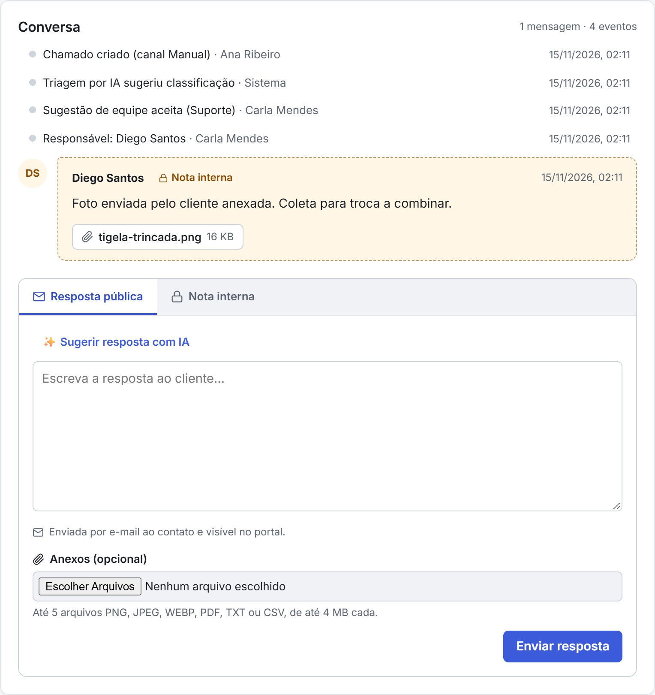

### 9.2 Verificação de segurança

Todo arquivo passa por uma verificação antes de ficar disponível:

- Arquivos liberados aparecem com nome e tamanho, e podem ser baixados com um clique.
- Arquivos em formato não permitido, vazios, grandes demais ou com conteúdo diferente da extensão são recusados. Nesse caso, o anexo aparece com a indicação "recusado" e o motivo, e o arquivo não é armazenado.
- Durante a verificação, o anexo pode aparecer por alguns instantes como pendente.

> **Atenção:** não envie senhas, dados completos de cartão ou documentos que não sejam necessários para o atendimento.

## 10. Status, prioridades e atribuições

### 10.1 Status do chamado

| Status | Significado |
| --- | --- |
| Novo | Recebido e ainda sem atendimento. |
| Aberto | Em atendimento pela equipe. |
| Aguardando cliente | A equipe espera uma resposta ou um documento do cliente. |
| Aguardando terceiro | A equipe depende de um parceiro, como transportadora ou fornecedor. |
| Resolvido | Atendimento concluído. |
| Fechado | Encerrado automaticamente após o prazo de reabertura. |
| Cancelado | Encerrado sem atendimento, com motivo registrado. |

Os botões do painel **Atendimento** mudam conforme o status atual:

- **Assumir:** aparece em qualquer chamado ativo do qual você ainda não é o responsável. O chamado passa a ser seu e, se estiver como Novo, vai para Aberto.
- **Novo:** **Abrir / reabrir**.
- **Aberto:** **Aguardando cliente**, **Aguardando terceiro** ou **Resolver**.
- **Aguardando cliente ou terceiro:** **Abrir / reabrir**, quando o atendimento for retomado.
- **Novo ou Aberto:** **Cancelar chamado**, que exige um motivo de pelo menos 5 caracteres.

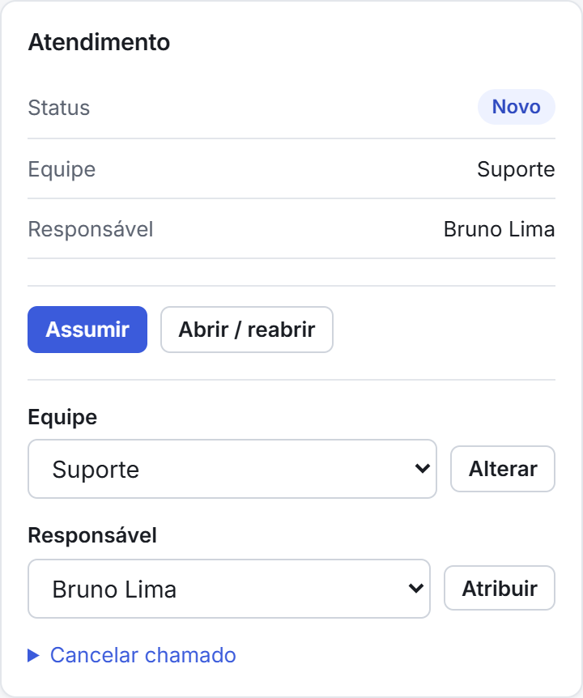

Regras importantes:

- **Para resolver**, o tipo e a categoria do chamado precisam estar confirmados por uma pessoa. Se houver sugestões da IA pendentes nesses campos, revise-as primeiro (capítulo 13).
- Ao resolver, o cliente recebe um e-mail com convite para avaliar o atendimento (CSAT, de 1 a 5).
- Se o cliente responder em até **7 dias** após a resolução, o chamado é reaberto. Depois desse prazo, ele é fechado automaticamente.

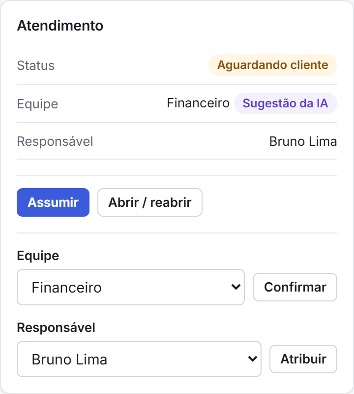

### 10.2 Prioridades

As prioridades são **Baixa**, **Média**, **Alta** e **Urgente**. A prioridade define as metas de SLA do chamado. Ela pode ser escolhida na criação, sugerida pela triagem ou definida automaticamente por regra da categoria (seção 15.5). Para alterá-la, use o campo **Prioridade** no painel **Classificação** e clique em **Confirmar**.

### 10.3 Equipe e responsável

- **Equipe (fila):** grupo responsável pelo chamado. Atendentes veem e assumem os chamados das suas equipes. Chamados sem equipe ficam na fila geral.
- **Responsável:** a pessoa que conduz o atendimento.

Como atribuir:

- **Atendente:** clica em **Assumir** para ficar com um chamado da sua equipe ou da fila geral.
- **Gestor e Administrador:** escolhem a **Equipe** e clicam em **Alterar** (ou **Confirmar**, quando a equipe foi sugerida pela IA). Depois escolhem o **Responsável** e clicam em **Atribuir**. O responsável precisa ser membro ativo da equipe do chamado.

### 10.4 SLA (prazos de atendimento)

O painel **SLA** mostra os dois prazos do chamado:

- **Primeira resposta:** tempo até a primeira resposta pública da equipe.
- **Resolução:** tempo até o chamado ser resolvido.

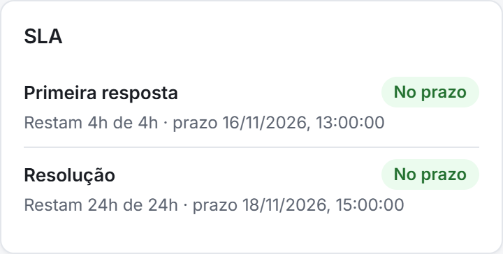

Cada prazo aparece como **No prazo**, **Em risco** (mais de 80% do tempo consumido), **Violado**, **Cumprido** ou **Pausado**. A contagem pausa enquanto o chamado está em Aguardando cliente ou Aguardando terceiro. As metas são definidas por prioridade pelo Administrador (seção 15.3).

## 11. Triagem inteligente com Gemini

A triagem inteligente analisa cada novo chamado e sugere sua classificação, usando o modelo de IA Google Gemini. Ela economiza tempo e ajuda a identificar rapidamente os casos mais sensíveis.

> **Disponibilidade:** a triagem depende de dois requisitos. (1) A sua organização precisa estar **autorizada** pela Orizon a usar recursos de IA. (2) Um Administrador precisa **ativar** a triagem em Configurações (seção 15.4). Sem esses requisitos, o atendimento funciona normalmente, só que sem as sugestões.

### 11.1 O que a IA sugere

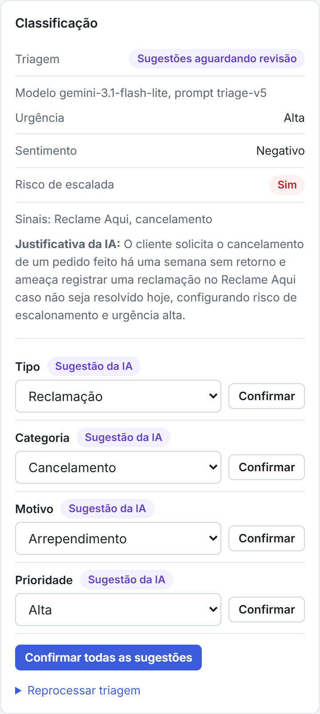

| Campo | O que indica |
| --- | --- |
| Tipo | Reclamação, Solicitação, Dúvida, Sugestão ou Elogio. |
| Categoria e Motivo | Assunto do chamado, conforme as listas cadastradas pela organização. |
| Prioridade | Baixa, Média, Alta ou Urgente. |
| Equipe | A fila mais adequada, entre as equipes ativas. |
| Urgência | Quão rápido o caso precisa de atenção. |
| Sentimento | Como o cliente parece se sentir, de muito negativo a positivo. |
| Risco de escalada | Se há sinais de que o caso pode escalar, como menção a Procon, Reclame Aqui, ação judicial ou cancelamento. Os sinais encontrados aparecem logo abaixo. |
| Justificativa da IA | Uma explicação curta do porquê da classificação. |

### 11.2 Como funciona

1. O chamado é criado (pelo portal, por e-mail ou manualmente).
2. Em poucos segundos, a IA analisa o assunto e a descrição. Enquanto isso, o painel mostra "Classificando…" e se atualiza sozinho.
3. As sugestões aparecem no painel **Classificação** com o selo **Sugestão da IA** e o chamado recebe a etiqueta "Revisar triagem" na lista.
4. Uma pessoa revisa e confirma ou corrige cada sugestão (capítulo 13).

### 11.3 Quando a triagem não está disponível

O painel mostra **Triagem indisponível** e o motivo, por exemplo: IA desativada na organização, cota mensal esgotada ou organização não autorizada. Nesses casos, preencha a classificação manualmente. Gestores e Administradores podem usar **Reprocessar triagem** quando o recurso voltar a estar disponível.

### 11.4 Privacidade

- Antes do envio à IA, dados pessoais do texto, como nomes, e-mails, telefones e documentos, são mascarados.
- A IA nunca altera o chamado sozinha: ela apenas sugere.
- O uso de IA respeita uma cota mensal por organização, acompanhada em Configurações.

## 12. Sugestão de respostas com IA

O botão **✨ Sugerir resposta com IA** gera um rascunho de resposta pública com base no assunto, na descrição, na classificação e nas mensagens recentes do chamado.

> **Disponibilidade:** o botão aparece somente quando a IA está autorizada para a sua organização e ativada por um Administrador, e quando o chamado ainda aceita respostas (não está resolvido, fechado ou cancelado).

### 12.1 Como usar

1. Abra o chamado e fique na aba **Resposta pública**.
2. Clique em **✨ Sugerir resposta com IA**. Enquanto a sugestão é gerada, aparece "Gerando resposta…".
3. O rascunho é inserido no editor com o aviso **"Sugestão disponível: revise e edite antes de enviar."**
4. Leia o texto com atenção, corrija o que for preciso e complete com as informações do atendimento.
5. Quando estiver de acordo, clique em **Enviar resposta**.

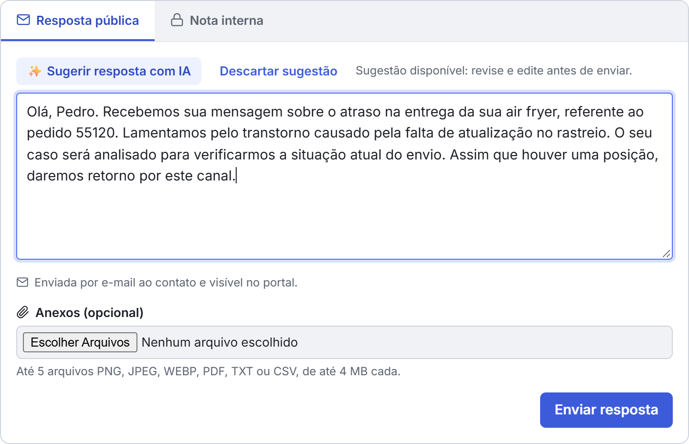

- **Descartar sugestão:** remove o rascunho e devolve ao editor o texto que estava lá antes.
- **Nada é enviado automaticamente:** a sugestão só preenche o editor. O envio depende sempre do clique em **Enviar resposta**.
- **Cuidados da IA:** a sugestão é orientada a não prometer prazos, reembolsos ou ações que não estejam registrados no chamado. Mesmo assim, a responsabilidade pelo conteúdo enviado é sempre de quem envia.
- Se a geração falhar, aparece "Falha ao gerar resposta" com uma orientação. Escreva a resposta manualmente ou tente de novo após alguns segundos.

> **Importante:** revise sempre a sugestão antes de enviar. Confira nomes, números de pedido, datas e o que está sendo prometido ao cliente.

## 13. Revisão humana das sugestões

Toda classificação sugerida pela IA precisa ser revisada por uma pessoa. A revisão garante a qualidade dos dados e é exigida para resolver o chamado.

### 13.1 Onde revisar

- No painel **Classificação** de cada chamado (imagem do capítulo 11).
- Na lista de chamados, pela visão **Aguardando revisão da triagem**.
- Na página Início, pelo atalho **Revisão da triagem**.

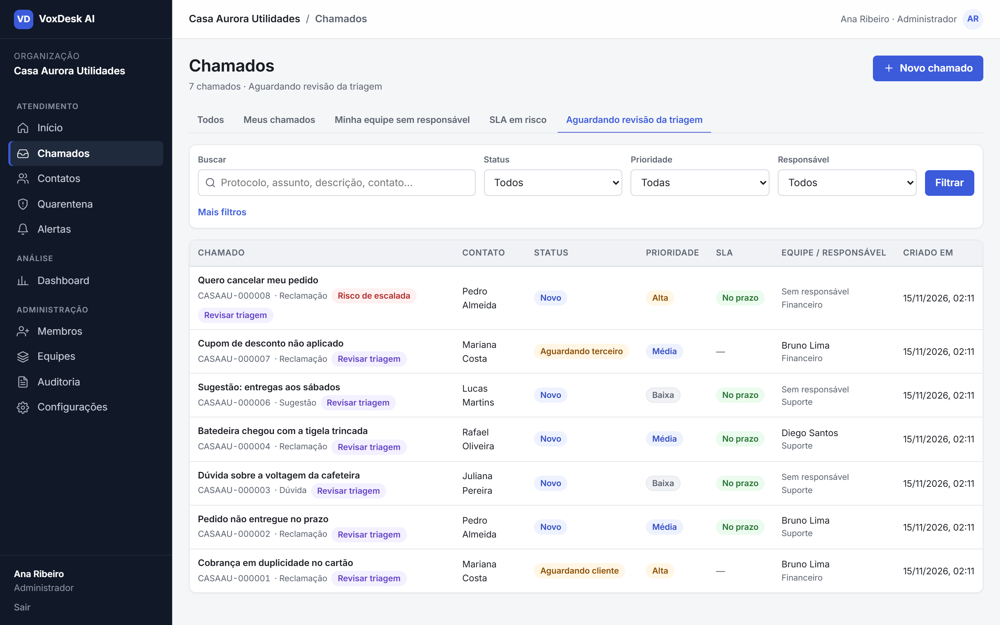

### 13.2 Como revisar

- **Aceitar uma sugestão:** mantenha o valor sugerido e clique em **Confirmar** ao lado do campo.
- **Corrigir uma sugestão:** escolha outro valor na lista e clique em **Confirmar**.
- **Aceitar tudo de uma vez:** clique em **Confirmar todas as sugestões**, depois de conferir os valores.
- **Equipe sugerida:** no painel **Atendimento**, a equipe sugerida aparece com o selo "Sugestão da IA". Confirme ou altere.
- **Reprocessar triagem (Gestor e Administrador):** pede uma nova análise da IA, por exemplo depois que o chamado recebeu mais informações.

Cada decisão fica registrada na conversa (por exemplo, "Sugestão de equipe aceita" ou "Sugestão de equipe alterada") e alimenta o indicador **Aceitação da triagem** do dashboard.

## 14. Equipes e permissões

### 14.1 Equipes

Equipes funcionam como filas de atendimento: os atendentes assumem os chamados das suas equipes. A página **Equipes** é exclusiva do Administrador.

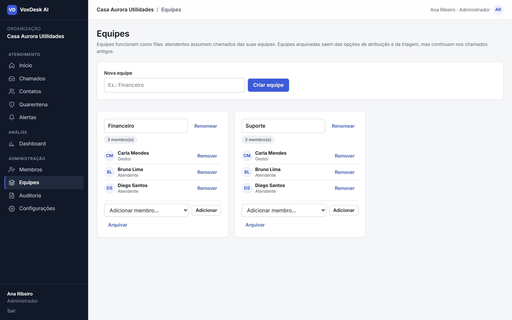

- **Criar equipe:** informe o nome em **Nova equipe** e clique em **Criar equipe**.
- **Adicionar membro:** escolha a pessoa em **Adicionar membro…** e clique em **Adicionar**.
- **Remover membro:** clique em **Remover** ao lado do nome.
- **Renomear** ou **Arquivar** a equipe. Equipes arquivadas saem das opções de atribuição e da triagem, mas continuam registradas nos chamados antigos.

### 14.2 Membros e convites

A página **Membros** (Administrador) lista as pessoas da organização, com perfil e situação.

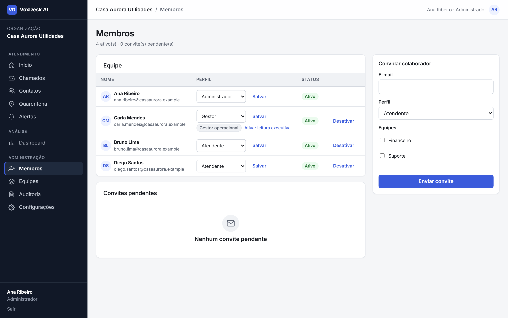

- **Convidar colaborador:** informe o **E-mail**, escolha o **Perfil** e, se quiser, as **Equipes**. Clique em **Enviar convite**. A pessoa recebe um e-mail com o link de acesso.
- **Convites pendentes:** convites enviados e ainda não aceitos. Use **Cancelar** para invalidar um convite.
- **Alterar perfil:** escolha o novo perfil e clique em **Salvar**.
- **Desativar / ativar:** um membro desativado perde o acesso à organização, mas o histórico das suas ações é mantido.
- **Leitura executiva (Gestor):** o botão **Ativar leitura executiva** transforma o acesso do Gestor em somente leitura de indicadores. Ele passa a ver o Dashboard, sem acesso a chamados e contatos.

### 14.3 Matriz de permissões

| Ação | Atendente | Gestor | Administrador |
| --- | :---: | :---: | :---: |
| Ver e atender chamados, responder e registrar notas | Sim | Sim | Sim |
| Cadastrar e editar contatos e empresas-cliente | Sim | Sim | Sim |
| Assumir chamados (das suas equipes ou da fila geral) | Sim | Sim | Sim |
| Revisar e confirmar sugestões da IA | Sim | Sim | Sim |
| Usar a sugestão de resposta com IA | Sim | Sim | Sim |
| Atribuir e reatribuir chamados, trocar a equipe | Não | Sim | Sim |
| Reprocessar a triagem | Não | Sim | Sim |
| Consultar o Dashboard | Não | Sim | Sim |
| Gerenciar a quarentena de e-mails | Não | Sim | Sim |
| Gerenciar membros, convites e equipes | Não | Não | Sim |
| Consultar a auditoria | Não | Não | Sim |
| Alterar configurações e ativar a IA | Não | Não | Sim |

## 15. Configurações

A página **Configurações** é exclusiva do Administrador. No topo, ela mostra o identificador da organização e o prefixo usado nos protocolos. As seções são: Organização, Portal e e-mail, Horário comercial, Metas de SLA, Triagem por IA, Categorias e Motivos.

### 15.1 Organização

Defina o **Nome** da organização e o **Fuso horário** usado em datas, prazos e indicadores. Clique em **Salvar**.

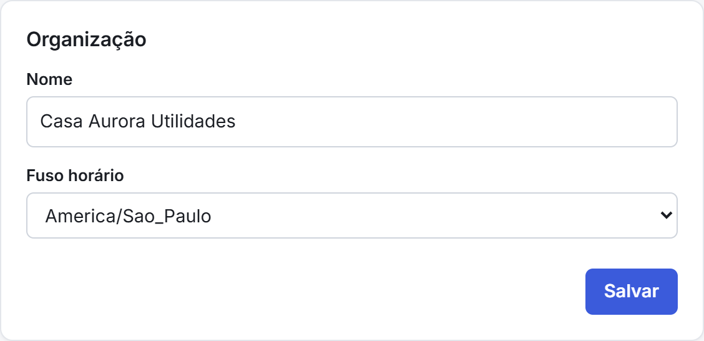

### 15.2 Horário comercial e feriados

Informe, para cada dia da semana, o horário de início e fim do expediente e clique em **Salvar horário**. Cadastre também os feriados em **Adicionar feriado**. Esses dados são usados no cálculo dos prazos em horas úteis.

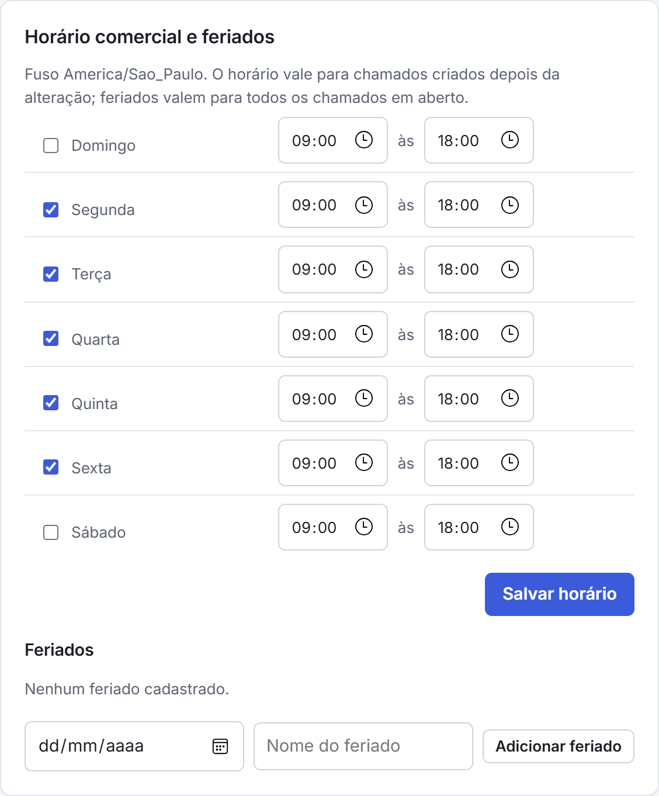

> **Observação:** o novo horário vale para chamados criados depois da alteração. Feriados valem para todos os chamados em aberto.

### 15.3 Metas de SLA

Para cada prioridade, informe as metas de **1ª resposta** e de **Resolução**, em horas (aceita decimais). Marque **Horas úteis** para contar somente o horário comercial. Deixe em branco para não ter meta. Clique em **Salvar metas**.

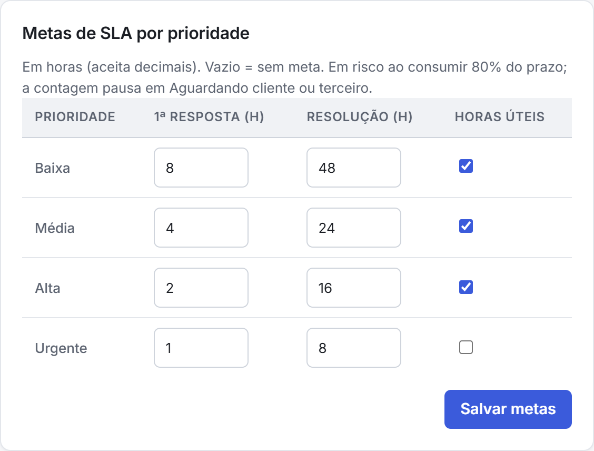

### 15.4 Triagem por IA

Esta seção mostra a **Situação** da IA (Ativada ou Desativada), a cota mensal de operações, o número de chamadas e o custo estimado do mês.

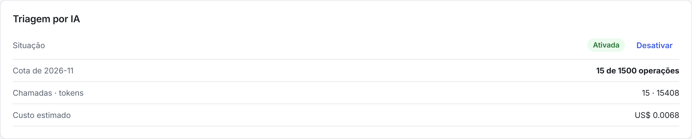

- Para ligar ou desligar a triagem e a sugestão de resposta, clique em **Ativar** ou **Desativar**.
- Se a organização ainda não estiver autorizada a usar IA, a tela informa isso e a ativação não fica disponível. Nesse caso, fale com a Orizon.
- Quando a cota mensal termina, as funções de IA ficam indisponíveis até o mês seguinte, e o atendimento continua normalmente.

### 15.5 Categorias e motivos

Categorias e motivos organizam os assuntos dos chamados e são usados pela triagem e pelos indicadores. A organização pode partir de um modelo sugerido e ajustá-lo.

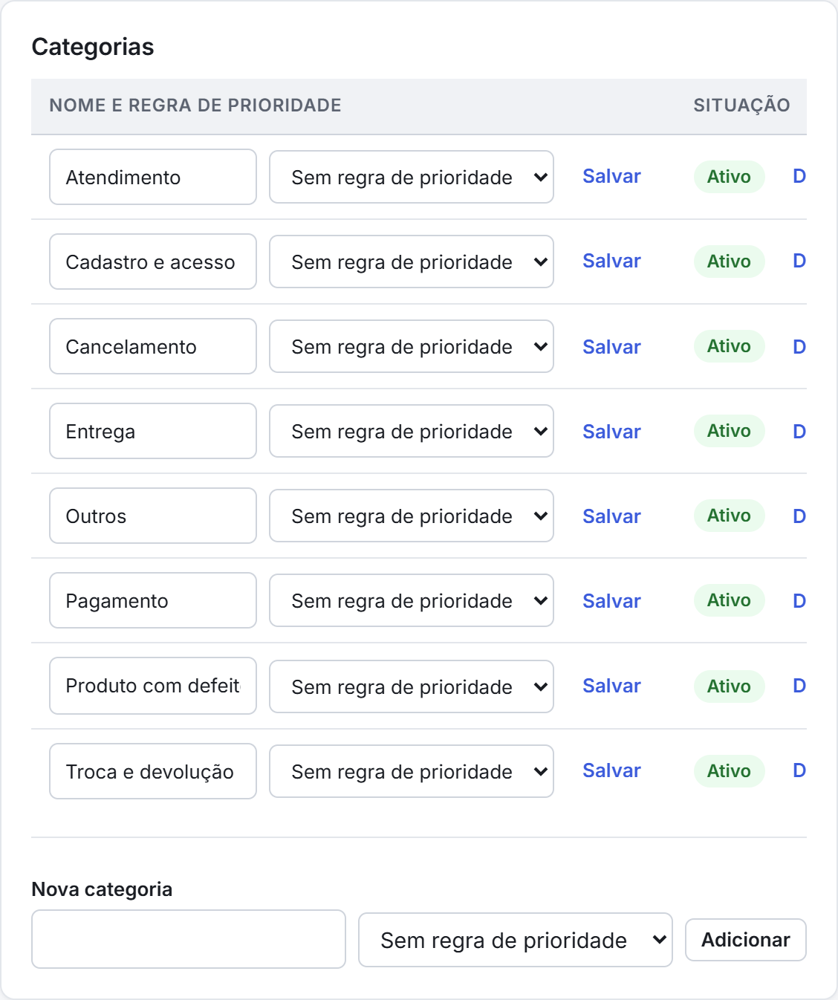

- **Adicionar:** informe o nome em **Nova categoria** (ou **Novo motivo**) e clique em **Adicionar**.
- **Prioridade padrão:** opcionalmente, defina uma prioridade para uma categoria ou motivo. Por exemplo, chamados de "Cancelamento" podem receber prioridade Alta automaticamente.
- **Desativar:** itens desativados deixam de aparecer nas opções, mas continuam nos chamados antigos.

### 15.6 Portal e e-mail de entrada

Esta seção mostra o endereço do **portal público** da organização, onde os clientes abrem e acompanham chamados, e a situação do **e-mail de entrada**, que transforma e-mails recebidos em chamados. A configuração do e-mail de entrada é feita com o apoio da Orizon.

## 16. Boas práticas

- **Revise toda sugestão da IA.** Confirme ou corrija a classificação e leia com atenção cada sugestão de resposta antes de enviar.
- **Use o status certo.** "Aguardando cliente" e "Aguardando terceiro" pausam o SLA e deixam claro de quem é o próximo passo.
- **Registre combinados em notas internas.** Assim qualquer colega consegue continuar o atendimento.
- **Responda pela plataforma.** Respostas enviadas fora do VoxDesk AI não ficam no histórico do chamado.
- **Fique atento ao "Risco de escalada".** Priorize chamados com menção a Procon, Reclame Aqui, ação judicial ou cancelamento.
- **Mantenha contatos atualizados.** Um e-mail correto garante que o cliente receba as respostas.
- **Proteja dados pessoais.** Não peça senhas nem dados completos de cartão. Anexe apenas o necessário.
- **Ative a verificação em duas etapas** e nunca compartilhe sua senha.
- **Mantenha a configuração em dia** (Administrador): equipes, categorias, horário comercial e metas de SLA refletem a operação real.

## 17. Perguntas frequentes

**Não recebi o convite. O que faço?**
Verifique a caixa de spam e confirme com o administrador o e-mail usado. O convite expira em 7 dias; se for o caso, peça um novo.

**Esqueci minha senha.**
Na tela de login, clique em **Esqueci minha senha** e siga o link enviado por e-mail.

**Troquei de celular ou perdi o aplicativo autenticador.**
Na tela de verificação, clique em **Perdeu o acesso ao aplicativo? Usar um código de recuperação** e digite um dos códigos que você guardou. Cada código vale uma única vez. Se não tiver mais os códigos, fale com o administrador da plataforma.

**O identificador que escolhi para a organização já está em uso.**
Escolha outro, por exemplo acrescentando a cidade ou o segmento. A tela mantém os dados que você já preencheu.

**Por que não vejo o Dashboard ou as Configurações?**
Essas áreas dependem do perfil. O Dashboard está disponível para Gestores e Administradores. As Configurações, só para Administradores.

**Por que o botão "Sugerir resposta com IA" não aparece?**
Ele só aparece quando a IA está autorizada e ativada para a organização e quando o chamado ainda aceita respostas. Chamados resolvidos, fechados ou cancelados não mostram o botão.

**A IA envia mensagens para o cliente sozinha?**
Não. A IA apenas sugere. Toda resposta é revisada e enviada por uma pessoa.

**Não consigo resolver o chamado. Por quê?**
Para resolver, o tipo e a categoria precisam estar confirmados. Revise as sugestões pendentes no painel **Classificação** e tente novamente.

**O cliente vê as notas internas?**
Não. Notas internas são visíveis apenas para a equipe.

**Meu anexo aparece como "recusado".**
O arquivo não atende às regras: formatos PNG, JPEG, WEBP, PDF, TXT ou CSV, até 4 MB cada, no máximo 5 por mensagem. Arquivos vazios ou com conteúdo diferente da extensão também são recusados.

**O que significa "SLA em risco"?**
Mais de 80% do prazo de primeira resposta ou de resolução já foi consumido. Priorize esses chamados.

**Um cliente respondeu depois de o chamado ser resolvido. E agora?**
Se a resposta chegar em até 7 dias, o chamado é reaberto automaticamente e volta para a fila.

**Trabalho em mais de uma empresa. Como troco de organização?**
Clique em **Trocar organização** no menu lateral e escolha outra organização.

**A triagem mostra "Triagem indisponível".**
A IA pode estar desativada, sem cota no mês ou não autorizada para a organização. Classifique o chamado manualmente e, se necessário, fale com o administrador.

## 18. Glossário

| Termo | Significado |
| --- | --- |
| Chamado | Registro de uma solicitação de cliente, com protocolo, conversa e histórico. |
| Protocolo | Identificador único do chamado (por exemplo, CASAAU-000002). |
| Identificador da organização | Nome técnico da organização usado no endereço da plataforma (por exemplo, `casa-aurora-utilidades`). Definido na criação da organização. |
| Verificação em duas etapas | Proteção do login que pede, além da senha, um código do aplicativo autenticador. |
| Contato | Cliente que abriu ou é atendido em chamados. |
| Empresa-cliente | Empresa à qual um ou mais contatos pertencem. |
| Equipe (fila) | Grupo de pessoas responsável por um conjunto de chamados. |
| Responsável | Pessoa que conduz o atendimento de um chamado. |
| SLA | Meta de tempo para primeira resposta e para resolução. |
| CSAT | Índice de satisfação do cliente, com notas de 1 a 5 enviadas após a resolução. |
| Backlog | Chamados ainda ativos ao fim de um período. |
| Triagem | Classificação do chamado (tipo, categoria, motivo, prioridade e outros), sugerida pela IA e revisada pela equipe. |
| Risco de escalada | Indicação de que o caso pode virar reclamação pública, ação judicial ou cancelamento. |
| Nota interna | Mensagem visível apenas para a equipe. |
| Resposta pública | Mensagem enviada ao cliente por e-mail e exibida no portal. |
| Portal do cliente | Página onde o cliente abre e acompanha seus chamados. |
| Quarentena | Área onde ficam os e-mails que não passaram na validação, até uma decisão da equipe. |

---

**VoxDesk AI — Manual do Usuário, versão 1.1 · Novembro de 2026**
Uma solução Orizon.
